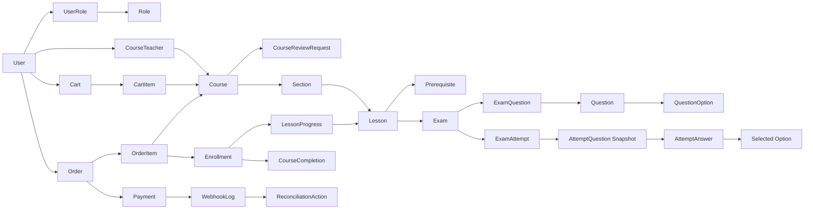
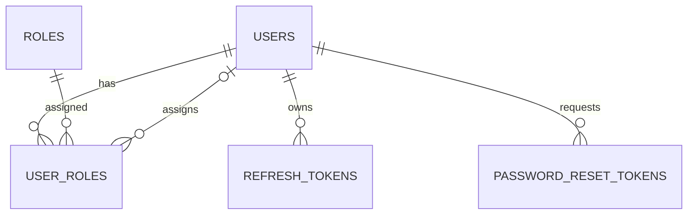
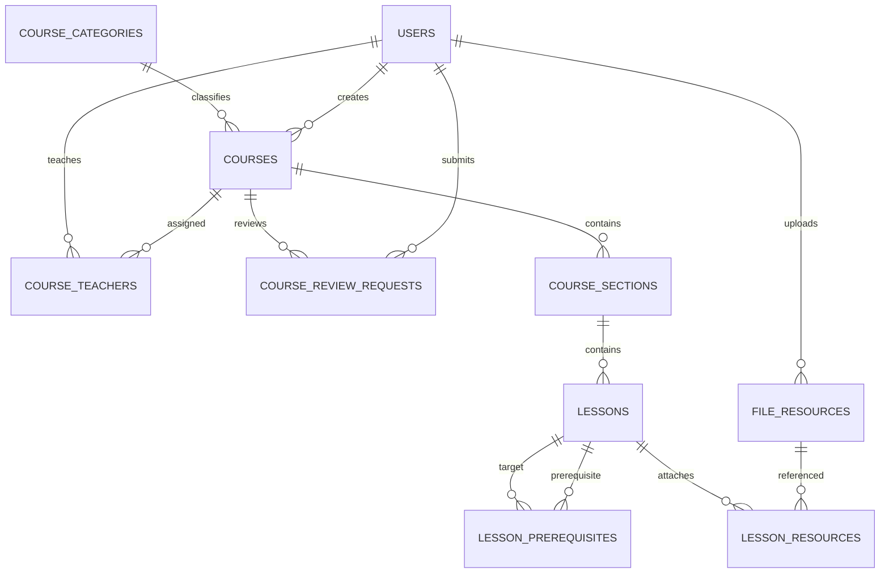
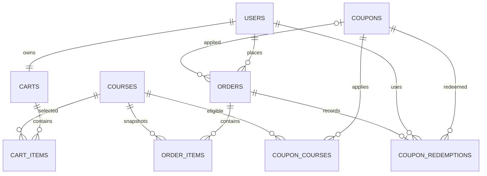
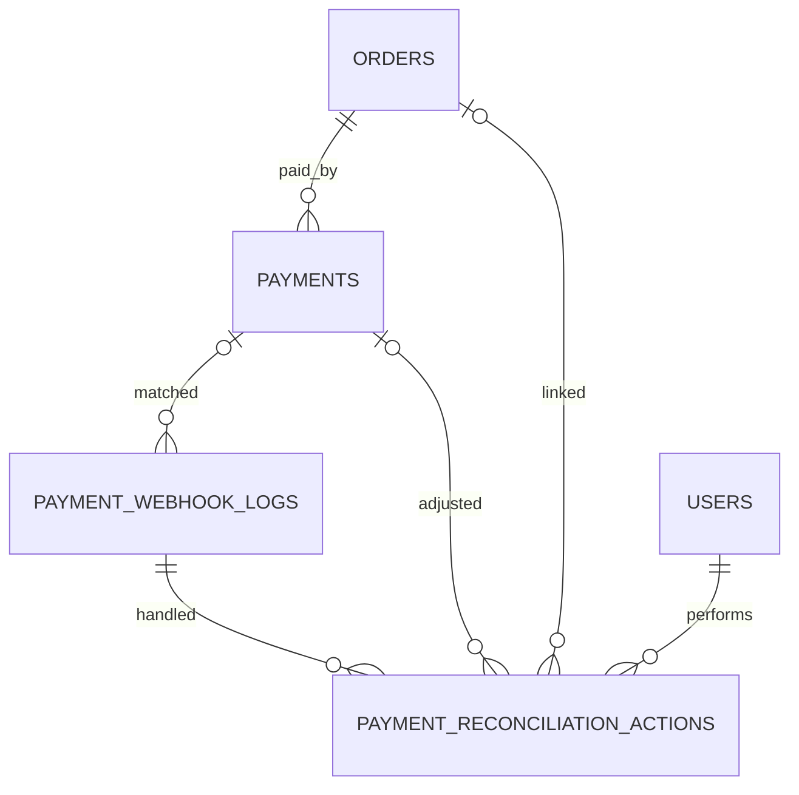
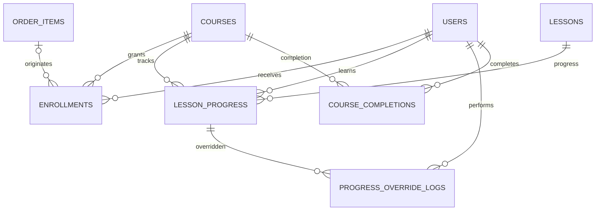
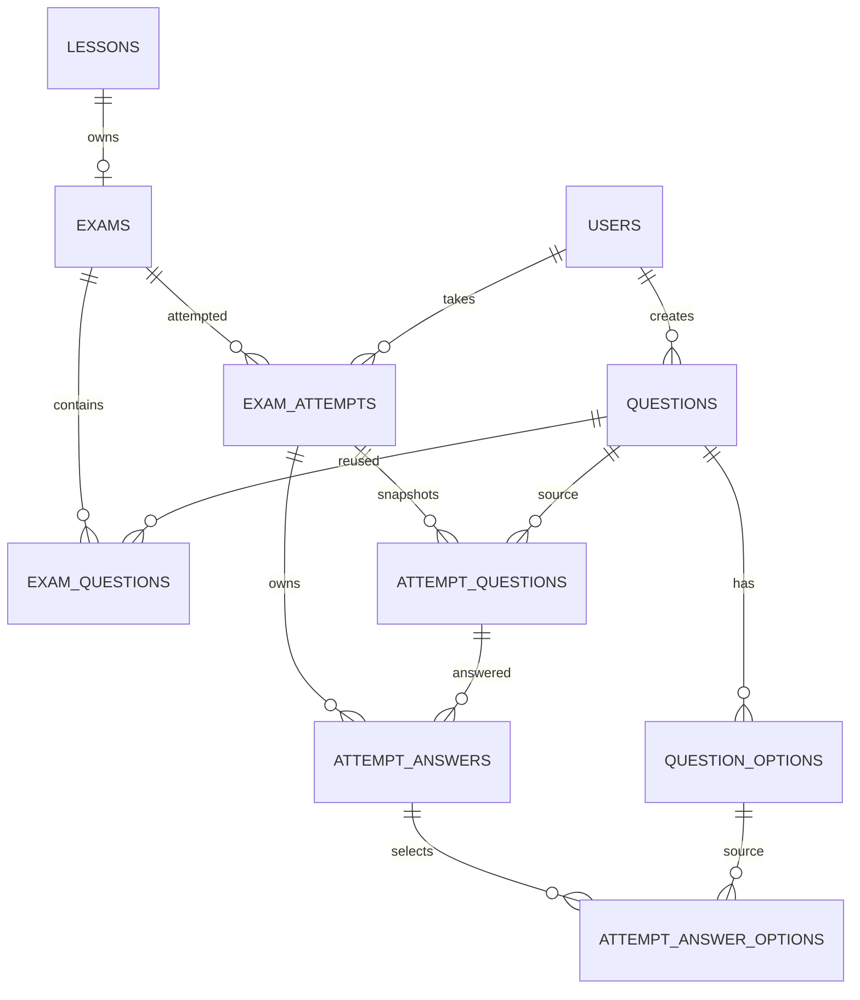
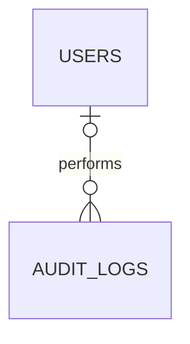
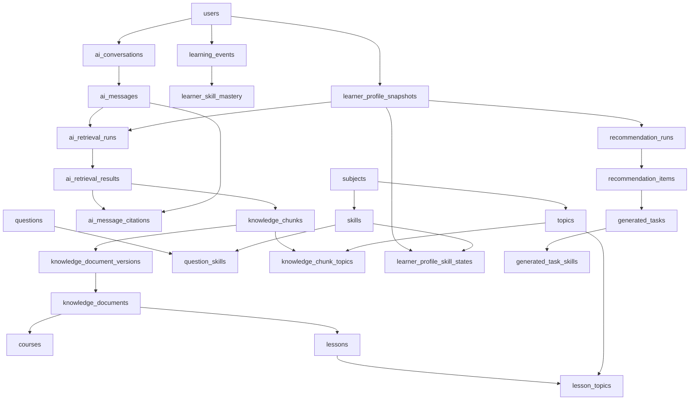

# ERD CHI TIẾT — MVP NÂNG CAO LMS

## Hệ thống học trực tuyến và kinh doanh khóa học

**Phiên bản:** 1.0  
**Ngày lập:** 06/08/2026  
**Database:** MySQL 8.x, InnoDB, UTF8MB4  
**ORM:** Spring Data JPA / Hibernate  
**Migration:** Flyway  
**Phạm vi:** 37 bảng theo đặc tả nghiệp vụ MVP nâng cao

---

# 1. Nguyên tắc thiết kế

- ERD bám theo các luồng Course Review, Commerce, Payment Reconciliation, Enrollment, Progress và Exam Attempt.
- Dùng `BIGINT UNSIGNED` cho khóa chính, `DECIMAL(12,2)` cho tiền và `DATETIME(6)` lưu UTC.
- Không xóa vật lý dữ liệu đã có giao dịch hoặc lịch sử học.
- `OrderItem` snapshot giá và tên Course tại thời điểm mua.
- `AttemptQuestion` snapshot đề thi để Question sửa sau đó không làm thay đổi Attempt đang diễn ra.
- `lesson_progress` dùng khóa nghiệp vụ `student_id + course_id + lesson_id`, không gắn cứng với một Enrollment lịch sử, đúng quyết định gia hạn trong đặc tả mới.
- Webhook log được lưu trước transaction nghiệp vụ để hỗ trợ idempotency và đối soát.
- AI chưa thuộc ERD MVP; Phase 2 có thể nối vào Course, Lesson, FileResource và Question.

# 2. Danh sách bảng

- **Identity và phân quyền:** `users`, `roles`, `user_roles`, `refresh_tokens`, `password_reset_tokens`
- **Course authoring:** `course_categories`, `courses`, `course_teachers`, `course_review_requests`, `course_sections`, `lessons`, `lesson_prerequisites`, `file_resources`, `lesson_resources`
- **Commerce:** `carts`, `cart_items`, `coupons`, `coupon_courses`, `orders`, `order_items`, `coupon_redemptions`
- **Payment và đối soát:** `payments`, `payment_webhook_logs`, `payment_reconciliation_actions`
- **Learning:** `enrollments`, `lesson_progress`, `progress_override_logs`, `course_completions`
- **Exam:** `exams`, `questions`, `question_options`, `exam_questions`, `exam_attempts`, `attempt_questions`, `attempt_answers`, `attempt_answer_options`
- **Supporting:** `audit_logs`

Tổng cộng: **37 bảng**.

---

# 3. Sơ đồ quan hệ tổng quát



---

# 4. Identity và phân quyền



## 4.1. `users`

| Cột | Kiểu dữ liệu | Ràng buộc | Ý nghĩa |
|---|---|---|---|
| `id` | BIGINT UNSIGNED | PK, AUTO_INCREMENT | Mã người dùng |
| `email` | VARCHAR(255) | UNIQUE, NOT NULL | Email đăng nhập |
| `password_hash` | VARCHAR(255) | NOT NULL | Mật khẩu hash |
| `full_name` | VARCHAR(255) | NOT NULL | Họ tên |
| `phone_number` | VARCHAR(20) | NULL | Số điện thoại |
| `avatar_url` | VARCHAR(500) | NULL | Ảnh đại diện |
| `status` | ENUM | NOT NULL, DEFAULT ACTIVE | ACTIVE/INACTIVE/BLOCKED |
| `email_verified` | BOOLEAN | NOT NULL, DEFAULT FALSE | Đã xác minh email |
| `last_login_at` | DATETIME(6) | NULL | Đăng nhập gần nhất |
| `version` | BIGINT | NOT NULL, DEFAULT 0 | Optimistic lock |
| `created_at` | DATETIME(6) | NOT NULL | Ngày tạo |
| `updated_at` | DATETIME(6) | NOT NULL | Ngày cập nhật |
## 4.2. `roles`

| Cột | Kiểu dữ liệu | Ràng buộc | Ý nghĩa |
|---|---|---|---|
| `id` | BIGINT UNSIGNED | PK, AUTO_INCREMENT | Mã role |
| `code` | VARCHAR(50) | UNIQUE, NOT NULL | ADMIN/TEACHER/STUDENT |
| `name` | VARCHAR(100) | NOT NULL | Tên role |
| `description` | VARCHAR(255) | NULL | Mô tả |
| `created_at` | DATETIME(6) | NOT NULL | Ngày tạo |
## 4.3. `user_roles`

| Cột | Kiểu dữ liệu | Ràng buộc | Ý nghĩa |
|---|---|---|---|
| `user_id` | BIGINT UNSIGNED | PK, FK → users.id | Người dùng |
| `role_id` | BIGINT UNSIGNED | PK, FK → roles.id | Vai trò |
| `assigned_by` | BIGINT UNSIGNED | FK → users.id, NULL | Admin gán |
| `assigned_at` | DATETIME(6) | NOT NULL | Thời điểm gán |

**Ràng buộc bổ sung**

```text
UNIQUE(user_id, role_id)
```
## 4.4. `refresh_tokens`

| Cột | Kiểu dữ liệu | Ràng buộc | Ý nghĩa |
|---|---|---|---|
| `id` | BIGINT UNSIGNED | PK, AUTO_INCREMENT | Mã token |
| `user_id` | BIGINT UNSIGNED | FK → users.id, NOT NULL | Chủ token |
| `token_hash` | VARCHAR(255) | UNIQUE, NOT NULL | Hash token |
| `family_id` | VARCHAR(64) | NULL, INDEX | Nhóm token rotation |
| `expires_at` | DATETIME(6) | NOT NULL, INDEX | Hết hạn |
| `revoked_at` | DATETIME(6) | NULL | Thu hồi |
| `revoked_reason` | VARCHAR(255) | NULL | Lý do |
| `created_at` | DATETIME(6) | NOT NULL | Ngày tạo |
## 4.5. `password_reset_tokens`

| Cột | Kiểu dữ liệu | Ràng buộc | Ý nghĩa |
|---|---|---|---|
| `id` | BIGINT UNSIGNED | PK, AUTO_INCREMENT | Mã |
| `user_id` | BIGINT UNSIGNED | FK → users.id, NOT NULL | Người dùng |
| `token_hash` | VARCHAR(255) | UNIQUE, NOT NULL | Token một lần |
| `expires_at` | DATETIME(6) | NOT NULL, INDEX | Hết hạn |
| `used_at` | DATETIME(6) | NULL | Đã sử dụng |
| `created_at` | DATETIME(6) | NOT NULL | Ngày tạo |
---

# 5. Course authoring



## 5.1. `course_categories`

| Cột | Kiểu dữ liệu | Ràng buộc | Ý nghĩa |
|---|---|---|---|
| `id` | BIGINT UNSIGNED | PK, AUTO_INCREMENT | Mã danh mục |
| `name` | VARCHAR(255) | NOT NULL | Tên |
| `slug` | VARCHAR(255) | UNIQUE, NOT NULL | Slug |
| `description` | TEXT | NULL | Mô tả |
| `active` | BOOLEAN | NOT NULL, DEFAULT TRUE | Hoạt động |
| `created_at` | DATETIME(6) | NOT NULL | Ngày tạo |
| `updated_at` | DATETIME(6) | NOT NULL | Ngày cập nhật |
## 5.2. `courses`

| Cột | Kiểu dữ liệu | Ràng buộc | Ý nghĩa |
|---|---|---|---|
| `id` | BIGINT UNSIGNED | PK, AUTO_INCREMENT | Mã khóa học |
| `category_id` | BIGINT UNSIGNED | FK → course_categories.id, NOT NULL | Danh mục |
| `created_by` | BIGINT UNSIGNED | FK → users.id, NOT NULL | Người tạo |
| `thumbnail_file_id` | BIGINT UNSIGNED | FK → file_resources.id, NULL | Ảnh đại diện |
| `title` | VARCHAR(255) | NOT NULL | Tên khóa học |
| `slug` | VARCHAR(255) | UNIQUE, NOT NULL | Slug |
| `short_description` | VARCHAR(500) | NULL | Mô tả ngắn |
| `description` | LONGTEXT | NULL | Mô tả chi tiết |
| `original_price` | DECIMAL(12,2) | NOT NULL, DEFAULT 0 | Giá gốc |
| `sale_price` | DECIMAL(12,2) | NOT NULL, DEFAULT 0 | Giá bán |
| `status` | ENUM | NOT NULL, DEFAULT DRAFT | DRAFT/PENDING_REVIEW/REJECTED/PUBLISHED/HIDDEN/ARCHIVED |
| `access_duration_days` | INT UNSIGNED | NULL | Số ngày học |
| `completion_rule` | ENUM | NOT NULL | Quy tắc hoàn thành |
| `published_at` | DATETIME(6) | NULL | Xuất bản |
| `hidden_at` | DATETIME(6) | NULL | Ẩn |
| `archived_at` | DATETIME(6) | NULL | Lưu trữ |
| `version` | BIGINT | NOT NULL, DEFAULT 0 | Optimistic lock |
| `created_at` | DATETIME(6) | NOT NULL | Ngày tạo |
| `updated_at` | DATETIME(6) | NOT NULL | Ngày cập nhật |
## 5.3. `course_teachers`

| Cột | Kiểu dữ liệu | Ràng buộc | Ý nghĩa |
|---|---|---|---|
| `course_id` | BIGINT UNSIGNED | PK, FK → courses.id | Khóa học |
| `teacher_id` | BIGINT UNSIGNED | PK, FK → users.id | Giáo viên |
| `is_primary` | BOOLEAN | NOT NULL, DEFAULT FALSE | Giáo viên chính |
| `active` | BOOLEAN | NOT NULL, DEFAULT TRUE | Đang phụ trách |
| `assigned_by` | BIGINT UNSIGNED | FK → users.id, NULL | Admin phân công |
| `assigned_at` | DATETIME(6) | NOT NULL | Ngày gán |
| `removed_at` | DATETIME(6) | NULL | Ngày thu hồi |

**Ràng buộc bổ sung**

```text
UNIQUE(course_id, teacher_id)
```
## 5.4. `course_review_requests`

| Cột | Kiểu dữ liệu | Ràng buộc | Ý nghĩa |
|---|---|---|---|
| `id` | BIGINT UNSIGNED | PK, AUTO_INCREMENT | Mã yêu cầu |
| `course_id` | BIGINT UNSIGNED | FK → courses.id, NOT NULL | Khóa học |
| `submitted_by` | BIGINT UNSIGNED | FK → users.id, NOT NULL | Người gửi |
| `reviewed_by` | BIGINT UNSIGNED | FK → users.id, NULL | Admin duyệt |
| `status` | ENUM | NOT NULL | PENDING/APPROVED/REJECTED/WITHDRAWN |
| `submission_note` | TEXT | NULL | Ghi chú gửi |
| `review_note` | TEXT | NULL | Lý do duyệt/từ chối |
| `submitted_at` | DATETIME(6) | NOT NULL | Gửi duyệt |
| `reviewed_at` | DATETIME(6) | NULL | Xử lý |
| `created_at` | DATETIME(6) | NOT NULL | Ngày tạo |
## 5.5. `course_sections`

| Cột | Kiểu dữ liệu | Ràng buộc | Ý nghĩa |
|---|---|---|---|
| `id` | BIGINT UNSIGNED | PK, AUTO_INCREMENT | Mã chương |
| `course_id` | BIGINT UNSIGNED | FK → courses.id, NOT NULL | Khóa học |
| `title` | VARCHAR(255) | NOT NULL | Tiêu đề |
| `description` | TEXT | NULL | Mô tả |
| `position` | INT UNSIGNED | NOT NULL | Thứ tự |
| `published` | BOOLEAN | NOT NULL, DEFAULT FALSE | Phát hành |
| `release_after_days` | INT UNSIGNED | NOT NULL, DEFAULT 0 | Drip content |
| `created_at` | DATETIME(6) | NOT NULL | Ngày tạo |
| `updated_at` | DATETIME(6) | NOT NULL | Ngày cập nhật |

**Ràng buộc bổ sung**

```text
UNIQUE(course_id, position)
```
## 5.6. `lessons`

| Cột | Kiểu dữ liệu | Ràng buộc | Ý nghĩa |
|---|---|---|---|
| `id` | BIGINT UNSIGNED | PK, AUTO_INCREMENT | Mã bài học |
| `section_id` | BIGINT UNSIGNED | FK → course_sections.id, NOT NULL | Chương |
| `video_file_id` | BIGINT UNSIGNED | FK → file_resources.id, NULL | Video |
| `title` | VARCHAR(255) | NOT NULL | Tên |
| `description` | TEXT | NULL | Mô tả |
| `lesson_type` | ENUM | NOT NULL | VIDEO/TEXT/DOCUMENT/EXAM |
| `content` | LONGTEXT | NULL | Nội dung |
| `duration_seconds` | INT UNSIGNED | NULL | Thời lượng |
| `position` | INT UNSIGNED | NOT NULL | Thứ tự |
| `preview` | BOOLEAN | NOT NULL, DEFAULT FALSE | Xem thử |
| `published` | BOOLEAN | NOT NULL, DEFAULT FALSE | Phát hành |
| `mandatory` | BOOLEAN | NOT NULL, DEFAULT TRUE | Bắt buộc |
| `completion_method` | ENUM | NOT NULL, DEFAULT MANUAL | MANUAL/VIEW_CONTENT/VIDEO_PERCENT/PASS_EXAM/SUBMIT_EXAM |
| `completion_threshold` | DECIMAL(5,2) | NULL | Ngưỡng hoàn thành |
| `created_at` | DATETIME(6) | NOT NULL | Ngày tạo |
| `updated_at` | DATETIME(6) | NOT NULL | Ngày cập nhật |

**Ràng buộc bổ sung**

```text
UNIQUE(section_id, position)
```
## 5.7. `lesson_prerequisites`

| Cột | Kiểu dữ liệu | Ràng buộc | Ý nghĩa |
|---|---|---|---|
| `id` | BIGINT UNSIGNED | PK, AUTO_INCREMENT | Mã |
| `lesson_id` | BIGINT UNSIGNED | UNIQUE, FK → lessons.id | Lesson bị khóa |
| `prerequisite_lesson_id` | BIGINT UNSIGNED | FK → lessons.id, NULL | Lesson yêu cầu |
| `prerequisite_exam_id` | BIGINT UNSIGNED | FK → exams.id, NULL | Exam yêu cầu |
| `condition_type` | ENUM | NOT NULL | COMPLETE_LESSON/PASS_EXAM |
| `created_at` | DATETIME(6) | NOT NULL | Ngày tạo |
## 5.8. `file_resources`

| Cột | Kiểu dữ liệu | Ràng buộc | Ý nghĩa |
|---|---|---|---|
| `id` | BIGINT UNSIGNED | PK, AUTO_INCREMENT | Mã file |
| `uploaded_by` | BIGINT UNSIGNED | FK → users.id, NOT NULL | Người upload |
| `original_name` | VARCHAR(255) | NOT NULL | Tên file |
| `object_key` | VARCHAR(500) | UNIQUE, NOT NULL | Object key |
| `mime_type` | VARCHAR(100) | NOT NULL | MIME |
| `file_size` | BIGINT UNSIGNED | NOT NULL | Dung lượng |
| `storage_provider` | ENUM | NOT NULL | MINIO/S3/R2 |
| `status` | ENUM | NOT NULL, DEFAULT READY | PENDING/READY/FAILED/DELETED |
| `checksum` | VARCHAR(128) | NULL, INDEX | Checksum |
| `created_at` | DATETIME(6) | NOT NULL | Ngày tạo |
| `deleted_at` | DATETIME(6) | NULL | Xóa logic |
## 5.9. `lesson_resources`

| Cột | Kiểu dữ liệu | Ràng buộc | Ý nghĩa |
|---|---|---|---|
| `id` | BIGINT UNSIGNED | PK, AUTO_INCREMENT | Mã |
| `lesson_id` | BIGINT UNSIGNED | FK → lessons.id, NOT NULL | Bài học |
| `file_id` | BIGINT UNSIGNED | FK → file_resources.id, NOT NULL | File |
| `title` | VARCHAR(255) | NOT NULL | Tên hiển thị |
| `resource_type` | ENUM | NOT NULL | PDF/SLIDE/IMAGE/DOCUMENT/ATTACHMENT |
| `downloadable` | BOOLEAN | NOT NULL, DEFAULT TRUE | Cho tải |
| `position` | INT UNSIGNED | NOT NULL | Thứ tự |
| `created_at` | DATETIME(6) | NOT NULL | Ngày tạo |

**Ràng buộc bổ sung**

```text
UNIQUE(lesson_id, file_id)
UNIQUE(lesson_id, position)
```
---

# 6. Commerce



## 6.1. `carts`

| Cột | Kiểu dữ liệu | Ràng buộc | Ý nghĩa |
|---|---|---|---|
| `id` | BIGINT UNSIGNED | PK, AUTO_INCREMENT | Mã giỏ |
| `user_id` | BIGINT UNSIGNED | UNIQUE, FK → users.id | Chủ giỏ |
| `created_at` | DATETIME(6) | NOT NULL | Ngày tạo |
| `updated_at` | DATETIME(6) | NOT NULL | Ngày cập nhật |
## 6.2. `cart_items`

| Cột | Kiểu dữ liệu | Ràng buộc | Ý nghĩa |
|---|---|---|---|
| `id` | BIGINT UNSIGNED | PK, AUTO_INCREMENT | Mã item |
| `cart_id` | BIGINT UNSIGNED | FK → carts.id, NOT NULL | Giỏ |
| `course_id` | BIGINT UNSIGNED | FK → courses.id, NOT NULL | Khóa học |
| `added_at` | DATETIME(6) | NOT NULL | Ngày thêm |

**Ràng buộc bổ sung**

```text
UNIQUE(cart_id, course_id)
```
## 6.3. `coupons`

| Cột | Kiểu dữ liệu | Ràng buộc | Ý nghĩa |
|---|---|---|---|
| `id` | BIGINT UNSIGNED | PK, AUTO_INCREMENT | Mã |
| `code` | VARCHAR(50) | UNIQUE, NOT NULL | Mã coupon |
| `name` | VARCHAR(255) | NOT NULL | Tên |
| `discount_type` | ENUM | NOT NULL | PERCENTAGE/FIXED_AMOUNT |
| `discount_value` | DECIMAL(12,2) | NOT NULL | Giá trị |
| `minimum_order_amount` | DECIMAL(12,2) | NOT NULL, DEFAULT 0 | Đơn tối thiểu |
| `maximum_discount_amount` | DECIMAL(12,2) | NULL | Trần giảm |
| `total_usage_limit` | INT UNSIGNED | NULL | Tổng lượt |
| `per_user_limit` | INT UNSIGNED | NULL | Lượt/user |
| `used_count` | INT UNSIGNED | NOT NULL, DEFAULT 0 | Đã dùng |
| `scope` | ENUM | NOT NULL | ALL_COURSES/SPECIFIC_COURSES |
| `starts_at` | DATETIME(6) | NOT NULL | Bắt đầu |
| `ends_at` | DATETIME(6) | NOT NULL | Kết thúc |
| `status` | ENUM | NOT NULL, DEFAULT ACTIVE | ACTIVE/INACTIVE |
| `version` | BIGINT | NOT NULL, DEFAULT 0 | Lock quota |
| `created_at` | DATETIME(6) | NOT NULL | Ngày tạo |
| `updated_at` | DATETIME(6) | NOT NULL | Ngày cập nhật |
## 6.4. `coupon_courses`

| Cột | Kiểu dữ liệu | Ràng buộc | Ý nghĩa |
|---|---|---|---|
| `coupon_id` | BIGINT UNSIGNED | PK, FK → coupons.id | Coupon |
| `course_id` | BIGINT UNSIGNED | PK, FK → courses.id | Khóa học |
| `created_at` | DATETIME(6) | NOT NULL | Ngày tạo |

**Ràng buộc bổ sung**

```text
UNIQUE(coupon_id, course_id)
```
## 6.5. `orders`

| Cột | Kiểu dữ liệu | Ràng buộc | Ý nghĩa |
|---|---|---|---|
| `id` | BIGINT UNSIGNED | PK, AUTO_INCREMENT | Mã đơn |
| `code` | VARCHAR(50) | UNIQUE, NOT NULL | Mã hiển thị |
| `user_id` | BIGINT UNSIGNED | FK → users.id, NOT NULL | Người mua |
| `coupon_id` | BIGINT UNSIGNED | FK → coupons.id, NULL | Coupon |
| `coupon_code` | VARCHAR(50) | NULL | Snapshot mã |
| `subtotal` | DECIMAL(12,2) | NOT NULL | Tổng trước giảm |
| `discount_amount` | DECIMAL(12,2) | NOT NULL, DEFAULT 0 | Tiền giảm |
| `total_amount` | DECIMAL(12,2) | NOT NULL | Phải trả |
| `status` | ENUM | NOT NULL | PENDING_PAYMENT/PAID/CANCELLED/EXPIRED |
| `expires_at` | DATETIME(6) | NOT NULL, INDEX | Hạn trả |
| `paid_at` | DATETIME(6) | NULL | Đã trả |
| `cancelled_at` | DATETIME(6) | NULL | Hủy |
| `version` | BIGINT | NOT NULL, DEFAULT 0 | Lock |
| `created_at` | DATETIME(6) | NOT NULL | Ngày tạo |
| `updated_at` | DATETIME(6) | NOT NULL | Ngày cập nhật |
## 6.6. `order_items`

| Cột | Kiểu dữ liệu | Ràng buộc | Ý nghĩa |
|---|---|---|---|
| `id` | BIGINT UNSIGNED | PK, AUTO_INCREMENT | Mã item |
| `order_id` | BIGINT UNSIGNED | FK → orders.id, NOT NULL | Đơn |
| `course_id` | BIGINT UNSIGNED | FK → courses.id, NOT NULL | Khóa học nguồn |
| `course_title` | VARCHAR(255) | NOT NULL | Snapshot tên |
| `original_price` | DECIMAL(12,2) | NOT NULL | Snapshot giá |
| `discount_amount` | DECIMAL(12,2) | NOT NULL, DEFAULT 0 | Tiền giảm |
| `final_price` | DECIMAL(12,2) | NOT NULL | Giá cuối |
| `access_duration_days` | INT UNSIGNED | NULL | Snapshot thời hạn |
| `created_at` | DATETIME(6) | NOT NULL | Ngày tạo |

**Ràng buộc bổ sung**

```text
UNIQUE(order_id, course_id)
```
## 6.7. `coupon_redemptions`

| Cột | Kiểu dữ liệu | Ràng buộc | Ý nghĩa |
|---|---|---|---|
| `id` | BIGINT UNSIGNED | PK, AUTO_INCREMENT | Mã |
| `coupon_id` | BIGINT UNSIGNED | FK → coupons.id, NOT NULL | Coupon |
| `user_id` | BIGINT UNSIGNED | FK → users.id, NOT NULL | Người dùng |
| `order_id` | BIGINT UNSIGNED | UNIQUE, FK → orders.id | Đơn |
| `discount_amount` | DECIMAL(12,2) | NOT NULL | Tiền đã giảm |
| `redeemed_at` | DATETIME(6) | NOT NULL | Ngày dùng |
---

# 7. Payment và đối soát



## 7.1. `payments`

| Cột | Kiểu dữ liệu | Ràng buộc | Ý nghĩa |
|---|---|---|---|
| `id` | BIGINT UNSIGNED | PK, AUTO_INCREMENT | Mã payment |
| `order_id` | BIGINT UNSIGNED | FK → orders.id, NOT NULL | Đơn |
| `provider` | ENUM | NOT NULL | SEPAY/MANUAL |
| `method` | ENUM | NOT NULL | BANK_QR/BANK_TRANSFER |
| `expected_amount` | DECIMAL(12,2) | NOT NULL | Số tiền cần |
| `received_amount` | DECIMAL(12,2) | NULL | Thực nhận |
| `status` | ENUM | NOT NULL | PENDING/PAID/REVIEW_REQUIRED/FAILED/CANCELLED |
| `payment_reference` | VARCHAR(100) | UNIQUE, NOT NULL | Nội dung CK |
| `provider_transaction_id` | VARCHAR(255) | NULL | Mã giao dịch |
| `qr_content` | TEXT | NULL | QR payload |
| `paid_at` | DATETIME(6) | NULL | Thành công |
| `review_reason` | VARCHAR(500) | NULL | Lý do review |
| `failed_reason` | VARCHAR(500) | NULL | Lỗi |
| `version` | BIGINT | NOT NULL, DEFAULT 0 | Concurrency |
| `created_at` | DATETIME(6) | NOT NULL | Ngày tạo |
| `updated_at` | DATETIME(6) | NOT NULL | Ngày cập nhật |

**Ràng buộc bổ sung**

```text
UNIQUE(provider, provider_transaction_id)
```
## 7.2. `payment_webhook_logs`

| Cột | Kiểu dữ liệu | Ràng buộc | Ý nghĩa |
|---|---|---|---|
| `id` | BIGINT UNSIGNED | PK, AUTO_INCREMENT | Mã log |
| `payment_id` | BIGINT UNSIGNED | FK → payments.id, NULL | Payment matched |
| `provider` | ENUM | NOT NULL | Provider |
| `provider_event_id` | VARCHAR(255) | NULL | Event id |
| `provider_transaction_id` | VARCHAR(255) | NULL | Transaction id |
| `payment_reference` | VARCHAR(100) | NULL, INDEX | Reference |
| `received_amount` | DECIMAL(12,2) | NULL | Số tiền |
| `payload` | LONGTEXT | NOT NULL | Raw webhook |
| `signature` | VARCHAR(500) | NULL | Chữ ký |
| `valid_signature` | BOOLEAN | NOT NULL, DEFAULT FALSE | Hợp lệ |
| `processing_status` | ENUM | NOT NULL | RECEIVED/VALIDATED/MATCHED/PROCESSED/DUPLICATE/UNMATCHED/FAILED |
| `error_message` | TEXT | NULL | Lỗi |
| `received_at` | DATETIME(6) | NOT NULL, INDEX | Nhận |
| `processed_at` | DATETIME(6) | NULL | Xử lý |

**Ràng buộc bổ sung**

```text
UNIQUE(provider, provider_event_id)
```
## 7.3. `payment_reconciliation_actions`

| Cột | Kiểu dữ liệu | Ràng buộc | Ý nghĩa |
|---|---|---|---|
| `id` | BIGINT UNSIGNED | PK, AUTO_INCREMENT | Mã thao tác |
| `webhook_log_id` | BIGINT UNSIGNED | FK → payment_webhook_logs.id, NOT NULL | Webhook |
| `payment_id` | BIGINT UNSIGNED | FK → payments.id, NULL | Payment |
| `order_id` | BIGINT UNSIGNED | FK → orders.id, NULL | Order |
| `performed_by` | BIGINT UNSIGNED | FK → users.id, NOT NULL | Admin |
| `action_type` | ENUM | NOT NULL | MATCH/APPROVE/REJECT/UNMATCH |
| `previous_status` | VARCHAR(50) | NULL | Trạng thái cũ |
| `new_status` | VARCHAR(50) | NULL | Trạng thái mới |
| `note` | TEXT | NOT NULL | Lý do |
| `created_at` | DATETIME(6) | NOT NULL | Ngày thao tác |
---

# 8. Learning



## 8.1. `enrollments`

| Cột | Kiểu dữ liệu | Ràng buộc | Ý nghĩa |
|---|---|---|---|
| `id` | BIGINT UNSIGNED | PK, AUTO_INCREMENT | Mã enrollment |
| `student_id` | BIGINT UNSIGNED | FK → users.id, NOT NULL | Học viên |
| `course_id` | BIGINT UNSIGNED | FK → courses.id, NOT NULL | Khóa học |
| `order_item_id` | BIGINT UNSIGNED | FK → order_items.id, NULL | Nguồn mua |
| `source` | ENUM | NOT NULL | PURCHASE/ADMIN_GRANTED/RENEWAL |
| `status` | ENUM | NOT NULL | PENDING/ACTIVE/EXPIRED/REVOKED |
| `starts_at` | DATETIME(6) | NOT NULL | Bắt đầu |
| `expires_at` | DATETIME(6) | NULL | Hết hạn |
| `revoked_at` | DATETIME(6) | NULL | Thu hồi |
| `revoked_by` | BIGINT UNSIGNED | FK → users.id, NULL | Người thu hồi |
| `revoked_reason` | VARCHAR(500) | NULL | Lý do |
| `created_at` | DATETIME(6) | NOT NULL | Ngày tạo |
| `updated_at` | DATETIME(6) | NOT NULL | Ngày cập nhật |
## 8.2. `lesson_progress`

| Cột | Kiểu dữ liệu | Ràng buộc | Ý nghĩa |
|---|---|---|---|
| `id` | BIGINT UNSIGNED | PK, AUTO_INCREMENT | Mã progress |
| `student_id` | BIGINT UNSIGNED | FK → users.id, NOT NULL | Học viên |
| `course_id` | BIGINT UNSIGNED | FK → courses.id, NOT NULL | Khóa học |
| `lesson_id` | BIGINT UNSIGNED | FK → lessons.id, NOT NULL | Bài học |
| `status` | ENUM | NOT NULL | NOT_STARTED/IN_PROGRESS/COMPLETED |
| `watched_seconds` | INT UNSIGNED | NOT NULL, DEFAULT 0 | Mốc xem |
| `progress_percent` | DECIMAL(5,2) | NOT NULL, DEFAULT 0 | Phần trăm |
| `completion_source` | ENUM | NULL | Nguồn hoàn thành |
| `first_accessed_at` | DATETIME(6) | NULL | Lần đầu |
| `last_accessed_at` | DATETIME(6) | NULL | Gần nhất |
| `completed_at` | DATETIME(6) | NULL | Hoàn thành |
| `version` | BIGINT | NOT NULL, DEFAULT 0 | Heartbeat lock |
| `created_at` | DATETIME(6) | NOT NULL | Ngày tạo |
| `updated_at` | DATETIME(6) | NOT NULL | Ngày cập nhật |

**Ràng buộc bổ sung**

```text
UNIQUE(student_id, course_id, lesson_id)
```
## 8.3. `progress_override_logs`

| Cột | Kiểu dữ liệu | Ràng buộc | Ý nghĩa |
|---|---|---|---|
| `id` | BIGINT UNSIGNED | PK, AUTO_INCREMENT | Mã |
| `lesson_progress_id` | BIGINT UNSIGNED | FK → lesson_progress.id, NOT NULL | Progress |
| `performed_by` | BIGINT UNSIGNED | FK → users.id, NOT NULL | Teacher/Admin |
| `previous_status` | ENUM | NOT NULL | Trạng thái cũ |
| `new_status` | ENUM | NOT NULL | Trạng thái mới |
| `previous_percent` | DECIMAL(5,2) | NOT NULL | % cũ |
| `new_percent` | DECIMAL(5,2) | NOT NULL | % mới |
| `reason` | VARCHAR(500) | NOT NULL | Lý do |
| `created_at` | DATETIME(6) | NOT NULL | Ngày |
## 8.4. `course_completions`

| Cột | Kiểu dữ liệu | Ràng buộc | Ý nghĩa |
|---|---|---|---|
| `id` | BIGINT UNSIGNED | PK, AUTO_INCREMENT | Mã |
| `student_id` | BIGINT UNSIGNED | FK → users.id, NOT NULL | Học viên |
| `course_id` | BIGINT UNSIGNED | FK → courses.id, NOT NULL | Khóa học |
| `completion_rule` | ENUM | NOT NULL | Snapshot rule |
| `progress_percent_snapshot` | DECIMAL(5,2) | NOT NULL | % tại thời điểm |
| `mandatory_lessons_snapshot` | INT UNSIGNED | NOT NULL | Tổng bắt buộc |
| `completed_lessons_snapshot` | INT UNSIGNED | NOT NULL | Đã xong |
| `completed_at` | DATETIME(6) | NOT NULL | Hoàn thành |
| `created_by` | BIGINT UNSIGNED | FK → users.id, NULL | Null nếu system |
| `created_at` | DATETIME(6) | NOT NULL | Ngày tạo |

**Ràng buộc bổ sung**

```text
UNIQUE(student_id, course_id)
```
---

# 9. Exam



## 9.1. `exams`

| Cột | Kiểu dữ liệu | Ràng buộc | Ý nghĩa |
|---|---|---|---|
| `id` | BIGINT UNSIGNED | PK, AUTO_INCREMENT | Mã exam |
| `lesson_id` | BIGINT UNSIGNED | UNIQUE, FK → lessons.id | Lesson EXAM |
| `title` | VARCHAR(255) | NOT NULL | Tên |
| `description` | TEXT | NULL | Mô tả |
| `duration_minutes` | INT UNSIGNED | NOT NULL | Thời gian |
| `passing_score` | DECIMAL(5,2) | NOT NULL | Điểm đạt |
| `maximum_attempts` | INT UNSIGNED | NULL | Số lần tối đa |
| `shuffle_questions` | BOOLEAN | NOT NULL, DEFAULT FALSE | Xáo câu |
| `shuffle_options` | BOOLEAN | NOT NULL, DEFAULT FALSE | Xáo đáp án |
| `result_display_mode` | ENUM | NOT NULL | Chế độ hiển thị |
| `start_at` | DATETIME(6) | NULL | Mở |
| `end_at` | DATETIME(6) | NULL | Đóng |
| `status` | ENUM | NOT NULL | DRAFT/PUBLISHED/CLOSED |
| `created_by` | BIGINT UNSIGNED | FK → users.id, NOT NULL | Teacher |
| `created_at` | DATETIME(6) | NOT NULL | Ngày tạo |
| `updated_at` | DATETIME(6) | NOT NULL | Ngày cập nhật |
## 9.2. `questions`

| Cột | Kiểu dữ liệu | Ràng buộc | Ý nghĩa |
|---|---|---|---|
| `id` | BIGINT UNSIGNED | PK, AUTO_INCREMENT | Mã câu |
| `course_id` | BIGINT UNSIGNED | FK → courses.id, NOT NULL | Phạm vi Course |
| `content` | TEXT | NOT NULL | Nội dung |
| `question_type` | ENUM | NOT NULL | SINGLE_CHOICE/MULTIPLE_CHOICE |
| `difficulty` | ENUM | NOT NULL | EASY/MEDIUM/HARD |
| `explanation` | TEXT | NULL | Giải thích |
| `active` | BOOLEAN | NOT NULL, DEFAULT TRUE | Hoạt động |
| `created_by` | BIGINT UNSIGNED | FK → users.id, NOT NULL | Người tạo |
| `version` | INT UNSIGNED | NOT NULL, DEFAULT 1 | Version |
| `created_at` | DATETIME(6) | NOT NULL | Ngày tạo |
| `updated_at` | DATETIME(6) | NOT NULL | Ngày cập nhật |
## 9.3. `question_options`

| Cột | Kiểu dữ liệu | Ràng buộc | Ý nghĩa |
|---|---|---|---|
| `id` | BIGINT UNSIGNED | PK, AUTO_INCREMENT | Mã option |
| `question_id` | BIGINT UNSIGNED | FK → questions.id, NOT NULL | Question |
| `content` | TEXT | NOT NULL | Nội dung |
| `correct` | BOOLEAN | NOT NULL, DEFAULT FALSE | Đúng |
| `position` | INT UNSIGNED | NOT NULL | Thứ tự |
| `created_at` | DATETIME(6) | NOT NULL | Ngày tạo |
| `updated_at` | DATETIME(6) | NOT NULL | Ngày cập nhật |

**Ràng buộc bổ sung**

```text
UNIQUE(question_id, position)
```
## 9.4. `exam_questions`

| Cột | Kiểu dữ liệu | Ràng buộc | Ý nghĩa |
|---|---|---|---|
| `exam_id` | BIGINT UNSIGNED | PK, FK → exams.id | Exam |
| `question_id` | BIGINT UNSIGNED | PK, FK → questions.id | Question |
| `position` | INT UNSIGNED | NOT NULL | Thứ tự |
| `score` | DECIMAL(7,2) | NOT NULL | Trọng số |
| `required` | BOOLEAN | NOT NULL, DEFAULT TRUE | Bắt buộc |
| `created_at` | DATETIME(6) | NOT NULL | Ngày thêm |

**Ràng buộc bổ sung**

```text
UNIQUE(exam_id, question_id)
UNIQUE(exam_id, position)
```
## 9.5. `exam_attempts`

| Cột | Kiểu dữ liệu | Ràng buộc | Ý nghĩa |
|---|---|---|---|
| `id` | BIGINT UNSIGNED | PK, AUTO_INCREMENT | Mã attempt |
| `exam_id` | BIGINT UNSIGNED | FK → exams.id, NOT NULL | Exam |
| `student_id` | BIGINT UNSIGNED | FK → users.id, NOT NULL | Student |
| `enrollment_id` | BIGINT UNSIGNED | FK → enrollments.id, NOT NULL | Enrollment lúc thi |
| `attempt_number` | INT UNSIGNED | NOT NULL | Lần thứ |
| `status` | ENUM | NOT NULL | IN_PROGRESS/SUBMITTED/EXPIRED/GRADED |
| `submission_type` | ENUM | NULL | MANUAL/AUTO_EXPIRED |
| `started_at` | DATETIME(6) | NOT NULL | Bắt đầu |
| `expires_at` | DATETIME(6) | NOT NULL, INDEX | Hết giờ |
| `submitted_at` | DATETIME(6) | NULL | Nộp |
| `graded_at` | DATETIME(6) | NULL | Chấm |
| `score` | DECIMAL(7,2) | NULL | Điểm % |
| `maximum_score` | DECIMAL(7,2) | NOT NULL | Tổng điểm snapshot |
| `passing_score` | DECIMAL(5,2) | NOT NULL | Điểm đạt snapshot |
| `passed` | BOOLEAN | NULL | Kết quả |
| `version` | BIGINT | NOT NULL, DEFAULT 0 | Autosave lock |
| `created_at` | DATETIME(6) | NOT NULL | Ngày tạo |

**Ràng buộc bổ sung**

```text
UNIQUE(exam_id, student_id, attempt_number)
```
## 9.6. `attempt_questions`

| Cột | Kiểu dữ liệu | Ràng buộc | Ý nghĩa |
|---|---|---|---|
| `id` | BIGINT UNSIGNED | PK, AUTO_INCREMENT | Mã snapshot |
| `attempt_id` | BIGINT UNSIGNED | FK → exam_attempts.id, NOT NULL | Attempt |
| `source_question_id` | BIGINT UNSIGNED | FK → questions.id, NOT NULL | Question nguồn |
| `question_type` | ENUM | NOT NULL | Loại snapshot |
| `content_snapshot` | TEXT | NOT NULL | Nội dung snapshot |
| `explanation_snapshot` | TEXT | NULL | Giải thích snapshot |
| `position` | INT UNSIGNED | NOT NULL | Thứ tự |
| `maximum_score` | DECIMAL(7,2) | NOT NULL | Điểm tối đa |
| `option_snapshot_json` | JSON | NOT NULL | Option + correct snapshot |
| `created_at` | DATETIME(6) | NOT NULL | Ngày tạo |

**Ràng buộc bổ sung**

```text
UNIQUE(attempt_id, position)
UNIQUE(attempt_id, source_question_id)
```
## 9.7. `attempt_answers`

| Cột | Kiểu dữ liệu | Ràng buộc | Ý nghĩa |
|---|---|---|---|
| `id` | BIGINT UNSIGNED | PK, AUTO_INCREMENT | Mã answer |
| `attempt_id` | BIGINT UNSIGNED | FK → exam_attempts.id, NOT NULL | Attempt |
| `attempt_question_id` | BIGINT UNSIGNED | FK → attempt_questions.id, NOT NULL | Snapshot câu |
| `correct` | BOOLEAN | NULL | Đúng/sai |
| `score_awarded` | DECIMAL(7,2) | NULL | Điểm nhận |
| `answered_at` | DATETIME(6) | NULL | Lần lưu cuối |
| `created_at` | DATETIME(6) | NOT NULL | Ngày tạo |
| `updated_at` | DATETIME(6) | NOT NULL | Ngày cập nhật |

**Ràng buộc bổ sung**

```text
UNIQUE(attempt_id, attempt_question_id)
```
## 9.8. `attempt_answer_options`

| Cột | Kiểu dữ liệu | Ràng buộc | Ý nghĩa |
|---|---|---|---|
| `attempt_answer_id` | BIGINT UNSIGNED | PK, FK → attempt_answers.id | Answer |
| `option_id` | BIGINT UNSIGNED | PK, FK → question_options.id | Option nguồn |
| `option_content_snapshot` | TEXT | NOT NULL | Nội dung snapshot |
| `selected_at` | DATETIME(6) | NOT NULL | Thời điểm chọn |

**Ràng buộc bổ sung**

```text
UNIQUE(attempt_answer_id, option_id)
```
---

# 10. Supporting



## 10.1. `audit_logs`

| Cột | Kiểu dữ liệu | Ràng buộc | Ý nghĩa |
|---|---|---|---|
| `id` | BIGINT UNSIGNED | PK, AUTO_INCREMENT | Mã log |
| `actor_user_id` | BIGINT UNSIGNED | FK → users.id, NULL | Null nếu system |
| `action` | VARCHAR(100) | NOT NULL, INDEX | Hành động |
| `entity_type` | VARCHAR(100) | NOT NULL, INDEX | Loại entity |
| `entity_id` | BIGINT UNSIGNED | NULL, INDEX | Mã entity |
| `old_value` | JSON | NULL | Trước |
| `new_value` | JSON | NULL | Sau |
| `reason` | VARCHAR(500) | NULL | Lý do |
| `ip_address` | VARCHAR(45) | NULL | IP |
| `user_agent` | VARCHAR(500) | NULL | Client |
| `created_at` | DATETIME(6) | NOT NULL, INDEX | Thời điểm |

---

# 11. Quan hệ và cardinality quan trọng

| Quan hệ | Cardinality | Ý nghĩa |
|---|---|---|
| User – Role | N–N | Qua `user_roles`; một User có thể vừa Teacher vừa Student |
| User – Course | N–N | Qua `course_teachers`; dùng cho ownership authorization |
| Course – Section | 1–N | Một khóa học có nhiều chương |
| Section – Lesson | 1–N | Một chương có nhiều bài |
| Lesson – Lesson | 0..1 prerequisite | MVP cho tối đa một điều kiện tiên quyết trực tiếp |
| Lesson – FileResource | N–N | Qua `lesson_resources`; video chính dùng FK riêng |
| User – Cart | 1–1 | Một giỏ hoạt động |
| Cart – Course | N–N | Qua `cart_items` |
| Coupon – Course | N–N | Chỉ khi scope là `SPECIFIC_COURSES` |
| User – Order | 1–N | Người mua có nhiều đơn |
| Order – Course | N–N | Qua `order_items`, có snapshot |
| Order – Payment | 1–N | Cho phép lịch sử retry, chỉ một Payment active bằng business rule |
| Payment – WebhookLog | 1–N optional | Webhook unmatched có `payment_id = NULL` |
| OrderItem – Enrollment | 1–0..N | Có thể tạo lịch sử enrollment khi renewal |
| User – Course – Lesson | Quan hệ ba ngôi | Biểu diễn bởi `lesson_progress` |
| Lesson – Exam | 1–0..1 | Lesson kiểu EXAM có tối đa một Exam |
| Exam – Question | N–N | Qua `exam_questions` |
| Exam – Attempt | 1–N | Student có nhiều lượt |
| Attempt – AttemptQuestion | 1–N | Snapshot đề thi |
| AttemptQuestion – AttemptAnswer | 1–0..1 | Mỗi câu có tối đa một answer |
| AttemptAnswer – Option | N–N | Qua `attempt_answer_options` |

---

# 12. Delete rule đề xuất

- `CASCADE` chỉ dùng cho dữ liệu phụ chưa phát sinh lịch sử, ví dụ CartItem hoặc dữ liệu snapshot trong môi trường test.
- `RESTRICT` cho Course, Order, Payment, Enrollment, Question, ExamAttempt và các bảng lịch sử.
- `SET NULL` cho `payment_webhook_logs.payment_id` và `audit_logs.actor_user_id` khi đối tượng nguồn không còn.
- Production ưu tiên soft delete hoặc chuyển trạng thái `ARCHIVED`, `INACTIVE`, `REVOKED`.

---

# 13. Index phục vụ truy vấn

```text
-- Catalog
INDEX courses(status, category_id, published_at)
INDEX courses(status, sale_price)
INDEX course_sections(course_id, position)
INDEX lessons(section_id, position)

-- Authorization và learning
INDEX course_teachers(teacher_id, active, course_id)
INDEX enrollments(student_id, course_id, status)
INDEX enrollments(status, expires_at)
INDEX lesson_progress(student_id, course_id, status)
INDEX lesson_progress(student_id, last_accessed_at)

-- Commerce và payment
INDEX orders(user_id, created_at)
INDEX orders(status, expires_at)
INDEX payments(order_id, status)
INDEX payment_webhook_logs(processing_status, received_at)
INDEX payment_webhook_logs(provider, provider_transaction_id)

-- Exam
INDEX exam_attempts(exam_id, student_id, attempt_number)
INDEX exam_attempts(status, expires_at)
INDEX attempt_questions(attempt_id, position)
INDEX attempt_answers(attempt_id, attempt_question_id)

-- Reporting
INDEX payments(status, paid_at)
INDEX enrollments(course_id, status)
INDEX course_completions(course_id, completed_at)
```

---

# 14. Transaction boundary

## Checkout

```text
Validate Cart
→ Validate Course và Enrollment hiện tại
→ Validate Coupon
→ Create Order
→ Create OrderItems snapshot
→ Create Payment
```

Không tăng `coupon.used_count` tại checkout.

## Webhook thanh toán thành công

```text
Lock Payment/Order
→ Re-check idempotency
→ Payment = PAID
→ Order = PAID
→ Create Enrollment cho từng OrderItem
→ Create CouponRedemption
→ Increment Coupon.used_count
```

## Bắt đầu ExamAttempt

```text
Validate Enrollment
→ Validate drip/prerequisite
→ Validate attempt limit
→ Create ExamAttempt
→ Snapshot Question và Option
```

## Submit ExamAttempt

```text
Lock Attempt
→ Chặn autosave mới
→ Chấm từng AttemptQuestion
→ Update AttemptAnswer
→ Update score/pass
→ Update LessonProgress
→ Recalculate CourseCompletion
```

---

# 15. Các điểm cần chốt trước migration

1. `course_completions` lưu một lần hay nhiều lần theo mỗi lần gia hạn. ERD hiện dùng một lần/User/Course.
2. Có bắt buộc đúng một `course_teachers.is_primary = true` trên mỗi Course hay không.
3. Một Order có nhiều Payment lịch sử nhưng chỉ một Payment active; business rule cần lock.
4. Một Enrollment ACTIVE/User/Course không thể bảo vệ bằng partial unique index đơn giản trong MySQL; cần transaction và locking.
5. `lesson_prerequisites` phải kiểm tra vòng lặp tại service.
6. `attempt_questions.option_snapshot_json` là lựa chọn giảm bảng; nếu cần chuẩn hóa tuyệt đối có thể thêm bảng `attempt_question_options`.
7. Course `ARCHIVED` vẫn cho Enrollment hợp lệ học theo đặc tả mới.
8. Coupon được snapshot ở Order; Payment sau đó không tính lại giá.

---

# 16. Kết luận

ERD giữ độ phức tạp tại các điểm có giá trị học thuật và nghiệp vụ: ownership authorization, workflow duyệt Course, snapshot giao dịch, webhook idempotency, reconciliation, Enrollment lịch sử, prerequisite, drip content, Course completion và ExamAttempt snapshot. Không phải bảng nào cũng cần CRUD UI; nhiều bảng tồn tại để bảo đảm transaction, lịch sử và khả năng kiểm thử.


---

# PHẦN B — MỞ RỘNG DATABASE CHO AI TUTOR VÀ ADAPTIVE RAG

> Phần A giữ nguyên ERD LMS MVP nâng cao gồm 37 bảng. Phần B bổ sung các bảng để triển khai AI Tutor theo hướng production. Không bắt buộc triển khai toàn bộ phần Adaptive ngay ở migration đầu tiên.
>
> **Quy ước bổ sung:** các bảng mới dùng `BIGINT UNSIGNED` làm PK; thời gian dùng `DATETIME(6)` theo UTC; `created_at`/`updated_at` phải được gán bởi ứng dụng hoặc cơ chế mặc định đã thống nhất. `JSON` chỉ dùng cho metadata/cấu hình linh hoạt, không thay thế quan hệ cần truy vấn. Không lưu vector embedding dạng JSON/array trong MySQL; vector thực nằm ở vector store.

## B.1 Phạm vi và thứ tự triển khai

| Giai đoạn | Nhóm | Mục tiêu |
|---|---|---|
| B1 | Taxonomy | Gắn bài học/câu hỏi với môn học, chủ đề, kỹ năng |
| B2 | Knowledge base | Quản lý tài liệu, phiên bản, ingestion, chunks và liên kết vector store |
| B3 | AI Tutor | Hội thoại, tin nhắn, lượt truy xuất, kết quả truy xuất, citations, cấu hình model |
| B4 | Learner profile | Sự kiện học tập, mastery theo kỹ năng, snapshot hồ sơ |
| B5 | Adaptive recommendation | Lượt gợi ý, mục gợi ý, phản hồi; chỉ thêm khi có use case thật |
| B6 | Generated tasks | Lưu bài tập do AI sinh và kiểm duyệt; chưa cần nếu chỉ làm Q&A |

## B.2 Quy ước enum

Các giá trị dưới đây là giá trị nghiệp vụ đề xuất. Có thể triển khai bằng `VARCHAR` + enum Java hoặc MySQL `ENUM`; ưu tiên `VARCHAR` nếu cần mở rộng trạng thái mà không sửa schema thường xuyên.

- `knowledge_documents.status`: `ACTIVE`, `ARCHIVED`, `DISABLED`
- `knowledge_document_versions.status`: `PENDING`, `PROCESSING`, `READY`, `FAILED`, `SUPERSEDED`
- `knowledge_ingestion_jobs.status`: `QUEUED`, `RUNNING`, `SUCCEEDED`, `FAILED`, `CANCELLED`
- `ai_conversations.status`: `ACTIVE`, `ARCHIVED`, `CLOSED`
- `ai_messages.role`: `SYSTEM`, `USER`, `ASSISTANT`, `TOOL`
- `ai_messages.status`: `PENDING`, `COMPLETED`, `FAILED`, `CANCELLED`
- `learner_skill_mastery.mastery_status`: `UNKNOWN`, `WEAK`, `DEVELOPING`, `PROFICIENT`, `STRONG`
- `recommendation_runs.status`: `RUNNING`, `COMPLETED`, `FAILED`
- `recommendation_items.status`: `PENDING`, `ACCEPTED`, `DISMISSED`, `STARTED`, `COMPLETED`, `EXPIRED`

---

# B.3 Taxonomy — môn học, chủ đề và kỹ năng

## B.3.1 `subjects`

| Cột | Kiểu dữ liệu | Ràng buộc | Ý nghĩa |
|---|---|---|---|
| `id` | BIGINT UNSIGNED | PK, AUTO_INCREMENT | ID môn học |
| `code` | VARCHAR(80) | UNIQUE, NOT NULL | Mã ổn định, ví dụ `JAVA` |
| `name` | VARCHAR(255) | NOT NULL | Tên môn học |
| `description` | TEXT | NULL | Mô tả |
| `active` | BOOLEAN | NOT NULL, DEFAULT TRUE | Có được sử dụng |
| `created_at` | DATETIME(6) | NOT NULL | Thời điểm tạo |
| `updated_at` | DATETIME(6) | NOT NULL | Thời điểm cập nhật |

## B.3.2 `topics`

| Cột | Kiểu dữ liệu | Ràng buộc | Ý nghĩa |
|---|---|---|---|
| `id` | BIGINT UNSIGNED | PK, AUTO_INCREMENT | ID chủ đề |
| `subject_id` | BIGINT UNSIGNED | FK → `subjects.id`, NOT NULL | Môn học sở hữu |
| `parent_topic_id` | BIGINT UNSIGNED | FK → `topics.id`, NULL | Chủ đề cha, cho phép cây |
| `code` | VARCHAR(100) | NOT NULL | Mã chủ đề trong môn |
| `name` | VARCHAR(255) | NOT NULL | Tên chủ đề |
| `description` | TEXT | NULL | Mô tả |
| `active` | BOOLEAN | NOT NULL, DEFAULT TRUE | Trạng thái |
| `created_at` | DATETIME(6) | NOT NULL | Thời điểm tạo |
| `updated_at` | DATETIME(6) | NOT NULL | Thời điểm cập nhật |

Ràng buộc: `UNIQUE(subject_id, code)`, `INDEX(parent_topic_id)`. Service phải chặn chu trình trong cây chủ đề.

## B.3.3 `skills`

| Cột | Kiểu dữ liệu | Ràng buộc | Ý nghĩa |
|---|---|---|---|
| `id` | BIGINT UNSIGNED | PK, AUTO_INCREMENT | ID kỹ năng |
| `subject_id` | BIGINT UNSIGNED | FK → `subjects.id`, NOT NULL | Môn học |
| `code` | VARCHAR(100) | NOT NULL | Mã kỹ năng |
| `name` | VARCHAR(255) | NOT NULL | Tên kỹ năng |
| `description` | TEXT | NULL | Mô tả |
| `active` | BOOLEAN | NOT NULL, DEFAULT TRUE | Trạng thái |
| `created_at` | DATETIME(6) | NOT NULL | Thời điểm tạo |
| `updated_at` | DATETIME(6) | NOT NULL | Thời điểm cập nhật |

Ràng buộc: `UNIQUE(subject_id, code)`, `INDEX(subject_id, active)`.

## B.3.4 `lesson_topics`

| Cột | Kiểu dữ liệu | Ràng buộc | Ý nghĩa |
|---|---|---|---|
| `lesson_id` | BIGINT UNSIGNED | PK, FK → `lessons.id` | Bài học |
| `topic_id` | BIGINT UNSIGNED | PK, FK → `topics.id` | Chủ đề |
| `relevance_weight` | DECIMAL(5,4) | NOT NULL, DEFAULT 1.0000 | Mức liên quan 0–1 |
| `created_at` | DATETIME(6) | NOT NULL | Thời điểm liên kết |

Khóa chính ghép `(lesson_id, topic_id)`. Kiểm tra `relevance_weight BETWEEN 0 AND 1` ở database/service.

## B.3.5 `question_skills`

| Cột | Kiểu dữ liệu | Ràng buộc | Ý nghĩa |
|---|---|---|---|
| `question_id` | BIGINT UNSIGNED | PK, FK → `questions.id` | Câu hỏi |
| `skill_id` | BIGINT UNSIGNED | PK, FK → `skills.id` | Kỹ năng được kiểm tra |
| `weight` | DECIMAL(5,4) | NOT NULL, DEFAULT 1.0000 | Trọng số kỹ năng |
| `created_at` | DATETIME(6) | NOT NULL | Thời điểm gán |

Khóa chính ghép `(question_id, skill_id)`. Một câu hỏi có thể kiểm tra nhiều kỹ năng.

---

# B.4 Knowledge Base — quản lý nguồn tri thức RAG

## B.4.1 `knowledge_documents`

Đại diện cho một nguồn tài liệu logic được đưa vào AI Tutor. Bản thân file vẫn nằm trong MinIO; bảng này tham chiếu `file_resources` khi có file gốc.

| Cột | Kiểu dữ liệu | Ràng buộc | Ý nghĩa |
|---|---|---|---|
| `id` | BIGINT UNSIGNED | PK, AUTO_INCREMENT | ID tài liệu tri thức |
| `course_id` | BIGINT UNSIGNED | FK → `courses.id`, NOT NULL, INDEX | Phạm vi khóa học |
| `lesson_id` | BIGINT UNSIGNED | FK → `lessons.id`, NULL, INDEX | Phạm vi bài học nếu có |
| `file_resource_id` | BIGINT UNSIGNED | FK → `file_resources.id`, NULL | File nguồn trên MinIO |
| `created_by` | BIGINT UNSIGNED | FK → `users.id`, NOT NULL | Người tạo/đưa tài liệu vào |
| `title` | VARCHAR(255) | NOT NULL | Tên tài liệu |
| `source_type` | VARCHAR(40) | NOT NULL | `LESSON_CONTENT`, `FILE`, `TRANSCRIPT`, `EXTERNAL_TEXT` |
| `source_uri` | VARCHAR(1000) | NULL | URI nguồn ngoài nếu được phép |
| `status` | VARCHAR(30) | NOT NULL, DEFAULT `ACTIVE` | Trạng thái tài liệu |
| `access_scope` | VARCHAR(30) | NOT NULL, DEFAULT `ENROLLED_STUDENTS` | `PUBLIC_PREVIEW`, `ENROLLED_STUDENTS`, `INTERNAL` |
| `metadata_json` | JSON | NULL | Metadata không có cấu trúc cố định |
| `created_at` | DATETIME(6) | NOT NULL | Thời điểm tạo |
| `updated_at` | DATETIME(6) | NOT NULL | Thời điểm cập nhật |
| `archived_at` | DATETIME(6) | NULL | Thời điểm lưu trữ |

Index đề xuất: `(course_id, status)`, `(lesson_id, status)`, `(file_resource_id)`. Không dựa riêng vào metadata vector store để quyết định quyền truy cập; backend phải xác minh quyền truy cập course/lesson trước khi truy xuất.

## B.4.2 `knowledge_document_versions`

Mỗi lần nội dung nguồn thay đổi phải tạo version mới. Không ghi đè chunks đang được version cũ tham chiếu.

| Cột | Kiểu dữ liệu | Ràng buộc | Ý nghĩa |
|---|---|---|---|
| `id` | BIGINT UNSIGNED | PK, AUTO_INCREMENT | ID version |
| `document_id` | BIGINT UNSIGNED | FK → `knowledge_documents.id`, NOT NULL | Tài liệu logic |
| `version_number` | INT UNSIGNED | NOT NULL | Số phiên bản tăng dần |
| `content_hash` | CHAR(64) | NOT NULL | SHA-256 nội dung chuẩn hóa |
| `content_text` | LONGTEXT | NULL | Nội dung đã trích xuất; NULL nếu không muốn lưu bản sao |
| `language_code` | VARCHAR(12) | NULL | Ngôn ngữ |
| `parser_name` | VARCHAR(100) | NULL | Parser sử dụng |
| `parser_version` | VARCHAR(100) | NULL | Version parser |
| `status` | VARCHAR(30) | NOT NULL, DEFAULT `PENDING` | Trạng thái xử lý |
| `is_current` | BOOLEAN | NOT NULL, DEFAULT FALSE | Version hiện hành |
| `created_by` | BIGINT UNSIGNED | FK → `users.id`, NOT NULL | Người tạo version |
| `created_at` | DATETIME(6) | NOT NULL | Thời điểm tạo |
| `ready_at` | DATETIME(6) | NULL | Xử lý xong |
| `error_message` | TEXT | NULL | Lỗi xử lý |

Ràng buộc: `UNIQUE(document_id, version_number)`, `INDEX(document_id, is_current)`, `INDEX(status, created_at)`. Đảm bảo tối đa một `is_current = TRUE` cho mỗi tài liệu bằng transaction/service hoặc thiết kế cột current-version ở bảng cha; MySQL không có partial unique index trực tiếp.

## B.4.3 `embedding_model_configs`

| Cột | Kiểu dữ liệu | Ràng buộc | Ý nghĩa |
|---|---|---|---|
| `id` | BIGINT UNSIGNED | PK, AUTO_INCREMENT | ID cấu hình |
| `code` | VARCHAR(100) | UNIQUE, NOT NULL | Mã cấu hình |
| `provider` | VARCHAR(80) | NOT NULL | Nhà cung cấp |
| `model_name` | VARCHAR(255) | NOT NULL | Tên model embedding |
| `model_version` | VARCHAR(100) | NULL | Version cố định nếu có |
| `dimensions` | INT UNSIGNED | NOT NULL | Số chiều vector |
| `normalization` | VARCHAR(30) | NOT NULL, DEFAULT `L2` | Chuẩn hóa vector |
| `active` | BOOLEAN | NOT NULL, DEFAULT TRUE | Có dùng cho ingestion mới |
| `config_json` | JSON | NULL | Cấu hình không bí mật |
| `created_at` | DATETIME(6) | NOT NULL | Thời điểm tạo |
| `updated_at` | DATETIME(6) | NOT NULL | Thời điểm cập nhật |

Không lưu API key/secret trong `config_json`; dùng secret manager hoặc biến môi trường.

## B.4.4 `knowledge_ingestion_jobs`

| Cột | Kiểu dữ liệu | Ràng buộc | Ý nghĩa |
|---|---|---|---|
| `id` | BIGINT UNSIGNED | PK, AUTO_INCREMENT | ID job |
| `document_version_id` | BIGINT UNSIGNED | FK → `knowledge_document_versions.id`, NOT NULL | Version cần xử lý |
| `embedding_config_id` | BIGINT UNSIGNED | FK → `embedding_model_configs.id`, NOT NULL | Model embedding |
| `status` | VARCHAR(30) | NOT NULL, DEFAULT `QUEUED` | Trạng thái job |
| `attempt_count` | INT UNSIGNED | NOT NULL, DEFAULT 0 | Số lần chạy |
| `chunk_size` | INT UNSIGNED | NOT NULL | Kích thước chunk theo quy ước tokenizer |
| `chunk_overlap` | INT UNSIGNED | NOT NULL, DEFAULT 0 | Overlap |
| `vector_store` | VARCHAR(80) | NOT NULL | Ví dụ `QDRANT`, `FAISS` |
| `vector_collection` | VARCHAR(255) | NULL | Collection/index đích |
| `started_at` | DATETIME(6) | NULL | Bắt đầu |
| `finished_at` | DATETIME(6) | NULL | Kết thúc |
| `error_code` | VARCHAR(100) | NULL | Mã lỗi |
| `error_message` | TEXT | NULL | Chi tiết lỗi |
| `created_at` | DATETIME(6) | NOT NULL | Thời điểm tạo |

Index: `(status, created_at)`, `(document_version_id, created_at)`. Chống chạy trùng bằng idempotency key hoặc khóa/version check ở service; không tạo job mới vô hạn khi retry.

## B.4.5 `knowledge_chunks`

Lưu metadata và nội dung chunk có thể cần hiển thị/trích dẫn. Vector số thực được lưu trong vector store; `vector_id` là khóa đối chiếu.

| Cột | Kiểu dữ liệu | Ràng buộc | Ý nghĩa |
|---|---|---|---|
| `id` | BIGINT UNSIGNED | PK, AUTO_INCREMENT | ID chunk nội bộ |
| `document_version_id` | BIGINT UNSIGNED | FK → `knowledge_document_versions.id`, NOT NULL | Version nguồn |
| `ingestion_job_id` | BIGINT UNSIGNED | FK → `knowledge_ingestion_jobs.id`, NOT NULL | Job tạo chunk |
| `chunk_index` | INT UNSIGNED | NOT NULL | Thứ tự chunk trong version |
| `chunk_hash` | CHAR(64) | NOT NULL | Hash nội dung chunk |
| `content` | LONGTEXT | NOT NULL | Nội dung chunk |
| `token_count` | INT UNSIGNED | NULL | Số token ước tính |
| `start_offset` | BIGINT UNSIGNED | NULL | Offset bắt đầu trong văn bản chuẩn hóa |
| `end_offset` | BIGINT UNSIGNED | NULL | Offset kết thúc |
| `page_number` | INT UNSIGNED | NULL | Trang PDF nếu có |
| `timestamp_start_ms` | BIGINT UNSIGNED | NULL | Thời điểm bắt đầu transcript/video |
| `timestamp_end_ms` | BIGINT UNSIGNED | NULL | Thời điểm kết thúc transcript/video |
| `vector_store` | VARCHAR(80) | NOT NULL | Vector store |
| `vector_collection` | VARCHAR(255) | NOT NULL | Collection/index |
| `vector_id` | VARCHAR(255) | NOT NULL | ID vector trong vector store |
| `active` | BOOLEAN | NOT NULL, DEFAULT TRUE | Có được truy xuất |
| `metadata_json` | JSON | NULL | Metadata bổ sung |
| `created_at` | DATETIME(6) | NOT NULL | Thời điểm tạo |

Ràng buộc: `UNIQUE(document_version_id, chunk_index)`, `UNIQUE(vector_store, vector_collection, vector_id)`, `INDEX(ingestion_job_id)`. Khi version bị thay thế, đánh dấu version/chunks cũ inactive sau khi index mới sẵn sàng; không xóa ngay nếu còn cần audit hoặc citations lịch sử.

## B.4.6 `knowledge_chunk_topics`

| Cột | Kiểu dữ liệu | Ràng buộc | Ý nghĩa |
|---|---|---|---|
| `chunk_id` | BIGINT UNSIGNED | PK, FK → `knowledge_chunks.id` | Chunk |
| `topic_id` | BIGINT UNSIGNED | PK, FK → `topics.id` | Chủ đề |
| `confidence` | DECIMAL(5,4) | NOT NULL, DEFAULT 1.0000 | Độ tin cậy ánh xạ |
| `mapping_source` | VARCHAR(30) | NOT NULL | `MANUAL`, `RULE`, `MODEL` |
| `created_at` | DATETIME(6) | NOT NULL | Thời điểm gán |

Khóa chính ghép `(chunk_id, topic_id)`. Index phụ `(topic_id, chunk_id)`.

---

# B.5 AI Tutor — hội thoại, lượt sinh và truy xuất

## B.5.1 `ai_model_configs`

| Cột | Kiểu dữ liệu | Ràng buộc | Ý nghĩa |
|---|---|---|---|
| `id` | BIGINT UNSIGNED | PK, AUTO_INCREMENT | ID cấu hình |
| `code` | VARCHAR(100) | UNIQUE, NOT NULL | Mã cấu hình nội bộ |
| `provider` | VARCHAR(80) | NOT NULL | Provider |
| `model_name` | VARCHAR(255) | NOT NULL | Tên model |
| `model_version` | VARCHAR(100) | NULL | Version nếu có |
| `purpose` | VARCHAR(40) | NOT NULL | `CHAT`, `RERANK`, `QUERY_REWRITE`, `CLASSIFICATION` |
| `temperature` | DECIMAL(4,3) | NULL | Temperature nếu hỗ trợ |
| `max_output_tokens` | INT UNSIGNED | NULL | Giới hạn output |
| `timeout_ms` | INT UNSIGNED | NOT NULL, DEFAULT 30000 | Timeout |
| `active` | BOOLEAN | NOT NULL, DEFAULT TRUE | Cho phép sử dụng |
| `config_json` | JSON | NULL | Tham số không nhạy cảm |
| `created_at` | DATETIME(6) | NOT NULL | Thời điểm tạo |
| `updated_at` | DATETIME(6) | NOT NULL | Thời điểm cập nhật |

## B.5.2 `ai_conversations`

| Cột | Kiểu dữ liệu | Ràng buộc | Ý nghĩa |
|---|---|---|---|
| `id` | BIGINT UNSIGNED | PK, AUTO_INCREMENT | ID hội thoại |
| `user_id` | BIGINT UNSIGNED | FK → `users.id`, NOT NULL | Chủ hội thoại |
| `course_id` | BIGINT UNSIGNED | FK → `courses.id`, NOT NULL | Phạm vi khóa học |
| `lesson_id` | BIGINT UNSIGNED | FK → `lessons.id`, NULL | Bài học hiện tại nếu có |
| `title` | VARCHAR(255) | NULL | Tiêu đề hiển thị |
| `status` | VARCHAR(30) | NOT NULL, DEFAULT `ACTIVE` | Trạng thái |
| `last_message_at` | DATETIME(6) | NULL | Tin nhắn gần nhất |
| `created_at` | DATETIME(6) | NOT NULL | Thời điểm tạo |
| `updated_at` | DATETIME(6) | NOT NULL | Thời điểm cập nhật |
| `archived_at` | DATETIME(6) | NULL | Thời điểm lưu trữ |

Index: `(user_id, updated_at)`, `(course_id, lesson_id, updated_at)`. Mọi truy vấn hội thoại phải lọc theo chủ sở hữu hoặc quyền quản trị hợp lệ.

## B.5.3 `ai_messages`

Một dòng cho mỗi tin nhắn người dùng hoặc phản hồi AI. Không lưu hidden chain-of-thought; chỉ lưu nội dung hiển thị, metadata vận hành và kết quả cần kiểm tra.

| Cột | Kiểu dữ liệu | Ràng buộc | Ý nghĩa |
|---|---|---|---|
| `id` | BIGINT UNSIGNED | PK, AUTO_INCREMENT | ID tin nhắn |
| `conversation_id` | BIGINT UNSIGNED | FK → `ai_conversations.id`, NOT NULL | Hội thoại |
| `sequence_number` | INT UNSIGNED | NOT NULL | Thứ tự trong hội thoại |
| `role` | VARCHAR(20) | NOT NULL | `USER`, `ASSISTANT`, `SYSTEM`, `TOOL` |
| `content` | LONGTEXT | NOT NULL | Nội dung hiển thị |
| `status` | VARCHAR(30) | NOT NULL | Trạng thái xử lý |
| `model_config_id` | BIGINT UNSIGNED | FK → `ai_model_configs.id`, NULL | Model dùng để sinh |
| `input_tokens` | INT UNSIGNED | NULL | Token đầu vào nếu provider cung cấp |
| `output_tokens` | INT UNSIGNED | NULL | Token đầu ra |
| `latency_ms` | INT UNSIGNED | NULL | Độ trễ |
| `error_code` | VARCHAR(100) | NULL | Mã lỗi |
| `error_message` | TEXT | NULL | Lỗi đã làm sạch dữ liệu nhạy cảm |
| `client_request_id` | VARCHAR(100) | NULL | ID request chống gửi lặp |
| `created_at` | DATETIME(6) | NOT NULL | Thời điểm tạo |
| `completed_at` | DATETIME(6) | NULL | Thời điểm hoàn tất |

Ràng buộc: `UNIQUE(conversation_id, sequence_number)`, `INDEX(conversation_id, created_at)`, `UNIQUE(conversation_id, client_request_id)` nếu client request ID được gửi ổn định và không NULL. Lưu ý MySQL cho phép nhiều giá trị NULL trong unique index.

## B.5.4 `ai_retrieval_runs`

Một lần truy xuất context phục vụ một phản hồi AI. Có thể có nhiều run cho một message khi query rewrite hoặc retry.

| Cột | Kiểu dữ liệu | Ràng buộc | Ý nghĩa |
|---|---|---|---|
| `id` | BIGINT UNSIGNED | PK, AUTO_INCREMENT | ID retrieval run |
| `conversation_id` | BIGINT UNSIGNED | FK → `ai_conversations.id`, NOT NULL | Hội thoại |
| `user_message_id` | BIGINT UNSIGNED | FK → `ai_messages.id`, NOT NULL | Câu hỏi kích hoạt retrieval |
| `assistant_message_id` | BIGINT UNSIGNED | FK → `ai_messages.id`, NULL | Câu trả lời dùng kết quả |
| `profile_snapshot_id` | BIGINT UNSIGNED | FK → `learner_profile_snapshots.id`, NULL | Snapshot cá nhân hóa nếu có |
| `query_text` | TEXT | NOT NULL | Query sau chuẩn hóa |
| `retrieval_mode` | VARCHAR(40) | NOT NULL | `TRADITIONAL`, `ADAPTIVE`, `HYBRID` |
| `embedding_config_id` | BIGINT UNSIGNED | FK → `embedding_model_configs.id`, NULL | Embedding query |
| `reranker_config_id` | BIGINT UNSIGNED | FK → `ai_model_configs.id`, NULL | Reranker |
| `candidate_count` | INT UNSIGNED | NOT NULL, DEFAULT 0 | Số ứng viên ban đầu |
| `result_count` | INT UNSIGNED | NOT NULL, DEFAULT 0 | Số kết quả cuối |
| `latency_ms` | INT UNSIGNED | NULL | Tổng độ trễ retrieval |
| `status` | VARCHAR(30) | NOT NULL | `SUCCEEDED`, `FAILED`, `EMPTY` |
| `error_message` | TEXT | NULL | Lỗi |
| `created_at` | DATETIME(6) | NOT NULL | Thời điểm tạo |

Index: `(conversation_id, created_at)`, `(user_message_id)`, `(profile_snapshot_id)`. Cần tạo FK tới `learner_profile_snapshots` sau khi migration tạo bảng đó; hoặc tạo nhóm Adaptive trước bảng này.

## B.5.5 `ai_retrieval_results`

Lưu thứ hạng trước/sau reranking và điểm số để có thể phân tích lỗi Skill MRR/Difficulty MRR.

| Cột | Kiểu dữ liệu | Ràng buộc | Ý nghĩa |
|---|---|---|---|
| `id` | BIGINT UNSIGNED | PK, AUTO_INCREMENT | ID kết quả |
| `retrieval_run_id` | BIGINT UNSIGNED | FK → `ai_retrieval_runs.id`, NOT NULL | Run |
| `chunk_id` | BIGINT UNSIGNED | FK → `knowledge_chunks.id`, NOT NULL | Chunk được truy xuất |
| `initial_rank` | INT UNSIGNED | NULL | Hạng trước reranking |
| `final_rank` | INT UNSIGNED | NOT NULL | Hạng cuối |
| `semantic_score` | DECIMAL(12,8) | NULL | Điểm semantic |
| `rerank_score` | DECIMAL(12,8) | NULL | Điểm reranker |
| `profile_score` | DECIMAL(12,8) | NULL | Điểm liên quan hồ sơ |
| `skill_match_score` | DECIMAL(12,8) | NULL | Điểm khớp kỹ năng nếu tính |
| `difficulty_match_score` | DECIMAL(12,8) | NULL | Điểm khớp độ khó nếu tính |
| `selected_for_context` | BOOLEAN | NOT NULL, DEFAULT FALSE | Có đưa vào prompt không |
| `created_at` | DATETIME(6) | NOT NULL | Thời điểm ghi |

Ràng buộc: `UNIQUE(retrieval_run_id, chunk_id)`, `UNIQUE(retrieval_run_id, final_rank)`, `INDEX(chunk_id)`. Các điểm số phải cùng quy ước/chuẩn hóa rõ ràng trong code; không so sánh trực tiếp score từ hai model khác nhau nếu chưa hiệu chuẩn.

## B.5.6 `ai_message_citations`

| Cột | Kiểu dữ liệu | Ràng buộc | Ý nghĩa |
|---|---|---|---|
| `id` | BIGINT UNSIGNED | PK, AUTO_INCREMENT | ID citation |
| `assistant_message_id` | BIGINT UNSIGNED | FK → `ai_messages.id`, NOT NULL | Câu trả lời AI |
| `retrieval_result_id` | BIGINT UNSIGNED | FK → `ai_retrieval_results.id`, NULL | Kết quả truy xuất liên quan |
| `chunk_id` | BIGINT UNSIGNED | FK → `knowledge_chunks.id`, NOT NULL | Chunk nguồn |
| `citation_label` | VARCHAR(30) | NULL | Nhãn như `[1]` |
| `quoted_text` | TEXT | NULL | Đoạn trích ngắn hiển thị |
| `start_offset` | BIGINT UNSIGNED | NULL | Offset trong chunk |
| `end_offset` | BIGINT UNSIGNED | NULL | Offset kết thúc |
| `created_at` | DATETIME(6) | NOT NULL | Thời điểm tạo |

Index: `(assistant_message_id)`, `(chunk_id)`. Citation nên tham chiếu version/chunk bất biến; không trỏ citation cũ sang nội dung version mới.

---

# B.6 Learner Profile — trạng thái năng lực người học

## B.6.1 `learning_events`

Nhật ký sự kiện học tập chuẩn hóa phục vụ cập nhật hồ sơ. Đây là dữ liệu phân tích/feature, không thay thế bảng nguồn nghiệp vụ như `attempt_answers`, `lesson_progress` hay `ai_messages`.

| Cột | Kiểu dữ liệu | Ràng buộc | Ý nghĩa |
|---|---|---|---|
| `id` | BIGINT UNSIGNED | PK, AUTO_INCREMENT | ID sự kiện |
| `user_id` | BIGINT UNSIGNED | FK → `users.id`, NOT NULL | Người học |
| `course_id` | BIGINT UNSIGNED | FK → `courses.id`, NULL | Khóa học liên quan |
| `lesson_id` | BIGINT UNSIGNED | FK → `lessons.id`, NULL | Bài học |
| `question_id` | BIGINT UNSIGNED | FK → `questions.id`, NULL | Câu hỏi nguồn nếu có |
| `skill_id` | BIGINT UNSIGNED | FK → `skills.id`, NULL | Kỹ năng liên quan |
| `event_type` | VARCHAR(40) | NOT NULL | `LESSON_COMPLETED`, `ANSWER_SUBMITTED`, `AI_HELP_REQUESTED`, ... |
| `source_type` | VARCHAR(40) | NULL | Loại bảng nguồn |
| `source_id` | BIGINT UNSIGNED | NULL | ID bản ghi nguồn, không có FK đa hình |
| `score` | DECIMAL(7,4) | NULL | Điểm chuẩn hóa 0–1; NULL nếu không có điểm |
| `duration_ms` | BIGINT UNSIGNED | NULL | Thời lượng sự kiện |
| `occurred_at` | DATETIME(6) | NOT NULL | Thời điểm xảy ra |
| `ingested_at` | DATETIME(6) | NOT NULL | Thời điểm ghi vào hệ thống |
| `event_key` | VARCHAR(150) | NULL | Idempotency key |
| `metadata_json` | JSON | NULL | Metadata không nhạy cảm |

Index: `(user_id, occurred_at)`, `(user_id, skill_id, occurred_at)`, `(course_id, event_type, occurred_at)`. Unique `(event_key)` nếu event key được cấp duy nhất toàn hệ thống. Không dùng `score = 0` để biểu diễn chưa làm; chưa có điểm phải là `NULL`.

## B.6.2 `learner_skill_mastery`

Trạng thái hiện tại theo từng người học và kỹ năng; bảng này là read model được cập nhật từ kết quả học tập.

| Cột | Kiểu dữ liệu | Ràng buộc | Ý nghĩa |
|---|---|---|---|
| `id` | BIGINT UNSIGNED | PK, AUTO_INCREMENT | ID trạng thái |
| `user_id` | BIGINT UNSIGNED | FK → `users.id`, NOT NULL | Người học |
| `skill_id` | BIGINT UNSIGNED | FK → `skills.id`, NOT NULL | Kỹ năng |
| `mastery_score` | DECIMAL(6,5) | NOT NULL, DEFAULT 0.50000 | Mức thành thạo 0–1 |
| `mastery_status` | VARCHAR(30) | NOT NULL, DEFAULT `UNKNOWN` | Nhãn phân loại |
| `evidence_count` | INT UNSIGNED | NOT NULL, DEFAULT 0 | Số bằng chứng |
| `correct_count` | INT UNSIGNED | NOT NULL, DEFAULT 0 | Số trả lời đúng |
| `incorrect_count` | INT UNSIGNED | NOT NULL, DEFAULT 0 | Số trả lời sai |
| `last_evidence_at` | DATETIME(6) | NULL | Bằng chứng gần nhất |
| `algorithm_version` | VARCHAR(100) | NOT NULL | Phiên bản thuật toán |
| `version` | BIGINT | NOT NULL, DEFAULT 0 | Optimistic lock |
| `created_at` | DATETIME(6) | NOT NULL | Thời điểm tạo |
| `updated_at` | DATETIME(6) | NOT NULL | Thời điểm cập nhật |

Ràng buộc: `UNIQUE(user_id, skill_id)`, `INDEX(user_id, mastery_status)`, `INDEX(skill_id, mastery_score)`. Giá trị mastery cần validate trong khoảng 0–1. Chỉ cập nhật khi có evidence phù hợp; không suy ra mastery chỉ từ việc mở bài học.

## B.6.3 `learner_profile_snapshots`

Snapshot bất biến đại diện cho hồ sơ người học tại thời điểm một lần cá nhân hóa. Giúp tái lập retrieval/recommendation và phân tích kết quả.

| Cột | Kiểu dữ liệu | Ràng buộc | Ý nghĩa |
|---|---|---|---|
| `id` | BIGINT UNSIGNED | PK, AUTO_INCREMENT | ID snapshot |
| `user_id` | BIGINT UNSIGNED | FK → `users.id`, NOT NULL | Người học |
| `course_id` | BIGINT UNSIGNED | FK → `courses.id`, NULL | Phạm vi khóa học |
| `profile_version` | INT UNSIGNED | NOT NULL | Version tăng dần theo user/scope |
| `algorithm_version` | VARCHAR(100) | NOT NULL | Thuật toán tạo profile |
| `average_score` | DECIMAL(7,4) | NULL | Điểm trung bình chuẩn hóa |
| `score_variance` | DECIMAL(10,7) | NULL | Độ biến thiên nếu tính |
| `learning_pace` | DECIMAL(10,4) | NULL | Chỉ số nhịp học; định nghĩa đơn vị ở application |
| `profile_summary_json` | JSON | NULL | Tóm tắt điểm mạnh/yếu và metadata |
| `profile_vector_store` | VARCHAR(80) | NULL | Vector store nếu có vector profile |
| `profile_vector_collection` | VARCHAR(255) | NULL | Collection |
| `profile_vector_id` | VARCHAR(255) | NULL | ID vector; không lưu vector trong MySQL |
| `created_at` | DATETIME(6) | NOT NULL | Thời điểm snapshot |

Ràng buộc: `UNIQUE(user_id, course_id, profile_version)`. Với MySQL, `NULL` trong unique index cho phép nhiều bản ghi trùng ở các cột NULL; nếu cần snapshot toàn cục, dùng `scope_type` + `scope_id` không NULL hoặc tách quy tắc unique ở service.

## B.6.4 `learner_profile_skill_states`

Danh sách trạng thái từng kỹ năng tại snapshot, không phải bảng trạng thái hiện tại.

| Cột | Kiểu dữ liệu | Ràng buộc | Ý nghĩa |
|---|---|---|---|
| `profile_snapshot_id` | BIGINT UNSIGNED | PK, FK → `learner_profile_snapshots.id` | Snapshot |
| `skill_id` | BIGINT UNSIGNED | PK, FK → `skills.id` | Kỹ năng |
| `mastery_score` | DECIMAL(6,5) | NOT NULL | Điểm mastery 0–1 |
| `mastery_status` | VARCHAR(30) | NOT NULL | Nhãn mastery |
| `evidence_count` | INT UNSIGNED | NOT NULL, DEFAULT 0 | Số evidence |
| `last_evidence_at` | DATETIME(6) | NULL | Evidence gần nhất |
| `created_at` | DATETIME(6) | NOT NULL | Thời điểm ghi |

Khóa chính ghép `(profile_snapshot_id, skill_id)`.

## B.6.5 `learner_profile_update_logs`

| Cột | Kiểu dữ liệu | Ràng buộc | Ý nghĩa |
|---|---|---|---|
| `id` | BIGINT UNSIGNED | PK, AUTO_INCREMENT | ID log |
| `user_id` | BIGINT UNSIGNED | FK → `users.id`, NOT NULL | Người học |
| `skill_id` | BIGINT UNSIGNED | FK → `skills.id`, NULL | Kỹ năng nếu cập nhật theo skill |
| `learning_event_id` | BIGINT UNSIGNED | FK → `learning_events.id`, NULL | Evidence kích hoạt |
| `previous_score` | DECIMAL(6,5) | NULL | Mastery trước |
| `new_score` | DECIMAL(6,5) | NULL | Mastery sau |
| `algorithm_version` | VARCHAR(100) | NOT NULL | Thuật toán |
| `reason_code` | VARCHAR(80) | NOT NULL | Lý do cập nhật |
| `created_at` | DATETIME(6) | NOT NULL | Thời điểm cập nhật |

Index: `(user_id, created_at)`, `(skill_id, created_at)`. Không lưu dữ liệu bí mật hoặc suy luận nhạy cảm trong `reason_code`.

---

# B.7 Recommendation và bài tập cá nhân hóa (tùy chọn)

## B.7.1 `recommendation_runs`

| Cột | Kiểu dữ liệu | Ràng buộc | Ý nghĩa |
|---|---|---|---|
| `id` | BIGINT UNSIGNED | PK, AUTO_INCREMENT | ID lượt gợi ý |
| `user_id` | BIGINT UNSIGNED | FK → `users.id`, NOT NULL | Người học |
| `course_id` | BIGINT UNSIGNED | FK → `courses.id`, NOT NULL | Khóa học |
| `lesson_id` | BIGINT UNSIGNED | FK → `lessons.id`, NULL | Bài học liên quan |
| `profile_snapshot_id` | BIGINT UNSIGNED | FK → `learner_profile_snapshots.id`, NULL | Profile đầu vào |
| `algorithm_code` | VARCHAR(100) | NOT NULL | Mã thuật toán |
| `algorithm_version` | VARCHAR(100) | NOT NULL | Version |
| `constraints_json` | JSON | NULL | Ràng buộc môn/chủ đề/độ khó |
| `candidate_count` | INT UNSIGNED | NOT NULL, DEFAULT 0 | Số ứng viên |
| `status` | VARCHAR(30) | NOT NULL | Trạng thái run |
| `latency_ms` | INT UNSIGNED | NULL | Độ trễ |
| `created_at` | DATETIME(6) | NOT NULL | Thời điểm tạo |
| `completed_at` | DATETIME(6) | NULL | Thời điểm xong |

Index: `(user_id, created_at)`, `(course_id, created_at)`.

## B.7.2 `recommendation_items`

| Cột | Kiểu dữ liệu | Ràng buộc | Ý nghĩa |
|---|---|---|---|
| `id` | BIGINT UNSIGNED | PK, AUTO_INCREMENT | ID item |
| `recommendation_run_id` | BIGINT UNSIGNED | FK → `recommendation_runs.id`, NOT NULL | Lượt gợi ý |
| `question_id` | BIGINT UNSIGNED | FK → `questions.id`, NULL | Câu hỏi có sẵn nếu dùng |
| `generated_task_id` | BIGINT UNSIGNED | FK → `generated_tasks.id`, NULL | Bài tập AI sinh nếu dùng |
| `rank_position` | INT UNSIGNED | NOT NULL | Thứ hạng |
| `final_score` | DECIMAL(12,8) | NULL | Điểm tổng |
| `semantic_score` | DECIMAL(12,8) | NULL | Điểm semantic |
| `profile_score` | DECIMAL(12,8) | NULL | Điểm profile |
| `difficulty_gap` | DECIMAL(7,4) | NULL | Chênh lệch độ khó và mastery |
| `personalization_reason` | TEXT | NULL | Giải thích ngắn, hiển thị được |
| `status` | VARCHAR(30) | NOT NULL, DEFAULT `PENDING` | Trạng thái item |
| `created_at` | DATETIME(6) | NOT NULL | Thời điểm tạo |

Ràng buộc: `UNIQUE(recommendation_run_id, rank_position)`. Đảm bảo bằng service rằng chỉ một trong `question_id` hoặc `generated_task_id` được điền; nếu cần ràng buộc DB chặt, dùng `CHECK ((question_id IS NOT NULL) <> (generated_task_id IS NOT NULL))` trên MySQL 8.0.16+.

## B.7.3 `recommendation_feedback`

| Cột | Kiểu dữ liệu | Ràng buộc | Ý nghĩa |
|---|---|---|---|
| `id` | BIGINT UNSIGNED | PK, AUTO_INCREMENT | ID phản hồi |
| `recommendation_item_id` | BIGINT UNSIGNED | FK → `recommendation_items.id`, NOT NULL | Item được gợi ý |
| `user_id` | BIGINT UNSIGNED | FK → `users.id`, NOT NULL | Người phản hồi |
| `feedback_type` | VARCHAR(30) | NOT NULL | `HELPFUL`, `NOT_RELEVANT`, `TOO_EASY`, `TOO_HARD`, `DISMISSED` |
| `comment` | VARCHAR(1000) | NULL | Ghi chú |
| `created_at` | DATETIME(6) | NOT NULL | Thời điểm phản hồi |

Index: `(user_id, created_at)`, `(recommendation_item_id, created_at)`. Kiểm tra người phản hồi là người được gợi ý ở service.

## B.7.4 `generated_tasks`

Lưu bài tập được AI sinh để có thể kiểm duyệt, tái sử dụng hoặc đưa vào luồng làm bài. Không nên dùng bảng này nếu sản phẩm chỉ trả lời Q&A và chưa sinh bài tập.

| Cột | Kiểu dữ liệu | Ràng buộc | Ý nghĩa |
|---|---|---|---|
| `id` | BIGINT UNSIGNED | PK, AUTO_INCREMENT | ID task |
| `course_id` | BIGINT UNSIGNED | FK → `courses.id`, NOT NULL | Khóa học |
| `lesson_id` | BIGINT UNSIGNED | FK → `lessons.id`, NULL | Bài học nguồn |
| `created_by_user_id` | BIGINT UNSIGNED | FK → `users.id`, NULL | NULL nếu do hệ thống sinh |
| `source_retrieval_run_id` | BIGINT UNSIGNED | FK → `ai_retrieval_runs.id`, NULL | Context retrieval đã dùng |
| `title` | VARCHAR(255) | NOT NULL | Tiêu đề |
| `task_type` | VARCHAR(40) | NOT NULL | Loại bài tập |
| `difficulty_level` | VARCHAR(30) | NOT NULL | `EASY`, `MEDIUM`, `HARD` hoặc thang đã định nghĩa |
| `content_json` | JSON | NOT NULL | Nội dung có cấu trúc, schema phải version hóa |
| `answer_key_json` | JSON | NULL | Đáp án chuẩn; không gửi trường này trong API học viên trước khi nộp |
| `explanation` | LONGTEXT | NULL | Lời giải/giải thích |
| `personalization_reason` | TEXT | NULL | Lý do phù hợp với người học |
| `status` | VARCHAR(30) | NOT NULL, DEFAULT `DRAFT` | `DRAFT`, `PENDING_REVIEW`, `APPROVED`, `REJECTED`, `ARCHIVED` |
| `generation_model_config_id` | BIGINT UNSIGNED | FK → `ai_model_configs.id`, NULL | Model sinh |
| `prompt_version` | VARCHAR(100) | NULL | Version prompt |
| `created_at` | DATETIME(6) | NOT NULL | Thời điểm tạo |
| `reviewed_by` | BIGINT UNSIGNED | FK → `users.id`, NULL | Người duyệt |
| `reviewed_at` | DATETIME(6) | NULL | Thời điểm duyệt |

Index: `(course_id, status, created_at)`, `(lesson_id, status)`. `content_json`/`answer_key_json` cần schema version hoặc trường `content_schema_version`.

## B.7.5 `generated_task_skills`

| Cột | Kiểu dữ liệu | Ràng buộc | Ý nghĩa |
|---|---|---|---|
| `generated_task_id` | BIGINT UNSIGNED | PK, FK → `generated_tasks.id` | Bài tập |
| `skill_id` | BIGINT UNSIGNED | PK, FK → `skills.id` | Kỹ năng |
| `weight` | DECIMAL(5,4) | NOT NULL, DEFAULT 1.0000 | Trọng số |
| `created_at` | DATETIME(6) | NOT NULL | Thời điểm gán |

Khóa chính ghép `(generated_task_id, skill_id)`.

---

# B.8 Sơ đồ quan hệ bổ sung



---

# B.9 Quan hệ bổ sung và cardinality

| Quan hệ | Cardinality | Ghi chú |
|---|---|---|
| Subject – Topic | 1–N | Topic thuộc một môn |
| Subject – Skill | 1–N | Skill thuộc một môn |
| Topic – Topic | 1–N đệ quy | Topic cha/con, không được tạo chu trình |
| Lesson – Topic | N–N | Qua `lesson_topics` |
| Question – Skill | N–N | Qua `question_skills` |
| Course/Lesson – KnowledgeDocument | 1–N | Một tài liệu có thể thuộc course và tùy chọn một lesson |
| KnowledgeDocument – Version | 1–N | Version bất biến theo nội dung |
| Version – IngestionJob | 1–N | Cho phép retry hoặc re-embed bằng cấu hình khác |
| IngestionJob – Chunk | 1–N | Job tạo chunk |
| Chunk – Topic | N–N | Qua `knowledge_chunk_topics` |
| User – Conversation | 1–N | Mỗi hội thoại có một chủ sở hữu |
| Conversation – Message | 1–N | Theo `sequence_number` |
| UserMessage – RetrievalRun | 1–N | Có thể rewrite/retry |
| RetrievalRun – RetrievalResult | 1–N | Kết quả trước/sau reranking |
| AssistantMessage – Citation | 1–N | Citation tới chunk cụ thể |
| User – LearningEvent | 1–N | Nhật ký tín hiệu học |
| User – Skill | N–N | Trạng thái hiện tại qua `learner_skill_mastery` |
| User – ProfileSnapshot | 1–N | Snapshot bất biến |
| ProfileSnapshot – SkillState | 1–N | Mastery tại thời điểm snapshot |
| RecommendationRun – Item | 1–N | Danh sách gợi ý có thứ hạng |
| GeneratedTask – Skill | N–N | Qua `generated_task_skills` |

---

# B.10 Quy tắc nghiệp vụ bắt buộc khi triển khai

1. **Authorization trước retrieval:** xác thực user và quyền truy cập course/lesson trước khi query vector store. Không coi filter metadata trong vector store là lớp bảo mật duy nhất.
2. **Versioning:** thay đổi nội dung phải tạo `knowledge_document_versions` mới; không sửa `content` của chunk đã được dùng làm citation lịch sử.
3. **Index cutover:** chỉ chuyển version mới thành current/active sau khi parse, chunk và embedding hoàn tất; nếu job thất bại, giữ index cũ hoạt động.
4. **Idempotency:** ingestion job, event học tập và request chat cần cơ chế chống ghi lặp phù hợp.
5. **Profile không phải nguồn điểm gốc:** điểm thi vẫn ở `exam_attempts`/`attempt_answers`; `learning_events` và `learner_skill_mastery` là dữ liệu dẫn xuất có thể tái tính toán.
6. **Snapshot:** retrieval/recommendation lưu `profile_snapshot_id` và `algorithm_version` để phân tích kết quả về sau.
7. **Không lưu hidden reasoning:** chỉ lưu câu trả lời hiển thị, citations, phiên bản model/prompt, scores cần thiết và log vận hành.
8. **Bảo vệ answer key:** không trả `generated_tasks.answer_key_json` cho học viên trước khi nộp bài.
9. **Retention:** đặt chính sách thời gian lưu cho hội thoại, prompt/log, IP và dữ liệu sự kiện; tránh lưu vô hạn dữ liệu không cần thiết.
10. **Vector store là index:** MySQL lưu metadata và quan hệ; vector store lưu embedding và hỗ trợ nearest-neighbor search.
11. **Giới hạn quyền DB:** tài khoản ứng dụng không nên có quyền DDL; Flyway dùng tài khoản migration riêng.
12. **Không cascade xóa lịch sử AI/learning:** ưu tiên soft delete/retention job; citations và profile snapshot có thể cần cho audit/đánh giá.

---

# B.11 Index tổng hợp đề xuất

```sql
-- Taxonomy
CREATE INDEX idx_topics_subject_active ON topics(subject_id, active);
CREATE INDEX idx_skills_subject_active ON skills(subject_id, active);
CREATE INDEX idx_lesson_topics_topic ON lesson_topics(topic_id, lesson_id);
CREATE INDEX idx_question_skills_skill ON question_skills(skill_id, question_id);

-- Knowledge base
CREATE INDEX idx_knowledge_docs_course_status ON knowledge_documents(course_id, status);
CREATE INDEX idx_knowledge_docs_lesson_status ON knowledge_documents(lesson_id, status);
CREATE INDEX idx_doc_versions_status_created ON knowledge_document_versions(status, created_at);
CREATE INDEX idx_ingestion_status_created ON knowledge_ingestion_jobs(status, created_at);
CREATE INDEX idx_chunks_job ON knowledge_chunks(ingestion_job_id);
CREATE INDEX idx_chunks_version_active ON knowledge_chunks(document_version_id, active);
CREATE INDEX idx_chunk_topics_topic ON knowledge_chunk_topics(topic_id, chunk_id);

-- AI Tutor
CREATE INDEX idx_ai_conversations_user_updated ON ai_conversations(user_id, updated_at);
CREATE INDEX idx_ai_messages_conversation_created ON ai_messages(conversation_id, created_at);
CREATE INDEX idx_retrieval_conversation_created ON ai_retrieval_runs(conversation_id, created_at);
CREATE INDEX idx_retrieval_results_chunk ON ai_retrieval_results(chunk_id);
CREATE INDEX idx_citations_assistant_message ON ai_message_citations(assistant_message_id);

-- Learner profile
CREATE INDEX idx_learning_events_user_time ON learning_events(user_id, occurred_at);
CREATE INDEX idx_learning_events_user_skill_time ON learning_events(user_id, skill_id, occurred_at);
CREATE INDEX idx_mastery_user_status ON learner_skill_mastery(user_id, mastery_status);
CREATE INDEX idx_profile_snapshots_user_created ON learner_profile_snapshots(user_id, created_at);
CREATE INDEX idx_profile_update_user_created ON learner_profile_update_logs(user_id, created_at);

-- Recommendation
CREATE INDEX idx_recommendation_runs_user_created ON recommendation_runs(user_id, created_at);
CREATE INDEX idx_recommendation_items_run_rank ON recommendation_items(recommendation_run_id, rank_position);
CREATE INDEX idx_generated_tasks_course_status ON generated_tasks(course_id, status, created_at);
```

> Các index trên là index bổ sung. Trước khi áp dụng, đối chiếu với `UNIQUE` và index đã được MySQL tự tạo để tránh tạo trùng. Chạy `EXPLAIN ANALYZE` trên truy vấn thực tế trước khi tối ưu sâu.

---

# B.12 Các quyết định cần chốt trước khi viết migration

1. **Phạm vi AI Tutor:** chỉ hỏi đáp RAG hay có cả sinh bài tập cá nhân hóa. Nếu chỉ Q&A, hoãn toàn bộ `recommendation_*` và `generated_task_*`.
2. **Vector store:** chọn một giải pháp production rõ ràng. FAISS phù hợp thư viện/index do ứng dụng quản lý; Qdrant phù hợp dịch vụ vector độc lập. Trường metadata phải phản ánh lựa chọn thực tế.
3. **Lưu nội dung đã trích xuất:** quyết định có lưu `knowledge_document_versions.content_text` trong MySQL hay lưu bản chuẩn hóa ở object storage. Không lưu trùng dữ liệu lớn nếu không có yêu cầu.
4. **Embedding model:** đổi model/dimensions cần index/collection mới hoặc re-embedding; không trộn vector khác dimensions trong cùng collection.
5. **Profile scope:** profile theo toàn bộ người học hay theo từng khóa học. Quyết định này ảnh hưởng unique constraint và cách tạo snapshot.
6. **Assessment:** nếu sau này sinh bài tập cần chấm điểm, thiết kế luồng attempt/response dùng chung với hệ thống exam hoặc xác định rõ vì sao cần pipeline riêng; không tạo bảng attempt thứ hai chỉ để chứa AI-generated tasks.
7. **Dữ liệu riêng tư:** xác định retention, xóa tài khoản, export dữ liệu và ẩn danh trước khi dùng dữ liệu production cho nghiên cứu.
8. **Enum và ID:** thống nhất enum Java và schema DB; tránh để enum Java đổi tên gây lỗi dữ liệu lịch sử.
9. **Timezone:** ghi UTC nhất quán; cấu hình JDBC/session timezone rõ ràng.
10. **Migration ordering:** tạo bảng cha trước bảng con; `ai_retrieval_runs.profile_snapshot_id` phụ thuộc `learner_profile_snapshots`, vì vậy migration nhóm Learner Profile phải chạy trước migration tạo FK này hoặc thêm FK ở migration sau.

---

# B.13 Thứ tự migration Flyway đề xuất

Không tạo một migration khổng lồ. Mỗi migration nên có phạm vi nhỏ, review được và không sửa migration đã chạy ở môi trường chia sẻ.

```text
V1__identity_and_rbac.sql
V2__course_authoring.sql
V3__commerce_and_payment.sql
V4__learning_progress.sql
V5__exams_and_attempts.sql
V6__audit_logs.sql
V7__taxonomy.sql
V8__knowledge_base.sql
V9__learner_profile.sql
V10__ai_tutor.sql
V11__retrieval_citations.sql
V12__recommendation_and_generated_tasks.sql   -- chỉ khi cần
```

Nếu dự án đã có migration trong repository, không đổi nội dung migration đã được áp dụng; tạo migration mới để điều chỉnh schema.

---

# B.14 Checklist kiểm tra trước khi code Entity/JPA

- [ ] Tất cả PK/FK dùng cùng kiểu số tương thích (`BIGINT UNSIGNED` trong MySQL; kiểm tra mapping Hibernate và giới hạn kiểu Java).
- [ ] Mỗi FK có index phù hợp; không tạo index trùng unique index.
- [ ] `DECIMAL` map sang `BigDecimal`, không dùng `double` cho tiền hoặc điểm cần chính xác.
- [ ] Trường thời gian map nhất quán với UTC; kiểm tra `DATETIME(6)` và độ chính xác của driver.
- [ ] Quan hệ `@ManyToOne`/`@OneToMany` không bật cascade remove lên dữ liệu giao dịch/lịch sử.
- [ ] Không serialize entity trực tiếp thành API response; dùng DTO để tránh vòng lặp quan hệ và lộ answer key.
- [ ] Dùng `@Version` cho các bảng cần optimistic locking; các luồng quota/payment cần transaction/locking riêng.
- [ ] Thêm validation ở service cho CHECK nghiệp vụ, ownership, access control và các quan hệ đa hình.
- [ ] Test migration trên database trống và database đã có dữ liệu.
- [ ] Test idempotency webhook, ingestion retry, chat retry và update mastery.
- [ ] Kiểm thử query quyền truy cập trước retrieval; không chỉ dựa vào frontend.
- [ ] Thử xóa/lưu trữ dữ liệu để xác nhận delete rule không làm mất lịch sử giao dịch hoặc citations.

---

# B.15 Khuyến nghị phạm vi MVP

Để tránh overengineering, với sản phẩm LMS + AI Tutor nên triển khai theo thứ tự:

**Bắt buộc cho AI Tutor RAG:** `knowledge_documents`, `knowledge_document_versions`, `embedding_model_configs`, `knowledge_ingestion_jobs`, `knowledge_chunks`, `ai_model_configs`, `ai_conversations`, `ai_messages`, `ai_retrieval_runs`, `ai_retrieval_results`, `ai_message_citations`.

**Bắt buộc nếu Adaptive RAG thực sự dùng hồ sơ năng lực:** `subjects`, `topics`, `skills`, `question_skills`, `lesson_topics`, `learning_events`, `learner_skill_mastery`, `learner_profile_snapshots`, `learner_profile_skill_states`, `learner_profile_update_logs`.

**Có thể hoãn:** `recommendation_runs`, `recommendation_items`, `recommendation_feedback`, `generated_tasks`, `generated_task_skills` nếu chưa triển khai gợi ý/sinh bài tập.

**Không đưa vào production schema chỉ vì mục tiêu luận văn:** bảng dataset benchmark, bảng kết quả thống kê thực nghiệm và bảng lưu artifact nghiên cứu. Có thể quản lý chúng bằng Python + CSV/JSON hoặc công cụ thí nghiệm độc lập.

---

# PHẦN C — CÁC ĐIỂM PHẢI SỬA/CHỐT TRONG ERD NỀN TRƯỚC KHI CODE

Phần A là bản ERD nền được giữ lại; các điểm dưới đây cần quyết định hoặc điều chỉnh trước khi dùng làm DDL production.

1. **`lesson_prerequisites`:** không dùng `UNIQUE(lesson_id)` nếu một bài có thể có nhiều điều kiện tiên quyết. Dùng `UNIQUE(lesson_id, prerequisite_lesson_id, prerequisite_exam_id)` hoặc thiết kế hai loại prerequisite rõ ràng. Kiểm tra tự tham chiếu và chu trình ở service.
2. **`course_completions`:** `UNIQUE(student_id, course_id)` chỉ lưu một lần hoàn thành trong toàn bộ vòng đời. Nếu cho phép học lại và cấp chứng nhận nhiều lần, thêm `completion_number` hoặc quan hệ tới enrollment/course run.
3. **`course_teachers`:** PK `(course_id, teacher_id)` cùng `removed_at` không cho phép gán lại cùng giáo viên nhiều lần nếu giữ lịch sử. Nếu cần lịch sử assignment, dùng surrogate `id` và unique có điều kiện được quản lý ở service; nếu chỉ cần danh sách hiện tại thì bỏ trường lịch sử không dùng.
4. **`attempt_questions.option_snapshot_json`:** có thể dùng cho MVP, nhưng chấm điểm phải dựa vào snapshot bất biến chứ không đọc đáp án đúng hiện tại từ `question_options`.
5. **`attempt_answer_options`:** FK tới `question_options` chỉ để trace nguồn; `option_content_snapshot` mới là nội dung lịch sử. Cần bảo đảm option được chọn thuộc đúng question snapshot bằng service hoặc schema snapshot option riêng.
6. **`courses.thumbnail_file_id`:** nếu `courses` và `file_resources` tạo FK vòng, hãy tạo một bảng trước rồi thêm FK bằng migration `ALTER TABLE` sau; hoặc tách thumbnail khỏi FK cứng nếu không cần ràng buộc đó.
7. **`orders`/`payments`/`enrollments`:** bảo vệ bằng transaction, idempotency và khóa dòng; không dựa vào unique constraint đơn lẻ để bảo đảm mọi quy tắc “chỉ một payment active” hoặc “chỉ một enrollment active”.
8. **`learning_events.source_type/source_id`:** đây là tham chiếu đa hình nên không có FK trực tiếp. Nếu cần tính toàn vẹn mạnh, tạo bảng liên kết sự kiện riêng theo nguồn hoặc ghi sự kiện qua service trong cùng transaction/outbox.
9. **`ai_retrieval_runs.profile_snapshot_id`:** phải tạo FK sau khi `learner_profile_snapshots` tồn tại trong migration.
10. **Unsigned IDs:** MySQL `BIGINT UNSIGNED` có miền giá trị lớn hơn Java `Long` có dấu. Với hệ thống thông thường có thể dùng `BIGINT` có dấu cho đơn giản, hoặc giữ UNSIGNED nhưng xác nhận ORM/driver và quy ước ID nhất quán. Không trộn hai kiểu ở hai đầu FK.

---

# PHẦN D — MỨC ĐỘ SẴN SÀNG ĐỂ VIẾT DDL

Tài liệu này định nghĩa thực thể, kiểu dữ liệu, quan hệ, index và quy tắc nghiệp vụ để bắt đầu triển khai schema. Tuy nhiên, trước khi chạy production migration, nhóm vẫn phải chốt các quyết định tại mục 15 của Phần A và B.12; đây là các quyết định nghiệp vụ mà tài liệu không thể tự quyết thay cho chủ sản phẩm.

Cách triển khai an toàn:

1. Chốt các điểm trong Phần C và B.12.
2. Tạo Flyway migration cho nhóm MVP.
3. Chạy migration trên MySQL sạch và kiểm tra `SHOW CREATE TABLE`.
4. Viết Entity/Repository/Service dựa trên schema đã migrate; không để Hibernate tự ý thay đổi schema production.
5. Bổ sung nhóm AI Tutor theo luồng end-to-end nhỏ: upload nguồn → ingestion → retrieval → answer có citation.
6. Chỉ thêm Adaptive Profile và recommendation khi đã có tín hiệu học tập đủ tin cậy và use case rõ ràng.
