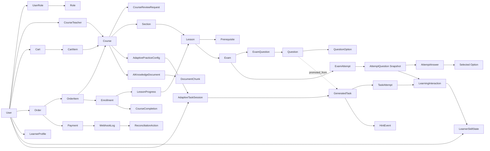
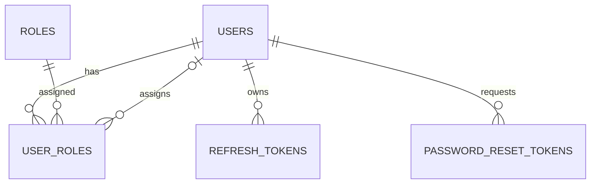
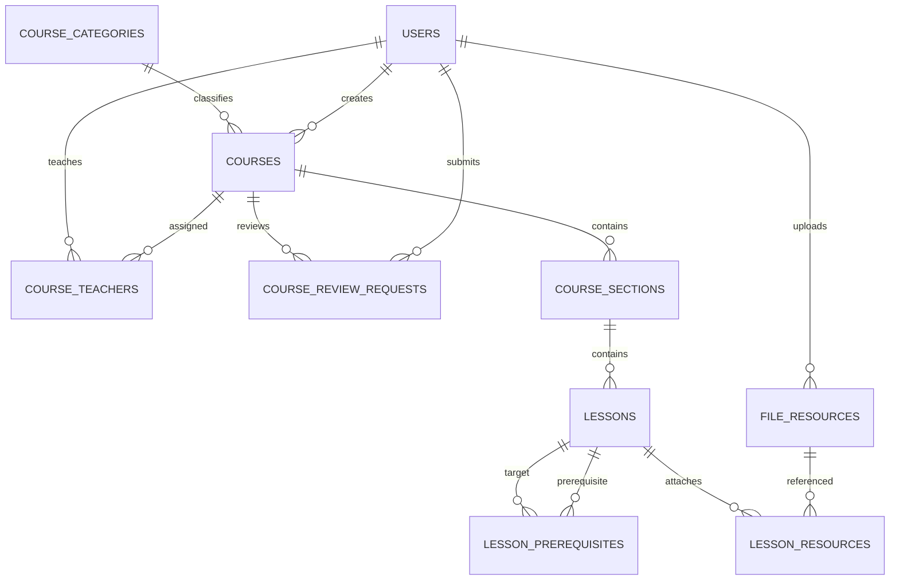
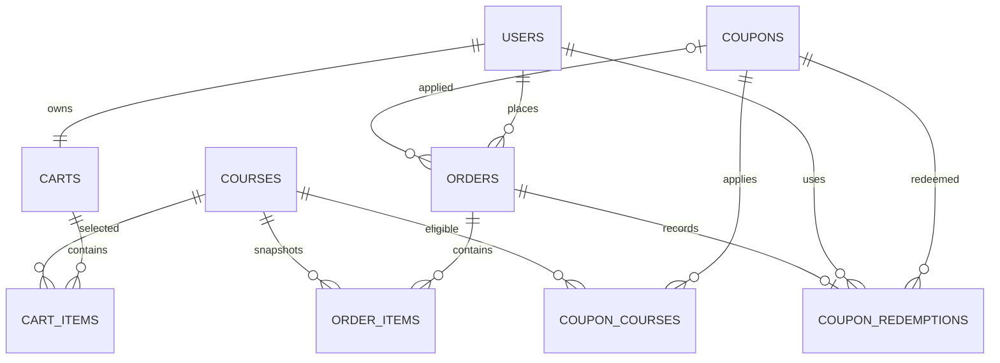
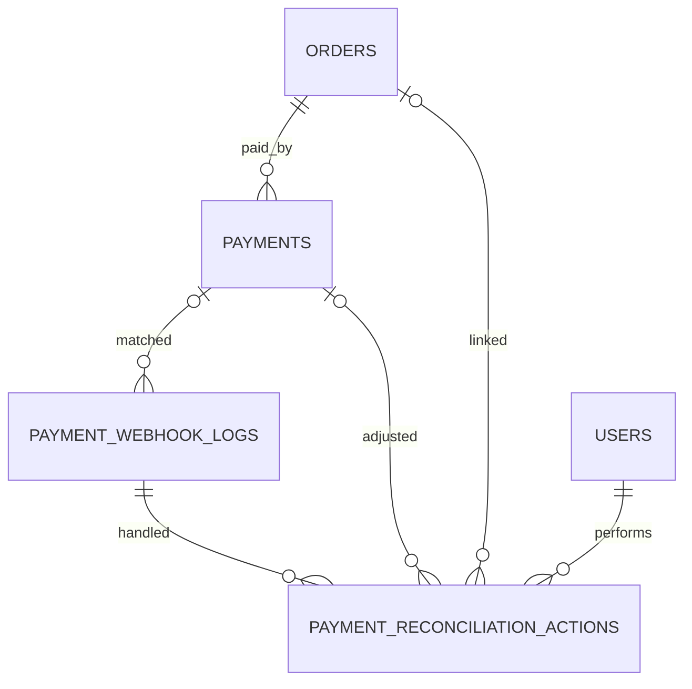
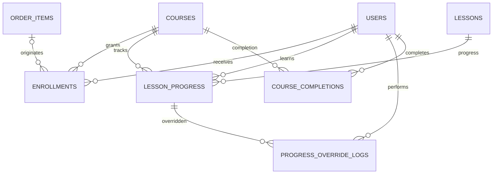
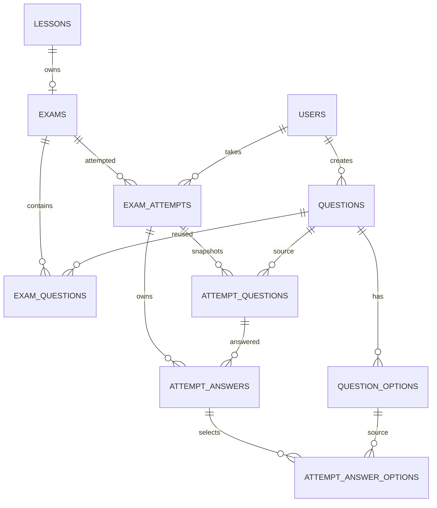
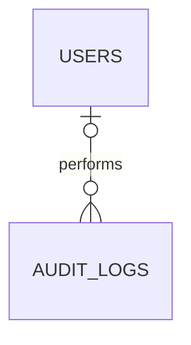
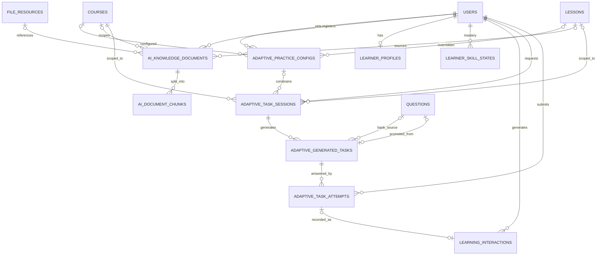

# ERD CHI TIẾT — LMS MVP + AI ADAPTIVE RAG

## Hệ thống học trực tuyến và kinh doanh khóa học

**Phiên bản:** 2.2  
**Ngày cập nhật:** 30/10/2026  
**Đồng bộ với:** Đặc tả nghiệp vụ v3.2, Decision Register v0.2  
**Database:** MySQL 8.x, InnoDB, UTF8MB4  
**ORM:** Spring Data JPA / Hibernate  
**Migration:** Flyway  
**Phạm vi:** 37 bảng LMS cốt lõi + 10 bảng cho Adaptive Profile-Based RAG (47 bảng logic)

---

# 0A. Thay đổi so với v2.1

ERD v2.2 đồng bộ với Đặc tả v3.2 (áp dụng Decision Register v0.1).

| Bảng | Thay đổi | Quyết định / lý do |
|---|---|---|
| `users`, `adaptive_task_sessions` | `users.avatar_url` → `avatar_file_id` (FK); `requested_task_type` → `requested_task_types_json` | Khớp OpenAPI: `avatarResourceId` là ID file, `taskTypes` là mảng (rà soát cấp trường 03/11) |
| `adaptive_task_hint_events` | **Bảng mới** (Should Have) | DEC-003: idempotency của hint; không ghi vào `learning_interactions` để không nhiễu ma trận `R` |
| `adaptive_task_sessions` | Bỏ `requested_difficulty`; thêm `attempt_count`, `auto_retry_count`, `manual_retry_count`, `lease_expires_at`, `worker_id`, `next_retry_at`, `last_error_message` | DEC-001 (độ khó do server chọn theo ZPD), DEC-004 (lease, fencing, retry) |
| `ai_knowledge_documents` | Thêm `source_text` (MEDIUMTEXT), CHECK theo `source_type`; thêm `attempt_count`, `lease_expires_at`, `next_retry_at` | DEC-002 (có chỗ lưu văn bản dán), DEC-004 |
| `payments` | Thêm `review_reason_code` ENUM, `paid_webhook_log_id` (FK, NULL) | DEC-005: lý do đối soát có cấu trúc; truy vết webhook đã chốt thanh toán |
| `payment_webhook_logs` | `unmatched_reason`: `NO_REFERENCE/UNKNOWN_REFERENCE/ALREADY_PAID/PAYMENT_NOT_PENDING`; bỏ `ORDER_NOT_PAYABLE`, `AMOUNT_MISMATCH` (nay là `review_reason_code` của Payment) | DEC-005: bảng quyết định đối soát |
| `enrollments` | Thêm `UNIQUE(order_item_id)` | DEC-005: mỗi OrderItem tạo tối đa một Enrollment |
| Cấu hình thời gian | `payment.late-grace-minutes` (mặc định 15) | DEC-005: grace sau `orders.expires_at` |
| Phân tầng | Mỗi bảng có tầng MUST/SHOULD ở Mục 2 | DEC-012 |

---

# 0B. Lịch sử: thay đổi v2.0 → v2.1

ERD v2.1 đồng bộ với Đặc tả v3.1. Các thay đổi được nhóm theo lý do.

## 0.1. Sửa mâu thuẫn với đặc tả

| Bảng | Thay đổi | Lý do |
|---|---|---|
| `enrollments` | Bỏ `PENDING` khỏi `status` | Enrollment tạo ra là `ACTIVE` (Đặc tả 12.2) |
| `exam_attempts` | Bỏ `EXPIRED` khỏi `status`; hết giờ = `GRADED` + `submission_type = AUTO_EXPIRED` | Đặc tả 14.3, 14.8 |
| Mọi cột tiền | `DECIMAL(12,2)` → `BIGINT UNSIGNED` (VND, số nguyên đồng) | Đặc tả 10.8; tránh lỗi làm tròn |
| `coupons.discount_value` | `PERCENTAGE` là số nguyên 1–100, `FIXED_AMOUNT` là số đồng | Cùng kiểu số nguyên |
| `payment_webhook_logs` | Bỏ `signature`/`valid_signature`, thêm `authenticated`; bỏ UNIQUE trên `provider_event_id`, thêm `dedup_key` + `primary_dedup_key` | SePay xác thực bằng API key; webhook trùng vẫn phải được ghi log và trả 2xx (Đặc tả 11.3) |
| `courses.completion_rule`, `exams.result_display_mode`, `lessons.completion_method` | Liệt kê đầy đủ giá trị ENUM | v2.0 để trống |

## 0.2. Bổ sung cho nghiệp vụ LMS

| Bảng | Thay đổi | Lý do |
|---|---|---|
| `orders` | Thêm `checkout_idempotency_key`, `checkout_request_hash`; `UNIQUE(user_id, checkout_idempotency_key)` | Checkout idempotent (Đặc tả 10.7) |
| `lesson_progress` | Thêm `last_heartbeat_event_id` | Heartbeat idempotent theo `clientEventId` |
| `courses` | Thêm `subject_code`, `grade_level` (NULL) | Mặc định cho cấu hình và tài liệu AI |
| `questions` | Thêm `skill_code` (NULL), `source` (MANUAL/AI_PROMOTED) | Đưa tín hiệu bài thi vào hồ sơ; truy nguồn nội dung AI (BR-AI-12) |
| `attempt_questions` | Thêm `skill_code_snapshot`, `difficulty_snapshot` | Snapshot cho `learning_interactions` |

## 0.3. Phần AI (Mục 17)

| Thay đổi | Lý do |
|---|---|
| **Bảng mới `adaptive_practice_configs`** | Ràng buộc `C` do Teacher đặt (Đặc tả 20A.5) |
| `adaptive_task_sessions`: bỏ `requested_by`, `subject_code`, `grade_level`, `target_difficulty`; thêm `config_id`, `constraints_json`, `requested_*`, `client_request_id`, `error_code` ENUM | Student không tự đặt ràng buộc; tái lập kết quả |
| `adaptive_generated_tasks`: thêm `origin`, `source_question_id`, `skill_code`, `fit_score`, `hint_steps_json`, thông tin duyệt; `difficulty_level` ENUM | Hỗ trợ cả chọn từ ngân hàng lẫn sinh; Socratic; duyệt |
| `adaptive_task_attempts`: thêm `client_event_id`, `hints_used`; `UNIQUE(task_id, student_id)` | Idempotency (BR-AI-08), BR-AI-15 |
| `learning_interactions`: `event_key` NOT NULL; thêm `difficulty_level`, `hints_used`; `item_type` còn `EXAM_QUESTION`/`ADAPTIVE_TASK` | Chặn cập nhật hồ sơ lặp; bỏ `LESSON` vì không có điểm |
| `ai_knowledge_documents`: thêm `deleted_at`, `deleted_by`; bỏ `storage_key` (đã có ở `file_resources`) | Gỡ tài liệu khỏi retrieval |
| `ai_document_chunks`: thêm `skill_code` | Lọc theo kỹ năng |
| `learner_profiles`: thêm `profile_version` | Tái lập (BR-AI-10) |
| Tất cả cột trạng thái/độ khó: `VARCHAR` → `ENUM`; độ khó thống nhất `EASY/MEDIUM/HARD` | Nhất quán với LMS và OpenAPI |

## 0.4. Quyết định đã chốt (trước đây ở mục "điểm cần chốt")

| Câu hỏi | Quyết định |
|---|---|
| `course_completions` lưu một hay nhiều lần | Một lần/User/Course (Đặc tả 13) |
| Cần đúng một `is_primary` mỗi Course | Không bắt buộc ở DB; service đảm bảo tối đa một |
| Order có nhiều Payment | Có, nhưng tối đa một `PENDING`; service lock Order |
| Webhook trùng | Ghi log mọi lần nhận; chỉ bản đầu có `primary_dedup_key`; bản sau `DUPLICATE` |

---

# 1. Nguyên tắc thiết kế

- ERD bám theo các luồng Course Review, Commerce, Payment Reconciliation, Enrollment, Progress và Exam Attempt.
- Dùng `BIGINT UNSIGNED` cho khóa chính và `DATETIME(6)` lưu UTC. Tiền chỉ là VND, lưu **số nguyên đồng** bằng `BIGINT UNSIGNED` (không dùng DECIMAL, không có cột `currency`).
- Không xóa vật lý dữ liệu đã có giao dịch hoặc lịch sử học.
- `OrderItem` snapshot giá và tên Course tại thời điểm mua.
- `AttemptQuestion` snapshot đề thi để Question sửa sau đó không làm thay đổi Attempt đang diễn ra.
- `lesson_progress` dùng khóa nghiệp vụ `student_id + course_id + lesson_id`, không gắn cứng với một Enrollment lịch sử, đúng quyết định gia hạn trong đặc tả mới.
- Webhook log được lưu trước transaction nghiệp vụ để hỗ trợ idempotency và đối soát.
- Idempotency được bảo đảm ở DB bằng UNIQUE: checkout (`orders`), webhook (`payment_webhook_logs.primary_dedup_key`, `payments`), tương tác AI (`learning_interactions.event_key`), nộp nhiệm vụ AI (`adaptive_task_attempts`).
- Tham chiếu đa hình (`learning_interactions.item_id`) không có FK; service xác thực.
- ENUM dùng nhất quán cho trạng thái; thêm giá trị mới cần migration.
- AI Adaptive Profile-Based RAG là phạm vi bắt buộc. Các bảng AI được bổ sung theo hướng lưu metadata, lịch sử và khả năng truy vết; vector embedding thực tế lưu trong vector index, không lưu mảng số lớn trong MySQL.

# 2. Danh sách bảng

- **Identity và phân quyền:** `users`, `roles`, `user_roles`, `refresh_tokens`, `password_reset_tokens`
- **Course authoring:** `course_categories`, `courses`, `course_teachers`, `course_review_requests`, `course_sections`, `lessons`, `lesson_prerequisites`, `file_resources`, `lesson_resources`
- **Commerce:** `carts`, `cart_items`, `coupons`, `coupon_courses`, `orders`, `order_items`, `coupon_redemptions`
- **Payment và đối soát:** `payments`, `payment_webhook_logs`, `payment_reconciliation_actions`
- **Learning:** `enrollments`, `lesson_progress`, `progress_override_logs`, `course_completions`
- **Exam:** `exams`, `questions`, `question_options`, `exam_questions`, `exam_attempts`, `attempt_questions`, `attempt_answers`, `attempt_answer_options`
- **Supporting:** `audit_logs`
- **AI Adaptive RAG:** `adaptive_practice_configs`, `ai_knowledge_documents`, `ai_document_chunks`, `learner_profiles`, `learner_skill_states`, `learning_interactions`, `adaptive_task_sessions`, `adaptive_generated_tasks`, `adaptive_task_attempts`, `adaptive_task_hint_events`

Tổng cộng: **47 bảng logic**: 37 bảng LMS và 10 bảng AI. Bảng AI được mô tả tại Mục 17.

**Phân tầng (Đặc tả 5.2):** toàn bộ bảng LMS và bảng AI là **MUST**, trừ: `adaptive_task_hint_events` (SHOULD, cắt đầu tiên cùng Socratic), `password_reset_tokens` (SHOULD), `coupons`/`coupon_courses`/`coupon_redemptions` (SHOULD; nếu cắt thì giữ bảng, tắt chức năng để không đổi schema), `progress_override_logs` (SHOULD). Bảng SHOULD vẫn được tạo bằng migration để schema ổn định; cắt giảm chỉ bỏ logic và UI.

## Thứ tự migration (Flyway) đề xuất

1. Identity → Course authoring (`file_resources` trước `courses`; `lessons` trước `exams`).
2. `exams` → `lesson_prerequisites` (FK tới `exams`) → Question/Option → `exam_questions`.
3. Commerce → Payment → Learning → Exam attempts → `audit_logs`.
4. AI: `adaptive_practice_configs`, `ai_knowledge_documents`, `ai_document_chunks`, `learner_profiles`, `learner_skill_states`, `learning_interactions`, `adaptive_task_sessions`, `adaptive_generated_tasks`, `adaptive_task_attempts`, `adaptive_task_hint_events`; sau đó `ALTER` thêm FK `adaptive_task_attempts.interaction_id`.

---

# 3. Sơ đồ quan hệ tổng quát



---

# 4. Identity và phân quyền



## 4.1. `users`

| Cột | Kiểu dữ liệu | Ràng buộc | Ý nghĩa |
|---|---|---|---|
| `id` | BIGINT UNSIGNED | PK, AUTO_INCREMENT | Mã người dùng |
| `email` | VARCHAR(255) | UNIQUE, NOT NULL | Email đăng nhập |
| `password_hash` | VARCHAR(255) | NOT NULL | Mật khẩu hash |
| `full_name` | VARCHAR(255) | NOT NULL | Họ tên |
| `phone_number` | VARCHAR(20) | NULL | Số điện thoại |
| `avatar_file_id` | BIGINT UNSIGNED | FK → file_resources.id, NULL | Ảnh đại diện (API `avatarResourceId`); FK thêm bằng ALTER vì `file_resources` tạo sau `users` |
| `status` | ENUM | NOT NULL, DEFAULT ACTIVE | ACTIVE/INACTIVE/BLOCKED |
| `email_verified` | BOOLEAN | NOT NULL, DEFAULT FALSE | Đã xác minh email |
| `last_login_at` | DATETIME(6) | NULL | Đăng nhập gần nhất |
| `version` | BIGINT | NOT NULL, DEFAULT 0 | Optimistic lock |
| `created_at` | DATETIME(6) | NOT NULL | Ngày tạo |
| `updated_at` | DATETIME(6) | NOT NULL | Ngày cập nhật |
## 4.2. `roles`

| Cột | Kiểu dữ liệu | Ràng buộc | Ý nghĩa |
|---|---|---|---|
| `id` | BIGINT UNSIGNED | PK, AUTO_INCREMENT | Mã role |
| `code` | VARCHAR(50) | UNIQUE, NOT NULL | ADMIN/TEACHER/STUDENT |
| `name` | VARCHAR(100) | NOT NULL | Tên role |
| `description` | VARCHAR(255) | NULL | Mô tả |
| `created_at` | DATETIME(6) | NOT NULL | Ngày tạo |
## 4.3. `user_roles`

| Cột | Kiểu dữ liệu | Ràng buộc | Ý nghĩa |
|---|---|---|---|
| `user_id` | BIGINT UNSIGNED | PK, FK → users.id | Người dùng |
| `role_id` | BIGINT UNSIGNED | PK, FK → roles.id | Vai trò |
| `assigned_by` | BIGINT UNSIGNED | FK → users.id, NULL | Admin gán |
| `assigned_at` | DATETIME(6) | NOT NULL | Thời điểm gán |

**Ràng buộc bổ sung**

```text
UNIQUE(user_id, role_id)
```
## 4.4. `refresh_tokens`

| Cột | Kiểu dữ liệu | Ràng buộc | Ý nghĩa |
|---|---|---|---|
| `id` | BIGINT UNSIGNED | PK, AUTO_INCREMENT | Mã token |
| `user_id` | BIGINT UNSIGNED | FK → users.id, NOT NULL | Chủ token |
| `token_hash` | VARCHAR(255) | UNIQUE, NOT NULL | Hash token |
| `family_id` | VARCHAR(64) | NULL, INDEX | Nhóm token rotation |
| `expires_at` | DATETIME(6) | NOT NULL, INDEX | Hết hạn |
| `revoked_at` | DATETIME(6) | NULL | Thu hồi |
| `revoked_reason` | VARCHAR(255) | NULL | Lý do |
| `created_at` | DATETIME(6) | NOT NULL | Ngày tạo |
## 4.5. `password_reset_tokens`

| Cột | Kiểu dữ liệu | Ràng buộc | Ý nghĩa |
|---|---|---|---|
| `id` | BIGINT UNSIGNED | PK, AUTO_INCREMENT | Mã |
| `user_id` | BIGINT UNSIGNED | FK → users.id, NOT NULL | Người dùng |
| `token_hash` | VARCHAR(255) | UNIQUE, NOT NULL | Token một lần |
| `expires_at` | DATETIME(6) | NOT NULL, INDEX | Hết hạn |
| `used_at` | DATETIME(6) | NULL | Đã sử dụng |
| `created_at` | DATETIME(6) | NOT NULL | Ngày tạo |
---

# 5. Course authoring



## 5.1. `course_categories`

| Cột | Kiểu dữ liệu | Ràng buộc | Ý nghĩa |
|---|---|---|---|
| `id` | BIGINT UNSIGNED | PK, AUTO_INCREMENT | Mã danh mục |
| `name` | VARCHAR(255) | NOT NULL | Tên |
| `slug` | VARCHAR(255) | UNIQUE, NOT NULL | Slug |
| `description` | TEXT | NULL | Mô tả |
| `active` | BOOLEAN | NOT NULL, DEFAULT TRUE | Hoạt động |
| `created_at` | DATETIME(6) | NOT NULL | Ngày tạo |
| `updated_at` | DATETIME(6) | NOT NULL | Ngày cập nhật |
## 5.2. `courses`

| Cột | Kiểu dữ liệu | Ràng buộc | Ý nghĩa |
|---|---|---|---|
| `id` | BIGINT UNSIGNED | PK, AUTO_INCREMENT | Mã khóa học |
| `category_id` | BIGINT UNSIGNED | FK → course_categories.id, NOT NULL | Danh mục |
| `created_by` | BIGINT UNSIGNED | FK → users.id, NOT NULL | Người tạo |
| `thumbnail_file_id` | BIGINT UNSIGNED | FK → file_resources.id, NULL | Ảnh đại diện |
| `title` | VARCHAR(255) | NOT NULL | Tên khóa học |
| `slug` | VARCHAR(255) | UNIQUE, NOT NULL | Slug |
| `short_description` | VARCHAR(500) | NULL | Mô tả ngắn |
| `description` | LONGTEXT | NULL | Mô tả chi tiết |
| `original_price` | BIGINT UNSIGNED | NOT NULL, DEFAULT 0 | Giá gốc |
| `sale_price` | BIGINT UNSIGNED | NOT NULL, DEFAULT 0 | Giá bán |
| `status` | ENUM | NOT NULL, DEFAULT DRAFT | DRAFT/PENDING_REVIEW/REJECTED/PUBLISHED/HIDDEN/ARCHIVED |
| `subject_code` | VARCHAR(100) | NULL | Môn học (mặc định cho cấu hình/tài liệu AI) |
| `grade_level` | VARCHAR(50) | NULL | Khối/lớp (mặc định cho cấu hình/tài liệu AI) |
| `access_duration_days` | INT UNSIGNED | NULL | Số ngày học; NULL = không giới hạn |
| `completion_rule` | ENUM | NOT NULL, DEFAULT ALL_MANDATORY_LESSONS | ALL_MANDATORY_LESSONS/ALL_MANDATORY_LESSONS_AND_PASS_REQUIRED_EXAMS/MANUAL_BY_TEACHER |
| `published_at` | DATETIME(6) | NULL | Xuất bản |
| `hidden_at` | DATETIME(6) | NULL | Ẩn |
| `archived_at` | DATETIME(6) | NULL | Lưu trữ |
| `version` | BIGINT | NOT NULL, DEFAULT 0 | Optimistic lock |
| `created_at` | DATETIME(6) | NOT NULL | Ngày tạo |
| `updated_at` | DATETIME(6) | NOT NULL | Ngày cập nhật |
## 5.3. `course_teachers`

| Cột | Kiểu dữ liệu | Ràng buộc | Ý nghĩa |
|---|---|---|---|
| `course_id` | BIGINT UNSIGNED | PK, FK → courses.id | Khóa học |
| `teacher_id` | BIGINT UNSIGNED | PK, FK → users.id | Giáo viên |
| `is_primary` | BOOLEAN | NOT NULL, DEFAULT FALSE | Giáo viên chính |
| `active` | BOOLEAN | NOT NULL, DEFAULT TRUE | Đang phụ trách |
| `assigned_by` | BIGINT UNSIGNED | FK → users.id, NULL | Admin phân công |
| `assigned_at` | DATETIME(6) | NOT NULL | Ngày gán |
| `removed_at` | DATETIME(6) | NULL | Ngày thu hồi |

**Ràng buộc bổ sung**

```text
UNIQUE(course_id, teacher_id)
```
## 5.4. `course_review_requests`

| Cột | Kiểu dữ liệu | Ràng buộc | Ý nghĩa |
|---|---|---|---|
| `id` | BIGINT UNSIGNED | PK, AUTO_INCREMENT | Mã yêu cầu |
| `course_id` | BIGINT UNSIGNED | FK → courses.id, NOT NULL | Khóa học |
| `submitted_by` | BIGINT UNSIGNED | FK → users.id, NOT NULL | Người gửi |
| `reviewed_by` | BIGINT UNSIGNED | FK → users.id, NULL | Admin duyệt |
| `status` | ENUM | NOT NULL | PENDING/APPROVED/REJECTED/WITHDRAWN; `APPROVED` là kết quả của request, Course chuyển thẳng `PUBLISHED` |
| `submission_note` | TEXT | NULL | Ghi chú gửi |
| `review_note` | TEXT | NULL | Lý do duyệt/từ chối |
| `submitted_at` | DATETIME(6) | NOT NULL | Gửi duyệt |
| `reviewed_at` | DATETIME(6) | NULL | Xử lý |
| `created_at` | DATETIME(6) | NOT NULL | Ngày tạo |
## 5.5. `course_sections`

| Cột | Kiểu dữ liệu | Ràng buộc | Ý nghĩa |
|---|---|---|---|
| `id` | BIGINT UNSIGNED | PK, AUTO_INCREMENT | Mã chương |
| `course_id` | BIGINT UNSIGNED | FK → courses.id, NOT NULL | Khóa học |
| `title` | VARCHAR(255) | NOT NULL | Tiêu đề |
| `description` | TEXT | NULL | Mô tả |
| `position` | INT UNSIGNED | NOT NULL | Thứ tự |
| `published` | BOOLEAN | NOT NULL, DEFAULT FALSE | Phát hành |
| `release_after_days` | INT UNSIGNED | NOT NULL, DEFAULT 0 | Drip content |
| `created_at` | DATETIME(6) | NOT NULL | Ngày tạo |
| `updated_at` | DATETIME(6) | NOT NULL | Ngày cập nhật |

**Ràng buộc bổ sung**

```text
UNIQUE(course_id, position)
```
## 5.6. `lessons`

| Cột | Kiểu dữ liệu | Ràng buộc | Ý nghĩa |
|---|---|---|---|
| `id` | BIGINT UNSIGNED | PK, AUTO_INCREMENT | Mã bài học |
| `section_id` | BIGINT UNSIGNED | FK → course_sections.id, NOT NULL | Chương |
| `video_file_id` | BIGINT UNSIGNED | FK → file_resources.id, NULL | Video |
| `title` | VARCHAR(255) | NOT NULL | Tên |
| `description` | TEXT | NULL | Mô tả |
| `lesson_type` | ENUM | NOT NULL | VIDEO/TEXT/DOCUMENT/EXAM |
| `content` | LONGTEXT | NULL | Nội dung |
| `duration_seconds` | INT UNSIGNED | NULL | Thời lượng |
| `position` | INT UNSIGNED | NOT NULL | Thứ tự |
| `preview` | BOOLEAN | NOT NULL, DEFAULT FALSE | Xem thử |
| `published` | BOOLEAN | NOT NULL, DEFAULT FALSE | Phát hành |
| `mandatory` | BOOLEAN | NOT NULL, DEFAULT TRUE | Bắt buộc |
| `completion_method` | ENUM | NOT NULL, DEFAULT MANUAL | MANUAL/VIEW_CONTENT/VIDEO_PERCENT/PASS_EXAM/SUBMIT_EXAM |
| `completion_threshold` | DECIMAL(5,2) | NULL | Ngưỡng hoàn thành |
| `created_at` | DATETIME(6) | NOT NULL | Ngày tạo |
| `updated_at` | DATETIME(6) | NOT NULL | Ngày cập nhật |

**Ràng buộc bổ sung**

```text
UNIQUE(section_id, position)
```
## 5.7. `lesson_prerequisites`

| Cột | Kiểu dữ liệu | Ràng buộc | Ý nghĩa |
|---|---|---|---|
| `id` | BIGINT UNSIGNED | PK, AUTO_INCREMENT | Mã |
| `lesson_id` | BIGINT UNSIGNED | UNIQUE, FK → lessons.id | Lesson bị khóa |
| `prerequisite_lesson_id` | BIGINT UNSIGNED | FK → lessons.id, NULL | Lesson yêu cầu |
| `prerequisite_exam_id` | BIGINT UNSIGNED | FK → exams.id, NULL | Exam yêu cầu |
| `condition_type` | ENUM | NOT NULL | COMPLETE_LESSON/PASS_EXAM |
| `created_at` | DATETIME(6) | NOT NULL | Ngày tạo |
## 5.8. `file_resources`

| Cột | Kiểu dữ liệu | Ràng buộc | Ý nghĩa |
|---|---|---|---|
| `id` | BIGINT UNSIGNED | PK, AUTO_INCREMENT | Mã file |
| `uploaded_by` | BIGINT UNSIGNED | FK → users.id, NOT NULL | Người upload |
| `original_name` | VARCHAR(255) | NOT NULL | Tên file |
| `object_key` | VARCHAR(500) | UNIQUE, NOT NULL | Object key |
| `mime_type` | VARCHAR(100) | NOT NULL | MIME |
| `file_size` | BIGINT UNSIGNED | NOT NULL | Dung lượng |
| `storage_provider` | ENUM | NOT NULL | MINIO/S3/R2 |
| `status` | ENUM | NOT NULL, DEFAULT READY | PENDING/READY/FAILED/DELETED |
| `checksum` | VARCHAR(128) | NULL, INDEX | Checksum |
| `created_at` | DATETIME(6) | NOT NULL | Ngày tạo |
| `deleted_at` | DATETIME(6) | NULL | Xóa logic |
## 5.9. `lesson_resources`

| Cột | Kiểu dữ liệu | Ràng buộc | Ý nghĩa |
|---|---|---|---|
| `id` | BIGINT UNSIGNED | PK, AUTO_INCREMENT | Mã |
| `lesson_id` | BIGINT UNSIGNED | FK → lessons.id, NOT NULL | Bài học |
| `file_id` | BIGINT UNSIGNED | FK → file_resources.id, NOT NULL | File |
| `title` | VARCHAR(255) | NOT NULL | Tên hiển thị |
| `resource_type` | ENUM | NOT NULL | PDF/SLIDE/IMAGE/DOCUMENT/ATTACHMENT |
| `downloadable` | BOOLEAN | NOT NULL, DEFAULT TRUE | Cho tải |
| `position` | INT UNSIGNED | NOT NULL | Thứ tự |
| `created_at` | DATETIME(6) | NOT NULL | Ngày tạo |

**Ràng buộc bổ sung**

```text
UNIQUE(lesson_id, file_id)
UNIQUE(lesson_id, position)
```
---

# 6. Commerce



## 6.1. `carts`

| Cột | Kiểu dữ liệu | Ràng buộc | Ý nghĩa |
|---|---|---|---|
| `id` | BIGINT UNSIGNED | PK, AUTO_INCREMENT | Mã giỏ |
| `user_id` | BIGINT UNSIGNED | UNIQUE, FK → users.id | Chủ giỏ |
| `created_at` | DATETIME(6) | NOT NULL | Ngày tạo |
| `updated_at` | DATETIME(6) | NOT NULL | Ngày cập nhật |
## 6.2. `cart_items`

| Cột | Kiểu dữ liệu | Ràng buộc | Ý nghĩa |
|---|---|---|---|
| `id` | BIGINT UNSIGNED | PK, AUTO_INCREMENT | Mã item |
| `cart_id` | BIGINT UNSIGNED | FK → carts.id, NOT NULL | Giỏ |
| `course_id` | BIGINT UNSIGNED | FK → courses.id, NOT NULL | Khóa học |
| `added_at` | DATETIME(6) | NOT NULL | Ngày thêm |

**Ràng buộc bổ sung**

```text
UNIQUE(cart_id, course_id)
```
## 6.3. `coupons`

| Cột | Kiểu dữ liệu | Ràng buộc | Ý nghĩa |
|---|---|---|---|
| `id` | BIGINT UNSIGNED | PK, AUTO_INCREMENT | Mã |
| `code` | VARCHAR(50) | UNIQUE, NOT NULL | Mã coupon |
| `name` | VARCHAR(255) | NOT NULL | Tên |
| `discount_type` | ENUM | NOT NULL | PERCENTAGE/FIXED_AMOUNT |
| `discount_value` | BIGINT UNSIGNED | NOT NULL | `PERCENTAGE`: số nguyên 1–100; `FIXED_AMOUNT`: số đồng |
| `minimum_order_amount` | BIGINT UNSIGNED | NOT NULL, DEFAULT 0 | Đơn tối thiểu |
| `maximum_discount_amount` | BIGINT UNSIGNED | NULL | Trần giảm |
| `total_usage_limit` | INT UNSIGNED | NULL | Tổng lượt |
| `per_user_limit` | INT UNSIGNED | NULL | Lượt/user |
| `used_count` | INT UNSIGNED | NOT NULL, DEFAULT 0 | Đã dùng |
| `scope` | ENUM | NOT NULL | ALL_COURSES/SPECIFIC_COURSES |
| `starts_at` | DATETIME(6) | NOT NULL | Bắt đầu |
| `ends_at` | DATETIME(6) | NOT NULL | Kết thúc |
| `status` | ENUM | NOT NULL, DEFAULT ACTIVE | ACTIVE/INACTIVE |
| `version` | BIGINT | NOT NULL, DEFAULT 0 | Optimistic lock khi tăng `used_count` |
| `created_at` | DATETIME(6) | NOT NULL | Ngày tạo |
| `updated_at` | DATETIME(6) | NOT NULL | Ngày cập nhật |
## 6.4. `coupon_courses`

| Cột | Kiểu dữ liệu | Ràng buộc | Ý nghĩa |
|---|---|---|---|
| `coupon_id` | BIGINT UNSIGNED | PK, FK → coupons.id | Coupon |
| `course_id` | BIGINT UNSIGNED | PK, FK → courses.id | Khóa học |
| `created_at` | DATETIME(6) | NOT NULL | Ngày tạo |

**Ràng buộc bổ sung**

```text
UNIQUE(coupon_id, course_id)
```
## 6.5. `orders`

| Cột | Kiểu dữ liệu | Ràng buộc | Ý nghĩa |
|---|---|---|---|
| `id` | BIGINT UNSIGNED | PK, AUTO_INCREMENT | Mã đơn |
| `code` | VARCHAR(50) | UNIQUE, NOT NULL | Mã hiển thị |
| `user_id` | BIGINT UNSIGNED | FK → users.id, NOT NULL | Người mua |
| `coupon_id` | BIGINT UNSIGNED | FK → coupons.id, NULL | Coupon |
| `coupon_code` | VARCHAR(50) | NULL | Snapshot mã |
| `subtotal` | BIGINT UNSIGNED | NOT NULL | Tổng trước giảm |
| `discount_amount` | BIGINT UNSIGNED | NOT NULL, DEFAULT 0 | Tiền giảm |
| `total_amount` | BIGINT UNSIGNED | NOT NULL | Phải trả |
| `checkout_idempotency_key` | VARCHAR(64) | NOT NULL | Header `Idempotency-Key` của checkout |
| `checkout_request_hash` | CHAR(64) | NOT NULL | Hash nội dung request; khác hash với cùng key thì từ chối |
| `status` | ENUM | NOT NULL | PENDING_PAYMENT/PAID/CANCELLED/EXPIRED |
| `expires_at` | DATETIME(6) | NOT NULL, INDEX | Hạn trả (mặc định 24 giờ sau khi tạo) |
| `paid_at` | DATETIME(6) | NULL | Đã trả |
| `cancelled_at` | DATETIME(6) | NULL | Hủy |
| `version` | BIGINT | NOT NULL, DEFAULT 0 | Lock |
| `created_at` | DATETIME(6) | NOT NULL | Ngày tạo |
| `updated_at` | DATETIME(6) | NOT NULL | Ngày cập nhật |
**Ràng buộc bổ sung**

```text
UNIQUE(user_id, checkout_idempotency_key)
```

Order `EXPIRED`/`CANCELLED` chỉ chuyển sang `PAID` qua đối soát của Admin (Đặc tả 10.5).

## 6.6. `order_items`

| Cột | Kiểu dữ liệu | Ràng buộc | Ý nghĩa |
|---|---|---|---|
| `id` | BIGINT UNSIGNED | PK, AUTO_INCREMENT | Mã item |
| `order_id` | BIGINT UNSIGNED | FK → orders.id, NOT NULL | Đơn |
| `course_id` | BIGINT UNSIGNED | FK → courses.id, NOT NULL | Khóa học nguồn |
| `course_title` | VARCHAR(255) | NOT NULL | Snapshot tên |
| `original_price` | BIGINT UNSIGNED | NOT NULL | Snapshot giá |
| `discount_amount` | BIGINT UNSIGNED | NOT NULL, DEFAULT 0 | Tiền giảm |
| `final_price` | BIGINT UNSIGNED | NOT NULL | Giá cuối |
| `access_duration_days` | INT UNSIGNED | NULL | Snapshot thời hạn |
| `created_at` | DATETIME(6) | NOT NULL | Ngày tạo |

**Ràng buộc bổ sung**

```text
UNIQUE(order_id, course_id)
```
## 6.7. `coupon_redemptions`

| Cột | Kiểu dữ liệu | Ràng buộc | Ý nghĩa |
|---|---|---|---|
| `id` | BIGINT UNSIGNED | PK, AUTO_INCREMENT | Mã |
| `coupon_id` | BIGINT UNSIGNED | FK → coupons.id, NOT NULL | Coupon |
| `user_id` | BIGINT UNSIGNED | FK → users.id, NOT NULL | Người dùng |
| `order_id` | BIGINT UNSIGNED | UNIQUE, FK → orders.id | Đơn |
| `discount_amount` | BIGINT UNSIGNED | NOT NULL | Tiền đã giảm |
| `redeemed_at` | DATETIME(6) | NOT NULL | Ngày dùng |
---

# 7. Payment và đối soát



## 7.1. `payments`

| Cột | Kiểu dữ liệu | Ràng buộc | Ý nghĩa |
|---|---|---|---|
| `id` | BIGINT UNSIGNED | PK, AUTO_INCREMENT | Mã payment |
| `order_id` | BIGINT UNSIGNED | FK → orders.id, NOT NULL | Đơn |
| `provider` | ENUM | NOT NULL | SEPAY/MANUAL |
| `method` | ENUM | NOT NULL | BANK_QR/BANK_TRANSFER |
| `expected_amount` | BIGINT UNSIGNED | NOT NULL | Số tiền cần |
| `received_amount` | BIGINT UNSIGNED | NULL | Thực nhận |
| `status` | ENUM | NOT NULL | PENDING/PAID/REVIEW_REQUIRED/FAILED/CANCELLED |
| `payment_reference` | VARCHAR(100) | UNIQUE, NOT NULL | Nội dung CK |
| `provider_transaction_id` | VARCHAR(255) | NULL | Mã giao dịch |
| `qr_content` | TEXT | NULL | QR payload |
| `paid_at` | DATETIME(6) | NULL | Thành công |
| `review_reason_code` | ENUM | NULL | ORDER_NOT_PAYABLE/AMOUNT_UNDERPAID/AMOUNT_OVERPAID (Đặc tả 11.6) |
| `review_reason` | VARCHAR(500) | NULL | Mô tả chi tiết cho Admin |
| `paid_webhook_log_id` | BIGINT UNSIGNED | FK → payment_webhook_logs.id, NULL | Webhook đã chốt thanh toán (hoặc webhook gây review) |
| `failed_reason` | VARCHAR(500) | NULL | Lỗi |
| `version` | BIGINT | NOT NULL, DEFAULT 0 | Concurrency |
| `created_at` | DATETIME(6) | NOT NULL | Ngày tạo |
| `updated_at` | DATETIME(6) | NOT NULL | Ngày cập nhật |

**Ràng buộc bổ sung**

```text
UNIQUE(provider, provider_transaction_id)
```
## 7.2. `payment_webhook_logs`

| Cột | Kiểu dữ liệu | Ràng buộc | Ý nghĩa |
|---|---|---|---|
| `id` | BIGINT UNSIGNED | PK, AUTO_INCREMENT | Mã log |
| `payment_id` | BIGINT UNSIGNED | FK → payments.id, NULL | Payment matched |
| `provider` | ENUM | NOT NULL | Provider |
| `provider_event_id` | VARCHAR(255) | NULL | Event id |
| `provider_transaction_id` | VARCHAR(255) | NULL | Transaction id |
| `payment_reference` | VARCHAR(100) | NULL, INDEX | Reference |
| `received_amount` | BIGINT UNSIGNED | NULL | Số tiền |
| `payload` | LONGTEXT | NOT NULL | Raw webhook |
| `dedup_key` | VARCHAR(300) | NOT NULL, INDEX | `{provider}:{provider_transaction_id}`; nếu thiếu transaction id thì dùng `{provider}:{provider_event_id}` |
| `primary_dedup_key` | VARCHAR(300) | NULL, UNIQUE | Bằng `dedup_key` chỉ ở lần nhận đầu tiên; các lần sau để NULL |
| `authenticated` | BOOLEAN | NOT NULL, DEFAULT FALSE | Xác thực API key hợp lệ (SePay) |
| `processing_status` | ENUM | NOT NULL | RECEIVED/VALIDATED/MATCHED/PROCESSED/DUPLICATE/UNMATCHED/FAILED |
| `unmatched_reason` | ENUM | NULL | NO_REFERENCE/UNKNOWN_REFERENCE/ALREADY_PAID/PAYMENT_NOT_PENDING (các lý do ORDER_NOT_PAYABLE, AMOUNT_* nằm ở `payments.review_reason_code`) |
| `error_message` | TEXT | NULL | Lỗi |
| `received_at` | DATETIME(6) | NOT NULL, INDEX | Nhận |
| `processed_at` | DATETIME(6) | NULL | Xử lý |

**Cơ chế idempotency**

Webhook luôn được ghi log trước khi xử lý (kể cả trùng) để có audit đầy đủ và để trả 2xx cho provider:

```text
INSERT log (primary_dedup_key = dedup_key)
  → thành công           : đây là lần nhận đầu, xử lý nghiệp vụ
  → vi phạm UNIQUE       : INSERT lại với primary_dedup_key = NULL, processing_status = DUPLICATE, bỏ qua nghiệp vụ
```

Cách này an toàn khi hai request trùng đến đồng thời, vì quyết định "bản đầu" do UNIQUE ở DB chốt. Hàng đợi đối soát của Admin chỉ lấy các log `UNMATCHED` hoặc gắn với Payment `REVIEW_REQUIRED`, không lấy `DUPLICATE`. Chống ghi nhận thanh toán hai lần còn có `UNIQUE(provider, provider_transaction_id)` ở `payments`.

**Bảng quyết định đối soát** (thứ tự ưu tiên, xem Đặc tả 11.6): không reference → `UNMATCHED/NO_REFERENCE`; reference lạ → `UNMATCHED/UNKNOWN_REFERENCE`; Payment đã `PAID` → `UNMATCHED/ALREADY_PAID`; Order không `PENDING_PAYMENT` → Payment `REVIEW_REQUIRED/ORDER_NOT_PAYABLE`; Payment không `PENDING` → `UNMATCHED/PAYMENT_NOT_PENDING`; thiếu/thừa tiền → `REVIEW_REQUIRED/AMOUNT_UNDERPAID|AMOUNT_OVERPAID`; còn lại → `PROCESSED`, Payment `PAID`.

**Khóa dedup theo giao dịch:** `dedup_key` ưu tiên `{provider}:{provider_transaction_id}`; chỉ khi thiếu mới dùng `{provider_event_id}`.
## 7.3. `payment_reconciliation_actions`

| Cột | Kiểu dữ liệu | Ràng buộc | Ý nghĩa |
|---|---|---|---|
| `id` | BIGINT UNSIGNED | PK, AUTO_INCREMENT | Mã thao tác |
| `webhook_log_id` | BIGINT UNSIGNED | FK → payment_webhook_logs.id, NOT NULL | Webhook |
| `payment_id` | BIGINT UNSIGNED | FK → payments.id, NULL | Payment |
| `order_id` | BIGINT UNSIGNED | FK → orders.id, NULL | Order |
| `performed_by` | BIGINT UNSIGNED | FK → users.id, NOT NULL | Admin |
| `action_type` | ENUM | NOT NULL | MATCH/APPROVE/REJECT/UNMATCH |
| `previous_status` | VARCHAR(50) | NULL | Trạng thái cũ |
| `new_status` | VARCHAR(50) | NULL | Trạng thái mới |
| `note` | TEXT | NOT NULL | Lý do |
| `created_at` | DATETIME(6) | NOT NULL | Ngày thao tác |
---

# 8. Learning



## 8.1. `enrollments`

| Cột | Kiểu dữ liệu | Ràng buộc | Ý nghĩa |
|---|---|---|---|
| `id` | BIGINT UNSIGNED | PK, AUTO_INCREMENT | Mã enrollment |
| `student_id` | BIGINT UNSIGNED | FK → users.id, NOT NULL | Học viên |
| `course_id` | BIGINT UNSIGNED | FK → courses.id, NOT NULL | Khóa học |
| `order_item_id` | BIGINT UNSIGNED | FK → order_items.id, NULL | Nguồn mua |
| `source` | ENUM | NOT NULL | PURCHASE/ADMIN_GRANTED/RENEWAL |
| `status` | ENUM | NOT NULL, DEFAULT ACTIVE | ACTIVE/EXPIRED/REVOKED |
| `starts_at` | DATETIME(6) | NOT NULL | Bắt đầu |
| `expires_at` | DATETIME(6) | NULL | Hết hạn |
| `revoked_at` | DATETIME(6) | NULL | Thu hồi |
| `revoked_by` | BIGINT UNSIGNED | FK → users.id, NULL | Người thu hồi |
| `revoked_reason` | VARCHAR(500) | NULL | Lý do |
| `created_at` | DATETIME(6) | NOT NULL | Ngày tạo |
| `updated_at` | DATETIME(6) | NOT NULL | Ngày cập nhật |
```text
UNIQUE(order_item_id)   -- NULL được lặp (ADMIN_GRANTED); mỗi OrderItem tối đa một Enrollment
```

**Ghi chú:** Enrollment được tạo ở `ACTIVE`. Không có ràng buộc UNIQUE cho (student, course) vì có lịch sử gia hạn; service lock theo (student, course) khi tạo Enrollment mới.

## 8.2. `lesson_progress`

| Cột | Kiểu dữ liệu | Ràng buộc | Ý nghĩa |
|---|---|---|---|
| `id` | BIGINT UNSIGNED | PK, AUTO_INCREMENT | Mã progress |
| `student_id` | BIGINT UNSIGNED | FK → users.id, NOT NULL | Học viên |
| `course_id` | BIGINT UNSIGNED | FK → courses.id, NOT NULL | Khóa học |
| `lesson_id` | BIGINT UNSIGNED | FK → lessons.id, NOT NULL | Bài học |
| `status` | ENUM | NOT NULL | NOT_STARTED/IN_PROGRESS/COMPLETED |
| `watched_seconds` | INT UNSIGNED | NOT NULL, DEFAULT 0 | Mốc xem |
| `progress_percent` | DECIMAL(5,2) | NOT NULL, DEFAULT 0 | Phần trăm |
| `completion_source` | ENUM | NULL | STUDENT_MANUAL/SYSTEM_VIDEO/SYSTEM_EXAM/TEACHER_OVERRIDE/ADMIN_OVERRIDE |
| `first_accessed_at` | DATETIME(6) | NULL | Lần đầu |
| `last_accessed_at` | DATETIME(6) | NULL | Gần nhất |
| `completed_at` | DATETIME(6) | NULL | Hoàn thành |
| `last_heartbeat_event_id` | VARCHAR(64) | NULL | `clientEventId` heartbeat gần nhất, chống xử lý lặp |
| `version` | BIGINT | NOT NULL, DEFAULT 0 | Heartbeat lock |
| `created_at` | DATETIME(6) | NOT NULL | Ngày tạo |
| `updated_at` | DATETIME(6) | NOT NULL | Ngày cập nhật |

**Ràng buộc bổ sung**

```text
UNIQUE(student_id, course_id, lesson_id)
```
## 8.3. `progress_override_logs`

| Cột | Kiểu dữ liệu | Ràng buộc | Ý nghĩa |
|---|---|---|---|
| `id` | BIGINT UNSIGNED | PK, AUTO_INCREMENT | Mã |
| `lesson_progress_id` | BIGINT UNSIGNED | FK → lesson_progress.id, NOT NULL | Progress |
| `performed_by` | BIGINT UNSIGNED | FK → users.id, NOT NULL | Teacher/Admin |
| `previous_status` | ENUM | NOT NULL | Trạng thái cũ |
| `new_status` | ENUM | NOT NULL | Trạng thái mới |
| `previous_percent` | DECIMAL(5,2) | NOT NULL | % cũ |
| `new_percent` | DECIMAL(5,2) | NOT NULL | % mới |
| `reason` | VARCHAR(500) | NOT NULL | Lý do |
| `created_at` | DATETIME(6) | NOT NULL | Ngày |
## 8.4. `course_completions`

| Cột | Kiểu dữ liệu | Ràng buộc | Ý nghĩa |
|---|---|---|---|
| `id` | BIGINT UNSIGNED | PK, AUTO_INCREMENT | Mã |
| `student_id` | BIGINT UNSIGNED | FK → users.id, NOT NULL | Học viên |
| `course_id` | BIGINT UNSIGNED | FK → courses.id, NOT NULL | Khóa học |
| `completion_rule` | ENUM | NOT NULL | Snapshot rule |
| `progress_percent_snapshot` | DECIMAL(5,2) | NOT NULL | % tại thời điểm |
| `mandatory_lessons_snapshot` | INT UNSIGNED | NOT NULL | Tổng bắt buộc |
| `completed_lessons_snapshot` | INT UNSIGNED | NOT NULL | Đã xong |
| `completed_at` | DATETIME(6) | NOT NULL | Hoàn thành |
| `created_by` | BIGINT UNSIGNED | FK → users.id, NULL | Null nếu system |
| `created_at` | DATETIME(6) | NOT NULL | Ngày tạo |

**Ràng buộc bổ sung**

```text
UNIQUE(student_id, course_id)
```
---

# 9. Exam



## 9.1. `exams`

| Cột | Kiểu dữ liệu | Ràng buộc | Ý nghĩa |
|---|---|---|---|
| `id` | BIGINT UNSIGNED | PK, AUTO_INCREMENT | Mã exam |
| `lesson_id` | BIGINT UNSIGNED | UNIQUE, FK → lessons.id | Lesson EXAM |
| `title` | VARCHAR(255) | NOT NULL | Tên |
| `description` | TEXT | NULL | Mô tả |
| `duration_minutes` | INT UNSIGNED | NOT NULL | Thời gian |
| `passing_score` | DECIMAL(5,2) | NOT NULL | Điểm đạt |
| `maximum_attempts` | INT UNSIGNED | NULL | Số lần tối đa |
| `shuffle_questions` | BOOLEAN | NOT NULL, DEFAULT FALSE | Xáo câu |
| `shuffle_options` | BOOLEAN | NOT NULL, DEFAULT FALSE | Xáo đáp án |
| `result_display_mode` | ENUM | NOT NULL, DEFAULT IMMEDIATE_SCORE_ONLY | IMMEDIATE_SCORE_ONLY/IMMEDIATE_WITH_CORRECT_ANSWERS/AFTER_EXAM_CLOSED (chế độ cuối là Should Have) |
| `start_at` | DATETIME(6) | NULL | Mở |
| `end_at` | DATETIME(6) | NULL | Đóng |
| `status` | ENUM | NOT NULL | DRAFT/PUBLISHED/CLOSED |
| `created_by` | BIGINT UNSIGNED | FK → users.id, NOT NULL | Teacher |
| `created_at` | DATETIME(6) | NOT NULL | Ngày tạo |
| `updated_at` | DATETIME(6) | NOT NULL | Ngày cập nhật |
## 9.2. `questions`

| Cột | Kiểu dữ liệu | Ràng buộc | Ý nghĩa |
|---|---|---|---|
| `id` | BIGINT UNSIGNED | PK, AUTO_INCREMENT | Mã câu |
| `course_id` | BIGINT UNSIGNED | FK → courses.id, NOT NULL | Phạm vi Course |
| `content` | TEXT | NOT NULL | Nội dung |
| `question_type` | ENUM | NOT NULL | SINGLE_CHOICE/MULTIPLE_CHOICE |
| `difficulty` | ENUM | NOT NULL | EASY/MEDIUM/HARD |
| `skill_code` | VARCHAR(150) | NULL, INDEX | Kỹ năng; chỉ câu có `skill_code` mới cập nhật `learner_skill_states` |
| `source` | ENUM | NOT NULL, DEFAULT MANUAL | MANUAL/AI_PROMOTED |
| `explanation` | TEXT | NULL | Giải thích |
| `active` | BOOLEAN | NOT NULL, DEFAULT TRUE | Hoạt động |
| `created_by` | BIGINT UNSIGNED | FK → users.id, NOT NULL | Người tạo |
| `version` | INT UNSIGNED | NOT NULL, DEFAULT 1 | Version |
| `created_at` | DATETIME(6) | NOT NULL | Ngày tạo |
| `updated_at` | DATETIME(6) | NOT NULL | Ngày cập nhật |
## 9.3. `question_options`

| Cột | Kiểu dữ liệu | Ràng buộc | Ý nghĩa |
|---|---|---|---|
| `id` | BIGINT UNSIGNED | PK, AUTO_INCREMENT | Mã option |
| `question_id` | BIGINT UNSIGNED | FK → questions.id, NOT NULL | Question |
| `content` | TEXT | NOT NULL | Nội dung |
| `correct` | BOOLEAN | NOT NULL, DEFAULT FALSE | Đúng |
| `position` | INT UNSIGNED | NOT NULL | Thứ tự |
| `created_at` | DATETIME(6) | NOT NULL | Ngày tạo |
| `updated_at` | DATETIME(6) | NOT NULL | Ngày cập nhật |

**Ràng buộc bổ sung**

```text
UNIQUE(question_id, position)
```
## 9.4. `exam_questions`

| Cột | Kiểu dữ liệu | Ràng buộc | Ý nghĩa |
|---|---|---|---|
| `exam_id` | BIGINT UNSIGNED | PK, FK → exams.id | Exam |
| `question_id` | BIGINT UNSIGNED | PK, FK → questions.id | Question |
| `position` | INT UNSIGNED | NOT NULL | Thứ tự |
| `score` | DECIMAL(7,2) | NOT NULL | Trọng số |
| `required` | BOOLEAN | NOT NULL, DEFAULT TRUE | Bắt buộc |
| `created_at` | DATETIME(6) | NOT NULL | Ngày thêm |

**Ràng buộc bổ sung**

```text
UNIQUE(exam_id, question_id)
UNIQUE(exam_id, position)
```
## 9.5. `exam_attempts`

| Cột | Kiểu dữ liệu | Ràng buộc | Ý nghĩa |
|---|---|---|---|
| `id` | BIGINT UNSIGNED | PK, AUTO_INCREMENT | Mã attempt |
| `exam_id` | BIGINT UNSIGNED | FK → exams.id, NOT NULL | Exam |
| `student_id` | BIGINT UNSIGNED | FK → users.id, NOT NULL | Student |
| `enrollment_id` | BIGINT UNSIGNED | FK → enrollments.id, NOT NULL | Enrollment lúc thi |
| `attempt_number` | INT UNSIGNED | NOT NULL | Lần thứ |
| `status` | ENUM | NOT NULL | IN_PROGRESS/SUBMITTED/GRADED |
| `submission_type` | ENUM | NULL | MANUAL/AUTO_EXPIRED; hết giờ = `GRADED` + `AUTO_EXPIRED` |
| `started_at` | DATETIME(6) | NOT NULL | Bắt đầu |
| `expires_at` | DATETIME(6) | NOT NULL, INDEX | Hết giờ |
| `submitted_at` | DATETIME(6) | NULL | Nộp |
| `graded_at` | DATETIME(6) | NULL | Chấm |
| `score` | DECIMAL(7,2) | NULL | Điểm % |
| `maximum_score` | DECIMAL(7,2) | NOT NULL | Tổng điểm snapshot |
| `passing_score` | DECIMAL(5,2) | NOT NULL | Điểm đạt snapshot |
| `passed` | BOOLEAN | NULL | Kết quả |
| `version` | BIGINT | NOT NULL, DEFAULT 0 | Autosave lock |
| `created_at` | DATETIME(6) | NOT NULL | Ngày tạo |

**Ràng buộc bổ sung**

```text
UNIQUE(exam_id, student_id, attempt_number)
```
## 9.6. `attempt_questions`

| Cột | Kiểu dữ liệu | Ràng buộc | Ý nghĩa |
|---|---|---|---|
| `id` | BIGINT UNSIGNED | PK, AUTO_INCREMENT | Mã snapshot |
| `attempt_id` | BIGINT UNSIGNED | FK → exam_attempts.id, NOT NULL | Attempt |
| `source_question_id` | BIGINT UNSIGNED | FK → questions.id, NOT NULL | Question nguồn |
| `question_type` | ENUM | NOT NULL | Loại snapshot |
| `content_snapshot` | TEXT | NOT NULL | Nội dung snapshot |
| `explanation_snapshot` | TEXT | NULL | Giải thích snapshot |
| `skill_code_snapshot` | VARCHAR(150) | NULL | Snapshot `questions.skill_code` |
| `difficulty_snapshot` | ENUM | NOT NULL | Snapshot EASY/MEDIUM/HARD |
| `position` | INT UNSIGNED | NOT NULL | Thứ tự |
| `maximum_score` | DECIMAL(7,2) | NOT NULL | Điểm tối đa |
| `option_snapshot_json` | JSON | NOT NULL | Option + correct snapshot |
| `created_at` | DATETIME(6) | NOT NULL | Ngày tạo |

**Ràng buộc bổ sung**

```text
UNIQUE(attempt_id, position)
UNIQUE(attempt_id, source_question_id)
```
## 9.7. `attempt_answers`

| Cột | Kiểu dữ liệu | Ràng buộc | Ý nghĩa |
|---|---|---|---|
| `id` | BIGINT UNSIGNED | PK, AUTO_INCREMENT | Mã answer |
| `attempt_id` | BIGINT UNSIGNED | FK → exam_attempts.id, NOT NULL | Attempt |
| `attempt_question_id` | BIGINT UNSIGNED | FK → attempt_questions.id, NOT NULL | Snapshot câu |
| `correct` | BOOLEAN | NULL | Đúng/sai |
| `score_awarded` | DECIMAL(7,2) | NULL | Điểm nhận |
| `answered_at` | DATETIME(6) | NULL | Lần lưu cuối |
| `created_at` | DATETIME(6) | NOT NULL | Ngày tạo |
| `updated_at` | DATETIME(6) | NOT NULL | Ngày cập nhật |

**Ràng buộc bổ sung**

```text
UNIQUE(attempt_id, attempt_question_id)
```
## 9.8. `attempt_answer_options`

| Cột | Kiểu dữ liệu | Ràng buộc | Ý nghĩa |
|---|---|---|---|
| `attempt_answer_id` | BIGINT UNSIGNED | PK, FK → attempt_answers.id | Answer |
| `option_id` | BIGINT UNSIGNED | PK, FK → question_options.id | Option nguồn |
| `option_content_snapshot` | TEXT | NOT NULL | Nội dung snapshot |
| `selected_at` | DATETIME(6) | NOT NULL | Thời điểm chọn |

**Ràng buộc bổ sung**

```text
UNIQUE(attempt_answer_id, option_id)
```
---

# 10. Supporting



## 10.1. `audit_logs`

| Cột | Kiểu dữ liệu | Ràng buộc | Ý nghĩa |
|---|---|---|---|
| `id` | BIGINT UNSIGNED | PK, AUTO_INCREMENT | Mã log |
| `actor_user_id` | BIGINT UNSIGNED | FK → users.id, NULL | Null nếu system |
| `action` | VARCHAR(100) | NOT NULL, INDEX | Hành động |
| `entity_type` | VARCHAR(100) | NOT NULL, INDEX | Loại entity |
| `entity_id` | BIGINT UNSIGNED | NULL, INDEX | Mã entity |
| `old_value` | JSON | NULL | Trước |
| `new_value` | JSON | NULL | Sau |
| `reason` | VARCHAR(500) | NULL | Lý do |
| `ip_address` | VARCHAR(45) | NULL | IP |
| `user_agent` | VARCHAR(500) | NULL | Client |
| `created_at` | DATETIME(6) | NOT NULL, INDEX | Thời điểm |

---

# 11. Quan hệ và cardinality quan trọng

| Quan hệ | Cardinality | Ý nghĩa |
|---|---|---|
| User – Role | N–N | Qua `user_roles`; một User có thể vừa Teacher vừa Student |
| User – Course | N–N | Qua `course_teachers`; dùng cho ownership authorization |
| Course – Section | 1–N | Một khóa học có nhiều chương |
| Section – Lesson | 1–N | Một chương có nhiều bài |
| Lesson – Lesson | 0..1 prerequisite | MVP cho tối đa một điều kiện tiên quyết trực tiếp |
| Lesson – FileResource | N–N | Qua `lesson_resources`; video chính dùng FK riêng |
| User – Cart | 1–1 | Một giỏ hoạt động |
| Cart – Course | N–N | Qua `cart_items` |
| Coupon – Course | N–N | Chỉ khi scope là `SPECIFIC_COURSES` |
| User – Order | 1–N | Người mua có nhiều đơn |
| Order – Course | N–N | Qua `order_items`, có snapshot |
| Order – Payment | 1–N | Cho phép lịch sử retry, chỉ một Payment active bằng business rule |
| Payment – WebhookLog | 1–N optional | Webhook unmatched có `payment_id = NULL` |
| OrderItem – Enrollment | 1–0..1 | `UNIQUE(order_item_id)`; renewal là OrderItem mới |
| User – Course – Lesson | Quan hệ ba ngôi | Biểu diễn bởi `lesson_progress` |
| Lesson – Exam | 1–0..1 | Lesson kiểu EXAM có tối đa một Exam |
| Exam – Question | N–N | Qua `exam_questions` |
| Exam – Attempt | 1–N | Student có nhiều lượt |
| Attempt – AttemptQuestion | 1–N | Snapshot đề thi |
| AttemptQuestion – AttemptAnswer | 1–0..1 | Mỗi câu có tối đa một answer |
| AttemptAnswer – Option | N–N | Qua `attempt_answer_options` |
| Course – AdaptivePracticeConfig | 1–N | Một cấu hình mặc định (`lesson_id` NULL) và tối đa một cấu hình ghi đè cho mỗi Lesson |
| Course/Lesson – AIKnowledgeDocument | 1–N optional | Tài liệu có thể không thuộc Course nào (benchmark) |
| AIKnowledgeDocument – Chunk | 1–N | Chỉ chunk có `index_version` bằng phiên bản hiện hành mới được truy xuất |
| User – LearnerProfile | 1–0..1 | Tạo khi có tương tác đầu hoặc phiên đầu |
| User – LearnerSkillState | 1–N | Một dòng cho mỗi `skill_code` |
| AdaptiveTaskSession – GeneratedTask | 1–N | Thứ tự bằng `position` |
| GeneratedTask – TaskAttempt | 1–N theo (task, student) | MVP: tối đa một lần cho mỗi Student |
| TaskAttempt – LearningInteraction | 1–0..1 | Qua `interaction_id` |
| GeneratedTask – HintEvent | 1–N theo (task, student) | Tối đa `max_hints`; không tạo `learning_interactions` |
| GeneratedTask – Question | 0..1 | Qua `promoted_question_id` (sau duyệt) hoặc `source_question_id` (chọn từ ngân hàng) |

---

# 12. Delete rule đề xuất

- `CASCADE` chỉ dùng cho dữ liệu phụ chưa phát sinh lịch sử, ví dụ CartItem hoặc dữ liệu snapshot trong môi trường test.
- `RESTRICT` cho Course, Order, Payment, Enrollment, Question, ExamAttempt và các bảng lịch sử.
- `SET NULL` cho `payment_webhook_logs.payment_id` và `audit_logs.actor_user_id` khi đối tượng nguồn không còn.
- Production ưu tiên soft delete hoặc chuyển trạng thái `ARCHIVED`, `INACTIVE`, `REVOKED`.
- Bảng AI: `RESTRICT` cho `adaptive_*`, `learning_interactions`, `learner_*` (lịch sử và khả năng tái lập). Tài liệu AI gỡ bằng `deleted_at`, không xóa vật lý.
- `ai_document_chunks.document_id`: `CASCADE` chỉ dùng khi dọn chunk của phiên bản index cũ, không dùng khi xóa tài liệu đã có tham chiếu từ `retrieval_trace_json`.

---

# 13. Index phục vụ truy vấn

```text
-- Catalog
INDEX courses(status, category_id, published_at)
INDEX courses(status, sale_price)
INDEX course_sections(course_id, position)
INDEX lessons(section_id, position)

-- Authorization và learning
INDEX course_teachers(teacher_id, active, course_id)
INDEX enrollments(student_id, course_id, status)
INDEX enrollments(status, expires_at)
INDEX lesson_progress(student_id, course_id, status)
INDEX lesson_progress(student_id, last_accessed_at)

-- Commerce và payment
INDEX orders(user_id, created_at)
INDEX orders(status, expires_at)
INDEX payments(order_id, status)
INDEX payment_webhook_logs(processing_status, received_at)
INDEX payment_webhook_logs(provider, provider_transaction_id)

-- Exam
INDEX exam_attempts(exam_id, student_id, attempt_number)
INDEX exam_attempts(status, expires_at)
INDEX attempt_questions(attempt_id, position)
INDEX attempt_answers(attempt_id, attempt_question_id)

-- Idempotency / đối soát
INDEX payment_webhook_logs(dedup_key)
INDEX payment_webhook_logs(processing_status, unmatched_reason, received_at)
INDEX payments(status, review_reason_code)

-- Reporting
INDEX payments(status, paid_at)
INDEX enrollments(course_id, status)
INDEX course_completions(course_id, completed_at)

-- AI: xem Mục 17.13
```

---

# 14. Transaction boundary

## Checkout

```text
Validate Cart
→ Validate Course và Enrollment hiện tại
→ Validate Coupon
→ Create Order
→ Create OrderItems snapshot
→ Create Payment
```

Trước bước đầu: tra `(user_id, Idempotency-Key)`. Có sẵn và cùng `checkout_request_hash` thì trả lại Order cũ; khác hash thì từ chối. Race hai request cùng key do `UNIQUE(user_id, checkout_idempotency_key)` chốt.

Không tăng `coupon.used_count` tại checkout. Hết hạn Order (job): `PENDING_PAYMENT → EXPIRED`, Payment `PENDING → CANCELLED`.

## Webhook thanh toán thành công

```text
Lock Payment/Order
→ Re-check idempotency
→ Payment = PAID (received_amount, paid_at, paid_webhook_log_id)
→ Order = PAID
→ Create Enrollment cho từng OrderItem (UNIQUE(order_item_id) chặn cấp trùng)
→ Create CouponRedemption
→ Increment Coupon.used_count
```

## Webhook không khớp hoặc cần đối soát

```text
Ghi log (primary_dedup_key)
→ Nếu trùng: log DUPLICATE, trả 2xx, dừng
→ Không tìm thấy Payment: UNMATCHED, trả 2xx
→ Áp bảng quyết định (Đặc tả 11.6) theo thứ tự:
   Payment đã PAID               : UNMATCHED/ALREADY_PAID
   Order EXPIRED/CANCELLED       : Payment = REVIEW_REQUIRED (ORDER_NOT_PAYABLE)
   Payment không PENDING         : UNMATCHED/PAYMENT_NOT_PENDING
   Thiếu/thừa tiền               : Payment = REVIEW_REQUIRED (AMOUNT_UNDERPAID/OVERPAID)
→ Không tạo Enrollment ở các nhánh trên, trả 2xx
```

Order còn nhận thanh toán tự động đến `expires_at + grace` (mặc định 15 phút); job hết hạn chỉ chuyển `EXPIRED` sau mốc này.

Admin approve: Payment = PAID, Order = PAID, tạo Enrollment `ACTIVE`, CouponRedemption, tăng `used_count`, ghi `payment_reconciliation_actions` và AuditLog trong cùng transaction.

## Bắt đầu ExamAttempt

```text
Validate Enrollment
→ Validate drip/prerequisite
→ Validate attempt limit
→ Create ExamAttempt
→ Snapshot Question và Option
```

## Submit ExamAttempt

```text
Lock Attempt
→ Chặn autosave mới
→ Chấm từng AttemptQuestion
→ Update AttemptAnswer
→ Update score/pass
→ Update LessonProgress
→ Recalculate CourseCompletion
→ Với mỗi câu có skill_code_snapshot: ghi learning_interactions (event_key = EXAMQ:{attempt_question_id})
→ Cập nhật learner_skill_states bằng EMA, tăng learner_profiles.profile_version
```

Nếu AI lỗi, phần ghi `learning_interactions` có thể chạy sau bằng job dựa trên `processed_at IS NULL`; **không** được làm hỏng việc chấm bài.

## Tạo phiên nhiệm vụ AI

```text
Validate Enrollment và quyền Course/Lesson
→ Đọc adaptive_practice_configs (Lesson ghi đè Course); không có hoặc enabled = FALSE: AI_NOT_CONFIGURED
→ Kiểm tra yêu cầu Student nằm trong cấu hình
→ INSERT adaptive_task_sessions (PENDING, constraints_json, UNIQUE(student_id, client_request_id))
→ [worker] nhận việc: PENDING→PROCESSING, lease, attempt_count++
→ Retrieval → Recommender (độ khó theo ZPD, kẹp trong khoảng cấu hình) → LLM → Validation
→ [một transaction] INSERT toàn bộ adaptive_generated_tasks + UPDATE SUCCEEDED (fencing theo attempt_count)
→ Lỗi tạm thời: PENDING + next_retry_at (tối đa 3 lần); lỗi nghiệp vụ hoặc hết lượt: FAILED
→ Retry thủ công: chỉ từ FAILED, manual_retry_count < 3
```

## Xin gợi ý AI (Should Have)

```text
Tra (student_id, Idempotency-Key): đã có thì trả gợi ý cũ (duplicate = true), dừng
→ Lock nhiệm vụ, kiểm tra Enrollment, nhiệm vụ chưa nộp
→ hint_index = COUNT(hint_events) + 1; vượt max_hints thì từ chối
→ INSERT adaptive_task_hint_events
```

## Nộp nhiệm vụ AI

```text
Lock/lookup (student_id, client_event_id): đã có thì trả kết quả cũ
→ Chấm rule-based theo answer_key_json
→ hints_used = COUNT(adaptive_task_hint_events)
→ INSERT adaptive_task_attempts
→ INSERT learning_interactions (event_key = TASK:{attempt_id})
→ Cập nhật learner_skill_states (EMA) và learner_profiles
→ UPDATE adaptive_task_attempts.interaction_id
```

Toàn bộ chạy trong một transaction.

## Duyệt nhiệm vụ AI thành Question

```text
Kiểm tra Teacher thuộc Course
→ INSERT questions (source = AI_PROMOTED) + question_options
→ UPDATE adaptive_generated_tasks (APPROVED, promoted_question_id, reviewed_by)
→ INSERT audit_logs
```

---

# 15. Các điểm cần lưu ý khi migration

1. Một Enrollment `ACTIVE` cho mỗi (User, Course) không thể bảo vệ bằng partial unique index đơn giản trong MySQL; dùng transaction và lock theo (student, course).
2. Order có thể có nhiều Payment lịch sử nhưng tối đa một `PENDING`; service lock Order.
3. `lesson_prerequisites` phải kiểm tra vòng lặp và cùng Course tại service. Dùng CHECK: đúng một trong `prerequisite_lesson_id`/`prerequisite_exam_id` khác NULL, khớp `condition_type`.
4. `attempt_questions.option_snapshot_json` là lựa chọn giảm bảng; nếu cần chuẩn hóa có thể thêm `attempt_question_options`.
5. Course `ARCHIVED` vẫn cho Enrollment hợp lệ học tiếp.
6. Coupon snapshot ở Order; Payment không tính lại giá. `used_count` có thể vượt `total_usage_limit` nhẹ (chấp nhận, Đặc tả 10.2).
7. `CHECK` cần MySQL 8.0.16 trở lên; nếu môi trường thấp hơn thì kiểm ở service.
8. `adaptive_practice_configs.scope_key` là generated column (`COALESCE(lesson_id, 0)`), cần `STORED`/`VIRTUAL` hỗ trợ index; kiểm tra phiên bản MySQL khi viết migration.
9. `users.avatar_file_id` → `file_resources` cũng là vòng FK (`file_resources.created_by` → `users`): thêm FK bằng `ALTER TABLE` sau khi tạo `file_resources`.
9b. `payments.paid_webhook_log_id` ↔ `payment_webhook_logs.payment_id` tạo vòng FK: tạo `payments` và `payment_webhook_logs` trước, rồi `ALTER TABLE payments ADD FOREIGN KEY (paid_webhook_log_id)`.
10. Một Order có Payment `REVIEW_REQUIRED` không bị job hết hạn chuyển `EXPIRED` (Đặc tả 10.6).
11. `ai_knowledge_documents.source_text` dùng `MEDIUMTEXT`; CHECK theo `source_type` cần MySQL 8.0.16+.
12. ENUM thêm giá trị cần `ALTER TABLE`; liệt kê đầy đủ ngay từ đầu để tránh migration không cần thiết.

---

# 16. Kết luận

ERD giữ độ phức tạp tại các điểm có giá trị học thuật và nghiệp vụ (47 bảng; 37 LMS và 10 AI): ownership authorization, workflow duyệt Course, snapshot giao dịch, webhook idempotency, reconciliation, Enrollment lịch sử, prerequisite, drip content, Course completion và ExamAttempt snapshot. Không phải bảng nào cũng cần CRUD UI; nhiều bảng tồn tại để bảo đảm transaction, lịch sử và khả năng kiểm thử.


---

# 17. AI Adaptive Profile-Based RAG

Phần này hiện thực hóa Mục 20A của Đặc tả v3.1. Ký hiệu trong khung nghiên cứu (`R`, `P(s)`, `D`, `C`, `T`) ánh xạ vào bảng như sau:

| Ký hiệu | Bảng |
|---|---|
| `D`, `V_D` (kho tài liệu, chunk) | `ai_knowledge_documents`, `ai_document_chunks` + vector index |
| `R` (ma trận tương tác) | `learning_interactions` (không có dòng = chưa làm, không lưu 0) |
| `P(s)` (hồ sơ) | `learner_profiles`, `learner_skill_states` |
| `C` (ràng buộc sư phạm) | `adaptive_practice_configs` |
| `T` (ngân hàng nhiệm vụ) | `questions` đã duyệt + `adaptive_generated_tasks` đã `VALID` |
| `Y` (đầu ra Ψ_LLM) | `adaptive_task_sessions`, `adaptive_generated_tasks` |
| Vòng phản hồi | `adaptive_task_attempts` → `learning_interactions` → `learner_skill_states` |

## 17.1. Nguyên tắc thiết kế phần AI

- Giữ nguyên các bảng LMS; AI đọc tiến độ, enrollment, bài thi và nội dung học qua quan hệ hiện có, không sao chép dữ liệu nghiệp vụ sang schema AI.
- MySQL là nguồn chuẩn cho metadata, hồ sơ, cấu hình, nhiệm vụ, lần làm bài và trạng thái xử lý tài liệu. File gốc nằm ở `file_resources`/MinIO.
- Vector embedding của tài liệu và hồ sơ nằm trong vector index (FAISS/Qdrant hoặc tương đương). MySQL chỉ lưu ID tham chiếu, phiên bản và metadata để tái lập index.
- Nhiệm vụ AI không phải câu hỏi chính thức. Chỉ nội dung được Teacher duyệt mới được chuyển vào `questions` (với `source = AI_PROMOTED`).
- **Thang độ khó thống nhất `EASY/MEDIUM/HARD`** cho `questions`, cấu hình và nhiệm vụ AI. Ánh xạ số cho ZPD (0.25/0.5/0.75) nằm ở tầng ứng dụng, không lưu trong DB.
- **Ràng buộc sư phạm do Teacher đặt** (`adaptive_practice_configs`). Student không tự đặt môn học, khối/lớp, khoảng độ khó.
- Trạng thái và enum dùng `ENUM` cho nhất quán với phần LMS.
- Thuật toán EMA/ZPD là bắt buộc ở MVP; BKT/DKT, CF, Cross-Encoder, Hybrid là lựa chọn thực nghiệm. ERD không giả định chúng đã được hiện thực hóa.
- Dữ liệu benchmark công khai chạy tách biệt khỏi DB sản phẩm (BR-AI-09). Nếu buộc phải nạp vào cùng DB, chỉ qua `ai_knowledge_documents.source_type = BENCHMARK`, không tạo `users` hay `learner_profiles` giả.

## 17.2. Quan hệ tổng quát



> `COURSES`, `LESSONS`, `FILE_RESOURCES`, `QUESTIONS`, `USERS` là bảng LMS hiện có. Quan hệ Course/Lesson/Resource của tài liệu có thể NULL để hỗ trợ nguồn văn bản độc lập.

## 17.3. `adaptive_practice_configs` (mới)

Cấu hình ràng buộc sư phạm `C` do Teacher đặt. Cấu hình ở Lesson ghi đè Course; không có ghi đè thì dùng cấu hình Course (Đặc tả 20A.5).

| Cột | Kiểu dữ liệu | Ràng buộc | Ý nghĩa |
|---|---|---|---|
| `id` | BIGINT UNSIGNED | PK, AUTO_INCREMENT | Mã cấu hình |
| `course_id` | BIGINT UNSIGNED | FK → courses.id, NOT NULL | Khóa học |
| `lesson_id` | BIGINT UNSIGNED | FK → lessons.id, NULL | NULL = cấu hình mặc định của Course |
| `scope_key` | BIGINT UNSIGNED | NOT NULL | Cột sinh: `COALESCE(lesson_id, 0)`, dùng cho UNIQUE |
| `enabled` | BOOLEAN | NOT NULL, DEFAULT FALSE | Bật/tắt cá nhân hóa |
| `subject_code` | VARCHAR(100) | NULL | Môn học; NULL thì lấy `courses.subject_code` |
| `grade_level` | VARCHAR(50) | NULL | Khối/lớp; NULL thì lấy `courses.grade_level` |
| `allowed_skills_json` | JSON | NOT NULL | Mảng `skill_code` được phép |
| `min_difficulty` | ENUM | NOT NULL, DEFAULT EASY | EASY/MEDIUM/HARD |
| `max_difficulty` | ENUM | NOT NULL, DEFAULT HARD | EASY/MEDIUM/HARD, ≥ `min_difficulty` |
| `allowed_task_types_json` | JSON | NOT NULL | Mảng loại nhiệm vụ: MULTIPLE_CHOICE (và SHORT_ANSWER nếu bật) |
| `max_tasks_per_session` | SMALLINT UNSIGNED | NOT NULL, DEFAULT 5 | `K_max` |
| `socratic_enabled` | BOOLEAN | NOT NULL, DEFAULT FALSE | Cho phép gợi ý Socratic (Should Have) |
| `max_hints_per_task` | TINYINT UNSIGNED | NOT NULL, DEFAULT 3 | Giới hạn gợi ý |
| `updated_by` | BIGINT UNSIGNED | FK → users.id, NOT NULL | Teacher/Admin cập nhật |
| `created_at` | DATETIME(6) | NOT NULL | Ngày tạo |
| `updated_at` | DATETIME(6) | NOT NULL | Ngày cập nhật |

```text
UNIQUE(course_id, scope_key)
```

`UNIQUE(course_id, lesson_id)` không đủ vì MySQL cho phép nhiều dòng `lesson_id = NULL`; `scope_key` giải quyết việc đó. Service kiểm tra `lesson_id` thuộc `course_id`, `min_difficulty ≤ max_difficulty` và người sửa là Teacher của Course. Chưa có cấu hình hoặc `enabled = FALSE` thì tạo phiên bị từ chối `AI_NOT_CONFIGURED` (AC-AI-11).

## 17.4. `ai_knowledge_documents`

Một nguồn tri thức văn bản đã đăng ký vào pipeline ingestion. File gốc nằm ở `file_resources`/MinIO; bảng này quản lý trạng thái xử lý, không thay thế lưu trữ file.

| Cột | Kiểu dữ liệu | Ràng buộc | Ý nghĩa |
|---|---|---|---|
| `id` | BIGINT UNSIGNED | PK, AUTO_INCREMENT | Mã tài liệu AI |
| `course_id` | BIGINT UNSIGNED | FK → courses.id, NULL, INDEX | Khóa học sở hữu |
| `lesson_id` | BIGINT UNSIGNED | FK → lessons.id, NULL, INDEX | Bài học liên quan |
| `file_resource_id` | BIGINT UNSIGNED | FK → file_resources.id, NULL, INDEX | File nguồn (bắt buộc khi `LMS_FILE`, cấm khi `PASTED_TEXT`) |
| `source_text` | MEDIUMTEXT | NULL | Văn bản dán (bắt buộc khi `PASTED_TEXT`, cấm khi `LMS_FILE`) |
| `title` | VARCHAR(255) | NOT NULL | Tên hiển thị |
| `source_type` | ENUM | NOT NULL | LMS_FILE/PASTED_TEXT/BENCHMARK |
| `source_uri` | VARCHAR(1000) | NULL | Định danh nguồn ngoài; không dùng thay kiểm tra quyền |
| `content_hash` | CHAR(64) | NULL, INDEX | Hash phát hiện nội dung thay đổi |
| `language_code` | VARCHAR(10) | NULL | Ngôn ngữ |
| `subject_code` | VARCHAR(100) | NULL, INDEX | Môn học, ghi đè `courses.subject_code` |
| `grade_level` | VARCHAR(50) | NULL, INDEX | Khối/lớp, ghi đè `courses.grade_level` |
| `topic_tags_json` | JSON | NULL | Chủ đề/`skill_code` liên quan |
| `index_status` | ENUM | NOT NULL, DEFAULT PENDING | PENDING/PROCESSING/READY/FAILED |
| `index_version` | INT UNSIGNED | NOT NULL, DEFAULT 1 | Phiên bản index hiện hành |
| `attempt_count` | SMALLINT UNSIGNED | NOT NULL, DEFAULT 0 | Số lần xử lý (fencing) |
| `lease_expires_at` | DATETIME(6) | NULL, INDEX | Hết hạn lease khi `PROCESSING` |
| `next_retry_at` | DATETIME(6) | NULL | Thời điểm tự retry kế tiếp (lỗi tạm thời, tối đa 3 lần) |
| `error_message` | TEXT | NULL | Lỗi ingestion gần nhất, đã loại bí mật |
| `deleted_at` | DATETIME(6) | NULL, INDEX | Xóa logic: gỡ khỏi retrieval |
| `deleted_by` | BIGINT UNSIGNED | FK → users.id, NULL | Người gỡ |
| `created_by` | BIGINT UNSIGNED | FK → users.id, NOT NULL | Người đăng ký |
| `created_at` | DATETIME(6) | NOT NULL | Ngày tạo |
| `updated_at` | DATETIME(6) | NOT NULL | Ngày cập nhật |

```text
CHECK (
  (source_type = 'LMS_FILE'    AND file_resource_id IS NOT NULL AND source_text IS NULL) OR
  (source_type = 'PASTED_TEXT' AND source_text IS NOT NULL AND file_resource_id IS NULL) OR
  (source_type = 'BENCHMARK')
)
```

Ingestion dùng cùng cơ chế job với phiên AI (Đặc tả 20A.14): nhận việc đặt `PROCESSING` + lease, thu hồi khi hết lease, fencing bằng `attempt_count`.

**Quy tắc retrieval:** chỉ lấy chunk khi `index_status = READY`, `deleted_at IS NULL` và `chunk.index_version = document.index_version`. Khi nguồn thay đổi, tăng `index_version`, đặt lại `PENDING` và chunk của phiên bản cũ không còn được truy xuất. Hai cột `subject_code`/`grade_level` NULL nghĩa là **chưa biết** (BR-AI-02): tài liệu chỉ đủ điều kiện lọc cứng khi đã có giá trị, hoặc kế thừa từ Course. Service xác minh nhất quán Course–Lesson–FileResource khi đăng ký.

## 17.5. `ai_document_chunks`

| Cột | Kiểu dữ liệu | Ràng buộc | Ý nghĩa |
|---|---|---|---|
| `id` | BIGINT UNSIGNED | PK, AUTO_INCREMENT | Mã chunk |
| `document_id` | BIGINT UNSIGNED | FK → ai_knowledge_documents.id, NOT NULL | Tài liệu nguồn |
| `chunk_index` | INT UNSIGNED | NOT NULL | Thứ tự chunk |
| `chunk_text` | MEDIUMTEXT | NOT NULL | Văn bản chuẩn hóa (mặc định 512 token, overlap 50 từ) |
| `token_count` | INT UNSIGNED | NULL | Số token ước tính |
| `page_number` | INT UNSIGNED | NULL | Trang nguồn |
| `section_title` | VARCHAR(255) | NULL | Tiêu đề mục nguồn |
| `skill_code` | VARCHAR(150) | NULL, INDEX | Kỹ năng chính của chunk nếu xác định được |
| `metadata_json` | JSON | NULL | Metadata bổ sung |
| `vector_id` | VARCHAR(255) | NULL, UNIQUE | ID trong vector index |
| `embedding_model` | VARCHAR(150) | NULL | Model embedding |
| `index_version` | INT UNSIGNED | NOT NULL | Phiên bản index |
| `created_at` | DATETIME(6) | NOT NULL | Ngày tạo |

```text
UNIQUE(document_id, index_version, chunk_index)
```

Chunk của phiên bản cũ có thể xóa theo chính sách vòng đời (job dọn), nhưng truy xuất không bao giờ phụ thuộc vào việc dọn đã chạy hay chưa vì đã lọc theo `index_version`.

## 17.6. `learner_profiles`

Hồ sơ tổng hợp `P(s) = (M, Ā, σ, W, ST, pace)`; `M` nằm ở `learner_skill_states`.

| Cột | Kiểu dữ liệu | Ràng buộc | Ý nghĩa |
|---|---|---|---|
| `id` | BIGINT UNSIGNED | PK, AUTO_INCREMENT | Mã hồ sơ |
| `student_id` | BIGINT UNSIGNED | FK → users.id, UNIQUE, NOT NULL | Một hồ sơ/người học |
| `average_score` | DECIMAL(6,5) | NULL | `Ā` chuẩn hóa [0,1] |
| `score_stddev` | DECIMAL(6,5) | NULL | `σ` |
| `learning_pace` | DECIMAL(10,4) | NULL | `pace` |
| `strength_topics_json` | JSON | NULL | `ST`: mảng `skill_code` mạnh |
| `weak_topics_json` | JSON | NULL | `W`: mảng `skill_code` yếu |
| `profile_vector_id` | VARCHAR(255) | NULL, UNIQUE | ID vector hồ sơ trong vector index (Should Have) |
| `profile_vector_version` | INT UNSIGNED | NOT NULL, DEFAULT 1 | Phiên bản vector |
| `profile_version` | INT UNSIGNED | NOT NULL, DEFAULT 1 | Tăng sau mỗi lần cập nhật; session ghi lại để tái lập |
| `last_interaction_at` | DATETIME(6) | NULL | Tương tác gần nhất đã tổng hợp |
| `computed_at` | DATETIME(6) | NULL | Lần tính gần nhất |
| `created_at` | DATETIME(6) | NOT NULL | Ngày tạo |
| `updated_at` | DATETIME(6) | NOT NULL | Ngày cập nhật |

Hồ sơ được tạo ngay lần tương tác đầu hoặc lần tạo phiên đầu (cold start): các trường tổng hợp để NULL.

## 17.7. `learner_skill_states`

Mức thành thạo `M_k` theo kỹ năng, cập nhật bằng EMA (BR-AI-14): `M_k(t) = α·S_k(t) + (1−α)·M_k(t−1)`.

| Cột | Kiểu dữ liệu | Ràng buộc | Ý nghĩa |
|---|---|---|---|
| `id` | BIGINT UNSIGNED | PK, AUTO_INCREMENT | Mã trạng thái |
| `student_id` | BIGINT UNSIGNED | FK → users.id, NOT NULL | Người học |
| `skill_code` | VARCHAR(150) | NOT NULL | Mã kỹ năng ổn định |
| `skill_name` | VARCHAR(255) | NOT NULL | Tên hiển thị |
| `subject_code` | VARCHAR(100) | NULL | Môn học |
| `mastery_score` | DECIMAL(6,5) | NOT NULL, DEFAULT 0.5 | `M_k` ∈ [0,1]; 0.5 là trung tính khi cold start |
| `evidence_count` | INT UNSIGNED | NOT NULL, DEFAULT 0 | Số tín hiệu đã dùng; dưới 3 coi là cold start (BR-AI-13) |
| `last_evidence_at` | DATETIME(6) | NULL | Tín hiệu gần nhất |
| `model_version` | VARCHAR(100) | NULL | Thuật toán + `α_EMA` đã dùng |
| `updated_at` | DATETIME(6) | NOT NULL | Ngày cập nhật |

```text
UNIQUE(student_id, skill_code)
CHECK (mastery_score BETWEEN 0 AND 1)   -- MySQL 8.0.16+
```

## 17.8. `learning_interactions`

Nhật ký tín hiệu chuẩn hóa, nguồn của ma trận `R`. Không thay thế `lesson_progress`, `exam_attempts` hay `adaptive_task_attempts`; chỉ ghi sự kiện đủ tín hiệu để cập nhật hồ sơ.

| Cột | Kiểu dữ liệu | Ràng buộc | Ý nghĩa |
|---|---|---|---|
| `id` | BIGINT UNSIGNED | PK, AUTO_INCREMENT | Mã tương tác |
| `student_id` | BIGINT UNSIGNED | FK → users.id, NOT NULL | Người học |
| `course_id` | BIGINT UNSIGNED | FK → courses.id, NULL | Khóa học |
| `lesson_id` | BIGINT UNSIGNED | FK → lessons.id, NULL | Bài học |
| `skill_code` | VARCHAR(150) | NULL, INDEX | Kỹ năng; NULL thì không cập nhật `learner_skill_states`, chỉ đóng góp điểm trung bình |
| `item_type` | ENUM | NOT NULL | EXAM_QUESTION/ADAPTIVE_TASK |
| `item_id` | BIGINT UNSIGNED | NOT NULL | `attempt_questions.id` hoặc `adaptive_generated_tasks.id` |
| `source_attempt_id` | BIGINT UNSIGNED | NULL | `exam_attempts.id` hoặc `adaptive_task_attempts.id` |
| `difficulty_level` | ENUM | NULL | EASY/MEDIUM/HARD của mục nguồn |
| `score` | DECIMAL(8,4) | NULL | Điểm đạt |
| `max_score` | DECIMAL(8,4) | NULL | Điểm tối đa, > 0 nếu có `score` |
| `is_correct` | BOOLEAN | NULL | Đúng/sai |
| `response_time_ms` | BIGINT UNSIGNED | NULL | Thời gian phản hồi |
| `hints_used` | TINYINT UNSIGNED | NOT NULL, DEFAULT 0 | Số gợi ý Socratic đã dùng |
| `occurred_at` | DATETIME(6) | NOT NULL | Thời điểm sự kiện |
| `processed_at` | DATETIME(6) | NULL | Đã dùng để cập nhật profile |
| `event_key` | VARCHAR(150) | UNIQUE, NOT NULL | Idempotency key; ví dụ `EXAMQ:{attempt_question_id}` hoặc `TASK:{task_attempt_id}` |
| `metadata_json` | JSON | NULL | Metadata tối thiểu |

`item_id` và `source_attempt_id` là tham chiếu đa hình nên không có FK; service xác thực theo `item_type`. `R[i,j]` được dựng bằng `score/max_score`; chưa làm thì không có dòng (BR-AI-04). Chỉ các tương tác có `skill_code` mới đi vào EMA. Với `EXAM_QUESTION`, `skill_code` lấy từ `attempt_questions.skill_code_snapshot`.

## 17.9. `adaptive_task_sessions`

Một lần Student yêu cầu bộ nhiệm vụ cá nhân hóa. Lưu ràng buộc **đã được phân giải** và trace để giải thích, tái lập (AC-AI-08).

| Cột | Kiểu dữ liệu | Ràng buộc | Ý nghĩa |
|---|---|---|---|
| `id` | BIGINT UNSIGNED | PK, AUTO_INCREMENT | Mã phiên |
| `student_id` | BIGINT UNSIGNED | FK → users.id, NOT NULL | Người học yêu cầu |
| `course_id` | BIGINT UNSIGNED | FK → courses.id, NOT NULL | Phạm vi khóa học (bắt buộc) |
| `lesson_id` | BIGINT UNSIGNED | FK → lessons.id, NULL | Phạm vi bài học |
| `config_id` | BIGINT UNSIGNED | FK → adaptive_practice_configs.id, NULL | Cấu hình đã áp dụng |
| `constraints_json` | JSON | NULL | Snapshot `C` đã phân giải (môn, khối, kỹ năng, khoảng độ khó, loại bài) |
| `requested_topics_json` | JSON | NULL | Student thu hẹp chủ đề trong phạm vi cho phép |
| `requested_task_types_json` | JSON | NULL | Các loại bài Student chọn (API `taskTypes`, mảng), nằm trong `allowed_task_types_json` |
| `task_count` | SMALLINT UNSIGNED | NOT NULL | `K ≤ max_tasks_per_session` |
| `client_request_id` | VARCHAR(64) | NULL | Idempotency tạo phiên |
| `pipeline_version` | VARCHAR(100) | NULL | Pipeline + tham số (`w1..w3`, `α`, `β`, model LLM/embedding) |
| `retrieval_trace_json` | JSON | NULL | ID chunk/task đã chọn và điểm xếp hạng |
| `profile_version` | INT UNSIGNED | NULL | `learner_profiles.profile_version` đã dùng |
| `status` | ENUM | NOT NULL, DEFAULT PENDING | PENDING/PROCESSING/SUCCEEDED/FAILED |
| `error_code` | ENUM | NULL | AI_NOT_CONFIGURED/NO_CANDIDATES/INSUFFICIENT_EVIDENCE/LLM_INVALID_OUTPUT/AI_UNAVAILABLE/INTERNAL_ERROR |
| `last_error_message` | TEXT | NULL | Lỗi gần nhất, đã loại bí mật; giữ lại khi retry |
| `attempt_count` | SMALLINT UNSIGNED | NOT NULL, DEFAULT 0 | Tăng mỗi lần worker nhận; dùng làm fencing token |
| `auto_retry_count` | TINYINT UNSIGNED | NOT NULL, DEFAULT 0 | Tự retry (tối đa 3); đặt lại khi retry thủ công |
| `manual_retry_count` | TINYINT UNSIGNED | NOT NULL, DEFAULT 0 | Retry thủ công (tối đa 3) |
| `lease_expires_at` | DATETIME(6) | NULL | Hết hạn lease khi `PROCESSING` |
| `worker_id` | VARCHAR(100) | NULL | Worker đang giữ phiên |
| `next_retry_at` | DATETIME(6) | NULL | Backoff cho tự retry |
| `created_at` | DATETIME(6) | NOT NULL | Thời điểm yêu cầu |
| `completed_at` | DATETIME(6) | NULL | Thời điểm kết thúc |

```text
UNIQUE(student_id, client_request_id)
```

So với v2.0: bỏ `requested_by` (luôn là Student), bỏ `subject_code`/`grade_level`/`target_difficulty` do Student tự nhập. Các ràng buộc này nay thuộc `constraints_json` và được lấy từ cấu hình của Teacher. So với v2.1: bỏ `requested_difficulty`; độ khó từng nhiệm vụ do server chọn theo ZPD và nằm ở `adaptive_generated_tasks.difficulty_level`.

**Cập nhật có fencing:** mọi `UPDATE` của worker kèm `WHERE id = ? AND status = 'PROCESSING' AND attempt_count = ?`; 0 dòng bị ảnh hưởng nghĩa là lease đã chuyển, worker phải dừng. Nhiệm vụ của phiên được INSERT một lần trong cùng transaction với việc chuyển `SUCCEEDED`; `UNIQUE(session_id, position)` ở `adaptive_generated_tasks` là lớp bảo vệ cuối.

## 17.10. `adaptive_generated_tasks`

Nhiệm vụ trong một phiên: sinh bởi LLM hoặc chọn từ ngân hàng `questions`. Tách khỏi `questions` vì nhiệm vụ AI chưa duyệt không phải nội dung chính thức.

| Cột | Kiểu dữ liệu | Ràng buộc | Ý nghĩa |
|---|---|---|---|
| `id` | BIGINT UNSIGNED | PK, AUTO_INCREMENT | Mã nhiệm vụ |
| `session_id` | BIGINT UNSIGNED | FK → adaptive_task_sessions.id, NOT NULL | Phiên |
| `position` | SMALLINT UNSIGNED | NOT NULL | Thứ tự |
| `origin` | ENUM | NOT NULL | GENERATED/BANK |
| `source_question_id` | BIGINT UNSIGNED | FK → questions.id, NULL | Có khi `origin = BANK` |
| `task_type` | ENUM | NOT NULL | MULTIPLE_CHOICE/SHORT_ANSWER |
| `skill_code` | VARCHAR(150) | NOT NULL | Kỹ năng chính |
| `difficulty_level` | ENUM | NOT NULL | EASY/MEDIUM/HARD |
| `content_json` | JSON | NOT NULL | Nội dung hiển thị (câu hỏi, lựa chọn) |
| `answer_key_json` | JSON | NOT NULL | Đáp án/quy tắc chấm; **không trả Student trước khi nộp** |
| `explanation` | TEXT | NULL | Giải thích |
| `personalization_reason` | TEXT | NOT NULL | Lý do cá nhân hóa; nêu rõ "chưa đủ dữ liệu" khi cold start |
| `fit_score` | DECIMAL(6,5) | NULL | `fit(t', s)` lúc xếp hạng |
| `hint_steps_json` | JSON | NULL | Gợi ý Socratic từng bước, không chứa đáp án (Should Have); NULL với `origin = BANK` (không có gợi ý) |
| `evidence_chunk_ids_json` | JSON | NULL | ID chunk làm căn cứ |
| `validation_status` | ENUM | NOT NULL, DEFAULT PENDING | PENDING/VALID/REJECTED |
| `validation_errors_json` | JSON | NULL | Lỗi validation nếu `REJECTED` |
| `teacher_review_status` | ENUM | NOT NULL, DEFAULT NOT_REQUIRED | NOT_REQUIRED/PENDING/APPROVED/REJECTED |
| `reviewed_by` | BIGINT UNSIGNED | FK → users.id, NULL | Teacher duyệt |
| `reviewed_at` | DATETIME(6) | NULL | Thời điểm duyệt |
| `review_note` | VARCHAR(500) | NULL | Ghi chú duyệt/từ chối |
| `promoted_question_id` | BIGINT UNSIGNED | FK → questions.id, NULL, UNIQUE | Question chính thức sau khi duyệt |
| `created_at` | DATETIME(6) | NOT NULL | Thời điểm tạo |

```text
UNIQUE(session_id, position)
```

Chỉ nhiệm vụ `validation_status = VALID` mới hiển thị cho Student. Khi Teacher duyệt: tạo bản ghi `questions` (`source = AI_PROMOTED`, `skill_code`, `difficulty`) cùng `question_options`, ghi `promoted_question_id`, `teacher_review_status = APPROVED` và AuditLog trong cùng transaction (AC-AI-13). Nhiệm vụ `origin = BANK` không cần duyệt lại.

## 17.11. `adaptive_task_attempts`

| Cột | Kiểu dữ liệu | Ràng buộc | Ý nghĩa |
|---|---|---|---|
| `id` | BIGINT UNSIGNED | PK, AUTO_INCREMENT | Mã lần làm |
| `task_id` | BIGINT UNSIGNED | FK → adaptive_generated_tasks.id, NOT NULL | Nhiệm vụ |
| `student_id` | BIGINT UNSIGNED | FK → users.id, NOT NULL | Người học |
| `client_event_id` | VARCHAR(64) | NOT NULL | Idempotency nộp bài (BR-AI-08) |
| `answer_json` | JSON | NULL | Câu trả lời |
| `score` | DECIMAL(8,4) | NULL | Điểm đạt |
| `max_score` | DECIMAL(8,4) | NULL | Điểm tối đa |
| `is_correct` | BOOLEAN | NULL | Đúng/sai |
| `feedback_text` | TEXT | NULL | Phản hồi |
| `hints_used` | TINYINT UNSIGNED | NOT NULL, DEFAULT 0 | Số gợi ý đã dùng, **do server đếm** từ `adaptive_task_hint_events` (không nhận từ client) |
| `response_time_ms` | BIGINT UNSIGNED | NULL | Thời gian trả lời |
| `grading_method` | ENUM | NOT NULL, DEFAULT RULE_BASED | RULE_BASED/LLM_ASSISTED/TEACHER; MVP chỉ dùng RULE_BASED (BR-AI-16) |
| `grading_confidence` | DECIMAL(6,5) | NULL | Chỉ dùng khi `LLM_ASSISTED` |
| `submitted_at` | DATETIME(6) | NULL | Nộp |
| `graded_at` | DATETIME(6) | NULL | Chấm |
| `interaction_id` | BIGINT UNSIGNED | FK → learning_interactions.id, NULL, UNIQUE | Sự kiện đã ghi nhận |
| `created_at` | DATETIME(6) | NOT NULL | Ngày tạo |

```text
UNIQUE(task_id, student_id)
UNIQUE(student_id, client_event_id)
```

MVP: mỗi Student làm mỗi nhiệm vụ đúng một lần. Gửi lại cùng `client_event_id` trả lại kết quả cũ, không chấm và không cập nhật hồ sơ lần hai. Việc chấm, tạo `learning_interactions` và cập nhật `learner_skill_states`/`learner_profiles` chạy trong một transaction (xem Mục 14).

## 17.12. `adaptive_task_hint_events` (Should Have)

Mỗi dòng là một lần Student được cấp một gợi ý. Bảng riêng, **không** dùng `learning_interactions`: bảng đó chỉ chứa tín hiệu kết quả làm bài để dựng ma trận `R` và cập nhật hồ sơ (DEC-003).

| Cột | Kiểu dữ liệu | Ràng buộc | Ý nghĩa |
|---|---|---|---|
| `id` | BIGINT UNSIGNED | PK, AUTO_INCREMENT | Mã sự kiện |
| `task_id` | BIGINT UNSIGNED | FK → adaptive_generated_tasks.id, NOT NULL | Nhiệm vụ |
| `student_id` | BIGINT UNSIGNED | FK → users.id, NOT NULL | Người học |
| `idempotency_key` | VARCHAR(64) | NOT NULL | Header `Idempotency-Key` |
| `hint_index` | TINYINT UNSIGNED | NOT NULL | Thứ tự gợi ý (1..`max_hints`); nội dung lấy từ `hint_steps_json[hint_index-1]` |
| `created_at` | DATETIME(6) | NOT NULL | Thời điểm cấp |

```text
UNIQUE(student_id, idempotency_key)
UNIQUE(task_id, student_id, hint_index)
CHECK (hint_index >= 1)
```

**Luồng:** tra `(student_id, idempotency_key)`; có sẵn thì trả lại đúng gợi ý `hint_index` đó với `duplicate = true`, không ghi gì. Chưa có thì lock nhiệm vụ, `hint_index = COUNT(*) + 1`; vượt `max_hints` thì từ chối; ngược lại INSERT. Hai UNIQUE chốt race khi hai request đồng thời. `adaptive_task_attempts.hints_used` được chốt bằng `COUNT(*)` tại thời điểm nộp. Hệ số giảm tín hiệu theo số gợi ý áp ở bước cập nhật EMA (BR-AI-15).

## 17.13. Chỉ mục gợi ý

```sql
-- Cấu hình và tài liệu
CREATE INDEX idx_ai_docs_scope_status ON ai_knowledge_documents(course_id, lesson_id, index_status, deleted_at);
CREATE INDEX idx_ai_docs_subject_grade ON ai_knowledge_documents(subject_code, grade_level, index_status);
CREATE INDEX idx_ai_chunks_doc_version ON ai_document_chunks(document_id, index_version, chunk_index);
CREATE INDEX idx_ai_chunks_skill ON ai_document_chunks(skill_code);

-- Hồ sơ và tương tác
CREATE INDEX idx_skill_state_student_subject ON learner_skill_states(student_id, subject_code);
CREATE INDEX idx_interactions_student_time ON learning_interactions(student_id, occurred_at);
CREATE INDEX idx_interactions_skill_time ON learning_interactions(student_id, skill_code, occurred_at);
CREATE INDEX idx_interactions_unprocessed ON learning_interactions(processed_at, occurred_at);

-- Phiên và nhiệm vụ
CREATE INDEX idx_adaptive_sessions_student_time ON adaptive_task_sessions(student_id, created_at);
CREATE INDEX idx_adaptive_sessions_status ON adaptive_task_sessions(status, created_at);
CREATE INDEX idx_adaptive_sessions_lease ON adaptive_task_sessions(status, lease_expires_at);
CREATE INDEX idx_adaptive_sessions_retry ON adaptive_task_sessions(status, next_retry_at);
CREATE INDEX idx_ai_docs_lease ON ai_knowledge_documents(index_status, lease_expires_at);
CREATE INDEX idx_generated_tasks_session_validation ON adaptive_generated_tasks(session_id, validation_status);
CREATE INDEX idx_generated_tasks_review ON adaptive_generated_tasks(teacher_review_status, created_at);
CREATE INDEX idx_task_attempts_student_submitted ON adaptive_task_attempts(student_id, submitted_at);
CREATE INDEX idx_hint_events_task ON adaptive_task_hint_events(task_id, student_id);
```

Đây là chỉ mục gợi ý, cần đối chiếu với truy vấn thực tế và tránh trùng với index tự tạo bởi UNIQUE/FK.

## 17.14. Ánh xạ nguồn dữ liệu và ranh giới trách nhiệm

| Nhu cầu | Nguồn dữ liệu chuẩn | Bảng AI liên quan |
|---|---|---|
| Quyền học và phạm vi tài liệu | `enrollments`, `courses`, `lessons`, `file_resources` | `ai_knowledge_documents` |
| Ràng buộc sư phạm | Teacher cấu hình | `adaptive_practice_configs` |
| Nội dung đã chunk và vector hóa | File gốc MinIO + pipeline | `ai_knowledge_documents`, `ai_document_chunks` |
| Lịch sử làm bài | `exam_attempts`, `attempt_questions`, `attempt_answers` | `learning_interactions` |
| Hồ sơ người học | Sự kiện tương tác đã xác thực | `learner_profiles`, `learner_skill_states` |
| Chọn và sinh nhiệm vụ | Hồ sơ + cấu hình + truy xuất chunk + `questions` | `adaptive_task_sessions`, `adaptive_generated_tasks` |
| Trả lời và phản hồi | Câu trả lời của Student | `adaptive_task_attempts`, `learning_interactions` |
| Gợi ý Socratic | `hint_steps_json` của nhiệm vụ | `adaptive_task_hint_events` |
| Câu hỏi chính thức sau duyệt | Quy trình duyệt của Teacher | `questions` (`source = AI_PROMOTED`) |

### Ranh giới triển khai

1. Kiểm tra quyền Enrollment/Course/Lesson **trước** retrieval; vector index không phải lớp phân quyền (BR-AI-01).
2. Ghi tương tác và cập nhật hồ sơ idempotent bằng `event_key` và `client_event_id` (BR-AI-08).
3. Ghi `pipeline_version`, `embedding_model`, `profile_version`, `constraints_json` để giải thích và tái lập (BR-AI-10).
4. Tách dữ liệu benchmark khỏi dữ liệu người dùng thật (BR-AI-09).
5. AI hoặc vector DB lỗi không được làm hỏng thanh toán, enrollment, tiến độ hay bài thi (BR-AI-11).
6. Không lưu secret, token, prompt nhạy cảm hay dữ liệu cá nhân không cần thiết trong `metadata_json`, `retrieval_trace_json`, `constraints_json` và log.
7. Response cho Student không chứa `answer_key_json` trước khi nộp (AC-AI-12); API Teacher review mới được trả đáp án.

---
