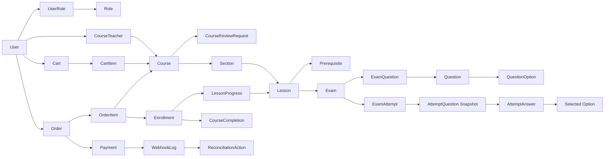
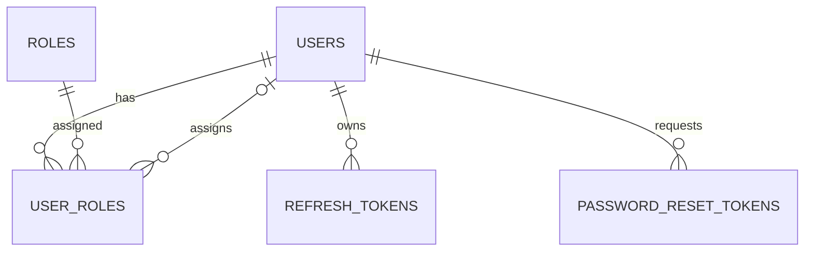
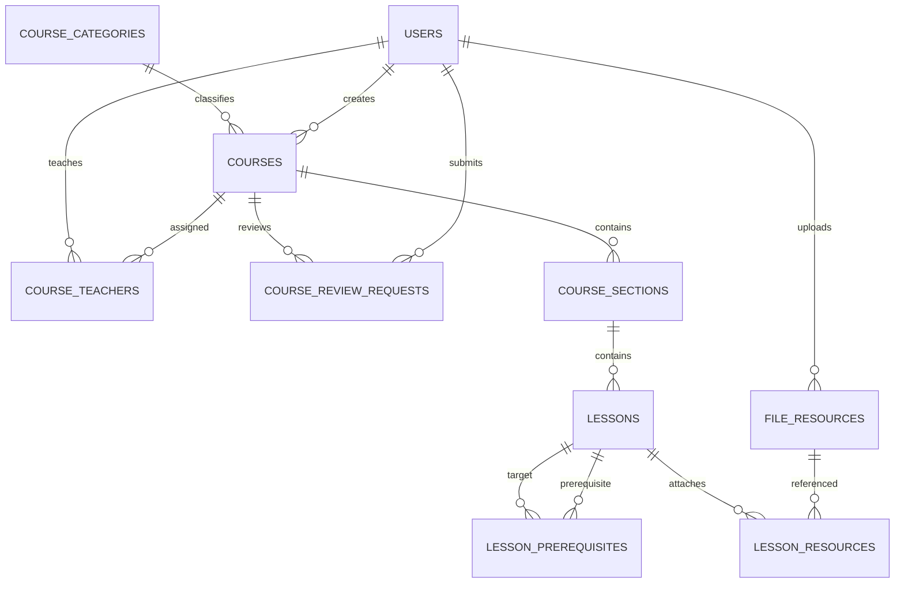
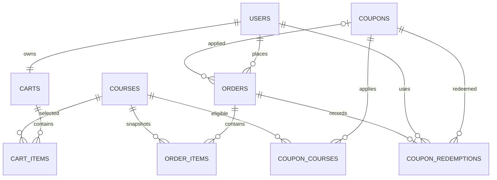
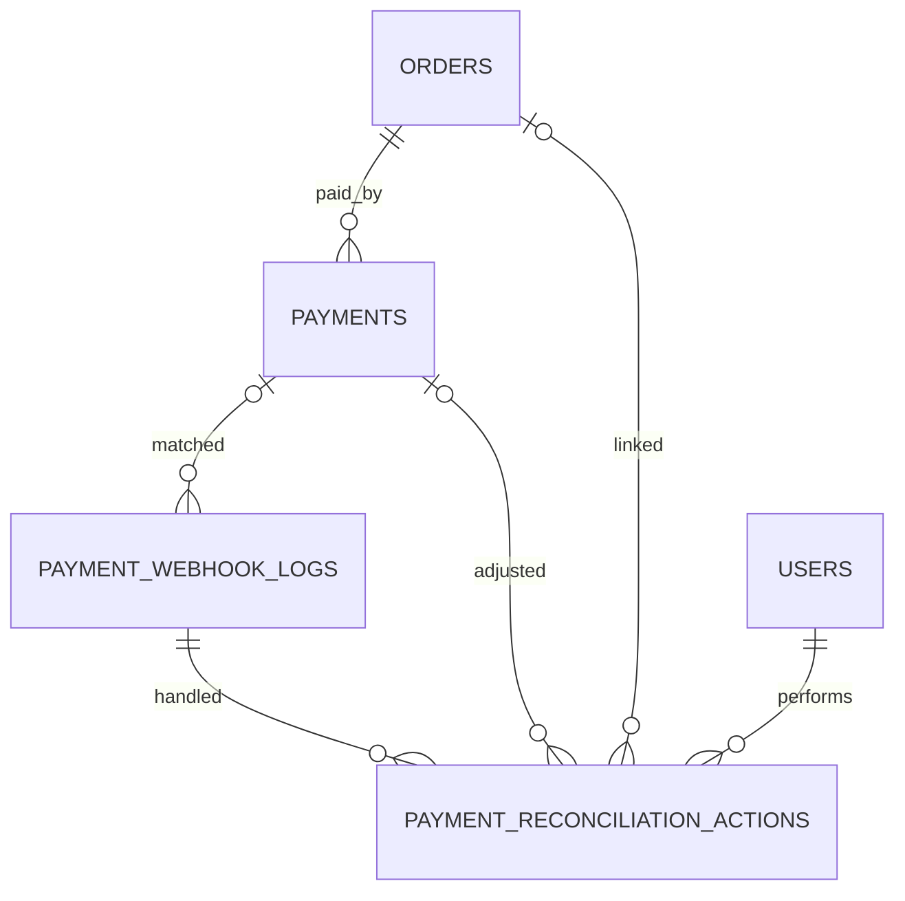
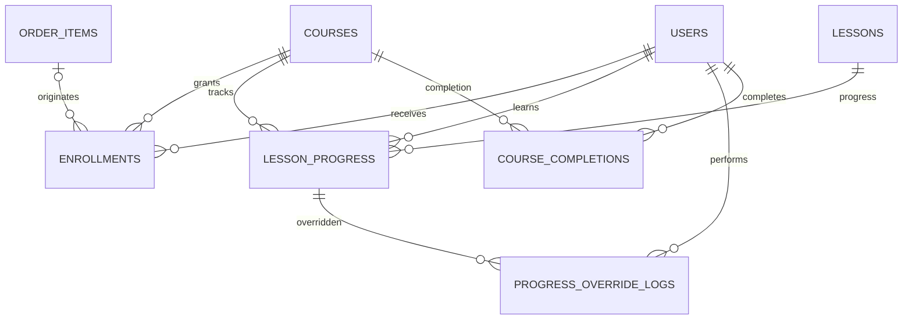
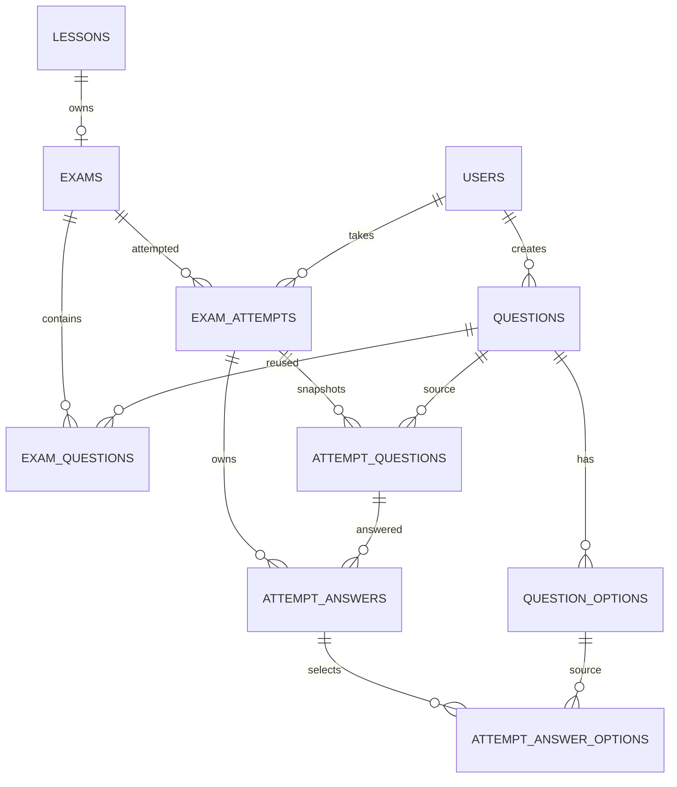
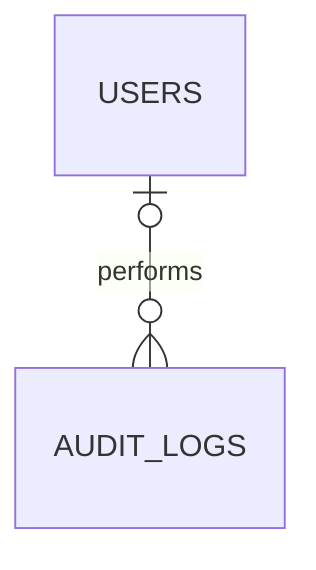

# ERD CHI TIẾT — MVP NÂNG CAO LMS

## Hệ thống học trực tuyến và kinh doanh khóa học

**Phiên bản:** 1.0  
**Ngày lập:** 06/08/2026  
**Database:** MySQL 8.x, InnoDB, UTF8MB4  
**ORM:** Spring Data JPA / Hibernate  
**Migration:** Flyway  
**Phạm vi:** 37 bảng theo đặc tả nghiệp vụ MVP nâng cao

---

# 1. Nguyên tắc thiết kế

- ERD bám theo các luồng Course Review, Commerce, Payment Reconciliation, Enrollment, Progress và Exam Attempt.
- Dùng `BIGINT UNSIGNED` cho khóa chính, `DECIMAL(12,2)` cho tiền và `DATETIME(6)` lưu UTC.
- Không xóa vật lý dữ liệu đã có giao dịch hoặc lịch sử học.
- `OrderItem` snapshot giá và tên Course tại thời điểm mua.
- `AttemptQuestion` snapshot đề thi để Question sửa sau đó không làm thay đổi Attempt đang diễn ra.
- `lesson_progress` dùng khóa nghiệp vụ `student_id + course_id + lesson_id`, không gắn cứng với một Enrollment lịch sử, đúng quyết định gia hạn trong đặc tả mới.
- Webhook log được lưu trước transaction nghiệp vụ để hỗ trợ idempotency và đối soát.
- AI chưa thuộc ERD MVP; Phase 2 có thể nối vào Course, Lesson, FileResource và Question.

# 2. Danh sách bảng

- **Identity và phân quyền:** `users`, `roles`, `user_roles`, `refresh_tokens`, `password_reset_tokens`
- **Course authoring:** `course_categories`, `courses`, `course_teachers`, `course_review_requests`, `course_sections`, `lessons`, `lesson_prerequisites`, `file_resources`, `lesson_resources`
- **Commerce:** `carts`, `cart_items`, `coupons`, `coupon_courses`, `orders`, `order_items`, `coupon_redemptions`
- **Payment và đối soát:** `payments`, `payment_webhook_logs`, `payment_reconciliation_actions`
- **Learning:** `enrollments`, `lesson_progress`, `progress_override_logs`, `course_completions`
- **Exam:** `exams`, `questions`, `question_options`, `exam_questions`, `exam_attempts`, `attempt_questions`, `attempt_answers`, `attempt_answer_options`
- **Supporting:** `audit_logs`

Tổng cộng: **37 bảng**.

---

# 3. Sơ đồ quan hệ tổng quát



---

# 4. Identity và phân quyền



## 4.1. `users`

| Cột | Kiểu dữ liệu | Ràng buộc | Ý nghĩa |
|---|---|---|---|
| `id` | BIGINT UNSIGNED | PK, AUTO_INCREMENT | Mã người dùng |
| `email` | VARCHAR(255) | UNIQUE, NOT NULL | Email đăng nhập |
| `password_hash` | VARCHAR(255) | NOT NULL | Mật khẩu hash |
| `full_name` | VARCHAR(255) | NOT NULL | Họ tên |
| `phone_number` | VARCHAR(20) | NULL | Số điện thoại |
| `avatar_url` | VARCHAR(500) | NULL | Ảnh đại diện |
| `status` | ENUM | NOT NULL, DEFAULT ACTIVE | ACTIVE/INACTIVE/BLOCKED |
| `email_verified` | BOOLEAN | NOT NULL, DEFAULT FALSE | Đã xác minh email |
| `last_login_at` | DATETIME(6) | NULL | Đăng nhập gần nhất |
| `version` | BIGINT | NOT NULL, DEFAULT 0 | Optimistic lock |
| `created_at` | DATETIME(6) | NOT NULL | Ngày tạo |
| `updated_at` | DATETIME(6) | NOT NULL | Ngày cập nhật |
## 4.2. `roles`

| Cột | Kiểu dữ liệu | Ràng buộc | Ý nghĩa |
|---|---|---|---|
| `id` | BIGINT UNSIGNED | PK, AUTO_INCREMENT | Mã role |
| `code` | VARCHAR(50) | UNIQUE, NOT NULL | ADMIN/TEACHER/STUDENT |
| `name` | VARCHAR(100) | NOT NULL | Tên role |
| `description` | VARCHAR(255) | NULL | Mô tả |
| `created_at` | DATETIME(6) | NOT NULL | Ngày tạo |
## 4.3. `user_roles`

| Cột | Kiểu dữ liệu | Ràng buộc | Ý nghĩa |
|---|---|---|---|
| `user_id` | BIGINT UNSIGNED | PK, FK → users.id | Người dùng |
| `role_id` | BIGINT UNSIGNED | PK, FK → roles.id | Vai trò |
| `assigned_by` | BIGINT UNSIGNED | FK → users.id, NULL | Admin gán |
| `assigned_at` | DATETIME(6) | NOT NULL | Thời điểm gán |

**Ràng buộc bổ sung**

```text
UNIQUE(user_id, role_id)
```
## 4.4. `refresh_tokens`

| Cột | Kiểu dữ liệu | Ràng buộc | Ý nghĩa |
|---|---|---|---|
| `id` | BIGINT UNSIGNED | PK, AUTO_INCREMENT | Mã token |
| `user_id` | BIGINT UNSIGNED | FK → users.id, NOT NULL | Chủ token |
| `token_hash` | VARCHAR(255) | UNIQUE, NOT NULL | Hash token |
| `family_id` | VARCHAR(64) | NULL, INDEX | Nhóm token rotation |
| `expires_at` | DATETIME(6) | NOT NULL, INDEX | Hết hạn |
| `revoked_at` | DATETIME(6) | NULL | Thu hồi |
| `revoked_reason` | VARCHAR(255) | NULL | Lý do |
| `created_at` | DATETIME(6) | NOT NULL | Ngày tạo |
## 4.5. `password_reset_tokens`

| Cột | Kiểu dữ liệu | Ràng buộc | Ý nghĩa |
|---|---|---|---|
| `id` | BIGINT UNSIGNED | PK, AUTO_INCREMENT | Mã |
| `user_id` | BIGINT UNSIGNED | FK → users.id, NOT NULL | Người dùng |
| `token_hash` | VARCHAR(255) | UNIQUE, NOT NULL | Token một lần |
| `expires_at` | DATETIME(6) | NOT NULL, INDEX | Hết hạn |
| `used_at` | DATETIME(6) | NULL | Đã sử dụng |
| `created_at` | DATETIME(6) | NOT NULL | Ngày tạo |
---

# 5. Course authoring



## 5.1. `course_categories`

| Cột | Kiểu dữ liệu | Ràng buộc | Ý nghĩa |
|---|---|---|---|
| `id` | BIGINT UNSIGNED | PK, AUTO_INCREMENT | Mã danh mục |
| `name` | VARCHAR(255) | NOT NULL | Tên |
| `slug` | VARCHAR(255) | UNIQUE, NOT NULL | Slug |
| `description` | TEXT | NULL | Mô tả |
| `active` | BOOLEAN | NOT NULL, DEFAULT TRUE | Hoạt động |
| `created_at` | DATETIME(6) | NOT NULL | Ngày tạo |
| `updated_at` | DATETIME(6) | NOT NULL | Ngày cập nhật |
## 5.2. `courses`

| Cột | Kiểu dữ liệu | Ràng buộc | Ý nghĩa |
|---|---|---|---|
| `id` | BIGINT UNSIGNED | PK, AUTO_INCREMENT | Mã khóa học |
| `category_id` | BIGINT UNSIGNED | FK → course_categories.id, NOT NULL | Danh mục |
| `created_by` | BIGINT UNSIGNED | FK → users.id, NOT NULL | Người tạo |
| `thumbnail_file_id` | BIGINT UNSIGNED | FK → file_resources.id, NULL | Ảnh đại diện |
| `title` | VARCHAR(255) | NOT NULL | Tên khóa học |
| `slug` | VARCHAR(255) | UNIQUE, NOT NULL | Slug |
| `short_description` | VARCHAR(500) | NULL | Mô tả ngắn |
| `description` | LONGTEXT | NULL | Mô tả chi tiết |
| `original_price` | DECIMAL(12,2) | NOT NULL, DEFAULT 0 | Giá gốc |
| `sale_price` | DECIMAL(12,2) | NOT NULL, DEFAULT 0 | Giá bán |
| `status` | ENUM | NOT NULL, DEFAULT DRAFT | DRAFT/PENDING_REVIEW/REJECTED/PUBLISHED/HIDDEN/ARCHIVED |
| `access_duration_days` | INT UNSIGNED | NULL | Số ngày học |
| `completion_rule` | ENUM | NOT NULL | Quy tắc hoàn thành |
| `published_at` | DATETIME(6) | NULL | Xuất bản |
| `hidden_at` | DATETIME(6) | NULL | Ẩn |
| `archived_at` | DATETIME(6) | NULL | Lưu trữ |
| `version` | BIGINT | NOT NULL, DEFAULT 0 | Optimistic lock |
| `created_at` | DATETIME(6) | NOT NULL | Ngày tạo |
| `updated_at` | DATETIME(6) | NOT NULL | Ngày cập nhật |
## 5.3. `course_teachers`

| Cột | Kiểu dữ liệu | Ràng buộc | Ý nghĩa |
|---|---|---|---|
| `course_id` | BIGINT UNSIGNED | PK, FK → courses.id | Khóa học |
| `teacher_id` | BIGINT UNSIGNED | PK, FK → users.id | Giáo viên |
| `is_primary` | BOOLEAN | NOT NULL, DEFAULT FALSE | Giáo viên chính |
| `active` | BOOLEAN | NOT NULL, DEFAULT TRUE | Đang phụ trách |
| `assigned_by` | BIGINT UNSIGNED | FK → users.id, NULL | Admin phân công |
| `assigned_at` | DATETIME(6) | NOT NULL | Ngày gán |
| `removed_at` | DATETIME(6) | NULL | Ngày thu hồi |

**Ràng buộc bổ sung**

```text
UNIQUE(course_id, teacher_id)
```
## 5.4. `course_review_requests`

| Cột | Kiểu dữ liệu | Ràng buộc | Ý nghĩa |
|---|---|---|---|
| `id` | BIGINT UNSIGNED | PK, AUTO_INCREMENT | Mã yêu cầu |
| `course_id` | BIGINT UNSIGNED | FK → courses.id, NOT NULL | Khóa học |
| `submitted_by` | BIGINT UNSIGNED | FK → users.id, NOT NULL | Người gửi |
| `reviewed_by` | BIGINT UNSIGNED | FK → users.id, NULL | Admin duyệt |
| `status` | ENUM | NOT NULL | PENDING/APPROVED/REJECTED/WITHDRAWN |
| `submission_note` | TEXT | NULL | Ghi chú gửi |
| `review_note` | TEXT | NULL | Lý do duyệt/từ chối |
| `submitted_at` | DATETIME(6) | NOT NULL | Gửi duyệt |
| `reviewed_at` | DATETIME(6) | NULL | Xử lý |
| `created_at` | DATETIME(6) | NOT NULL | Ngày tạo |
## 5.5. `course_sections`

| Cột | Kiểu dữ liệu | Ràng buộc | Ý nghĩa |
|---|---|---|---|
| `id` | BIGINT UNSIGNED | PK, AUTO_INCREMENT | Mã chương |
| `course_id` | BIGINT UNSIGNED | FK → courses.id, NOT NULL | Khóa học |
| `title` | VARCHAR(255) | NOT NULL | Tiêu đề |
| `description` | TEXT | NULL | Mô tả |
| `position` | INT UNSIGNED | NOT NULL | Thứ tự |
| `published` | BOOLEAN | NOT NULL, DEFAULT FALSE | Phát hành |
| `release_after_days` | INT UNSIGNED | NOT NULL, DEFAULT 0 | Drip content |
| `created_at` | DATETIME(6) | NOT NULL | Ngày tạo |
| `updated_at` | DATETIME(6) | NOT NULL | Ngày cập nhật |

**Ràng buộc bổ sung**

```text
UNIQUE(course_id, position)
```
## 5.6. `lessons`

| Cột | Kiểu dữ liệu | Ràng buộc | Ý nghĩa |
|---|---|---|---|
| `id` | BIGINT UNSIGNED | PK, AUTO_INCREMENT | Mã bài học |
| `section_id` | BIGINT UNSIGNED | FK → course_sections.id, NOT NULL | Chương |
| `video_file_id` | BIGINT UNSIGNED | FK → file_resources.id, NULL | Video |
| `title` | VARCHAR(255) | NOT NULL | Tên |
| `description` | TEXT | NULL | Mô tả |
| `lesson_type` | ENUM | NOT NULL | VIDEO/TEXT/DOCUMENT/EXAM |
| `content` | LONGTEXT | NULL | Nội dung |
| `duration_seconds` | INT UNSIGNED | NULL | Thời lượng |
| `position` | INT UNSIGNED | NOT NULL | Thứ tự |
| `preview` | BOOLEAN | NOT NULL, DEFAULT FALSE | Xem thử |
| `published` | BOOLEAN | NOT NULL, DEFAULT FALSE | Phát hành |
| `mandatory` | BOOLEAN | NOT NULL, DEFAULT TRUE | Bắt buộc |
| `completion_method` | ENUM | NOT NULL, DEFAULT MANUAL | MANUAL/VIEW_CONTENT/VIDEO_PERCENT/PASS_EXAM/SUBMIT_EXAM |
| `completion_threshold` | DECIMAL(5,2) | NULL | Ngưỡng hoàn thành |
| `created_at` | DATETIME(6) | NOT NULL | Ngày tạo |
| `updated_at` | DATETIME(6) | NOT NULL | Ngày cập nhật |

**Ràng buộc bổ sung**

```text
UNIQUE(section_id, position)
```
## 5.7. `lesson_prerequisites`

| Cột | Kiểu dữ liệu | Ràng buộc | Ý nghĩa |
|---|---|---|---|
| `id` | BIGINT UNSIGNED | PK, AUTO_INCREMENT | Mã |
| `lesson_id` | BIGINT UNSIGNED | UNIQUE, FK → lessons.id | Lesson bị khóa |
| `prerequisite_lesson_id` | BIGINT UNSIGNED | FK → lessons.id, NULL | Lesson yêu cầu |
| `prerequisite_exam_id` | BIGINT UNSIGNED | FK → exams.id, NULL | Exam yêu cầu |
| `condition_type` | ENUM | NOT NULL | COMPLETE_LESSON/PASS_EXAM |
| `created_at` | DATETIME(6) | NOT NULL | Ngày tạo |
## 5.8. `file_resources`

| Cột | Kiểu dữ liệu | Ràng buộc | Ý nghĩa |
|---|---|---|---|
| `id` | BIGINT UNSIGNED | PK, AUTO_INCREMENT | Mã file |
| `uploaded_by` | BIGINT UNSIGNED | FK → users.id, NOT NULL | Người upload |
| `original_name` | VARCHAR(255) | NOT NULL | Tên file |
| `object_key` | VARCHAR(500) | UNIQUE, NOT NULL | Object key |
| `mime_type` | VARCHAR(100) | NOT NULL | MIME |
| `file_size` | BIGINT UNSIGNED | NOT NULL | Dung lượng |
| `storage_provider` | ENUM | NOT NULL | MINIO/S3/R2 |
| `status` | ENUM | NOT NULL, DEFAULT READY | PENDING/READY/FAILED/DELETED |
| `checksum` | VARCHAR(128) | NULL, INDEX | Checksum |
| `created_at` | DATETIME(6) | NOT NULL | Ngày tạo |
| `deleted_at` | DATETIME(6) | NULL | Xóa logic |
## 5.9. `lesson_resources`

| Cột | Kiểu dữ liệu | Ràng buộc | Ý nghĩa |
|---|---|---|---|
| `id` | BIGINT UNSIGNED | PK, AUTO_INCREMENT | Mã |
| `lesson_id` | BIGINT UNSIGNED | FK → lessons.id, NOT NULL | Bài học |
| `file_id` | BIGINT UNSIGNED | FK → file_resources.id, NOT NULL | File |
| `title` | VARCHAR(255) | NOT NULL | Tên hiển thị |
| `resource_type` | ENUM | NOT NULL | PDF/SLIDE/IMAGE/DOCUMENT/ATTACHMENT |
| `downloadable` | BOOLEAN | NOT NULL, DEFAULT TRUE | Cho tải |
| `position` | INT UNSIGNED | NOT NULL | Thứ tự |
| `created_at` | DATETIME(6) | NOT NULL | Ngày tạo |

**Ràng buộc bổ sung**

```text
UNIQUE(lesson_id, file_id)
UNIQUE(lesson_id, position)
```
---

# 6. Commerce



## 6.1. `carts`

| Cột | Kiểu dữ liệu | Ràng buộc | Ý nghĩa |
|---|---|---|---|
| `id` | BIGINT UNSIGNED | PK, AUTO_INCREMENT | Mã giỏ |
| `user_id` | BIGINT UNSIGNED | UNIQUE, FK → users.id | Chủ giỏ |
| `created_at` | DATETIME(6) | NOT NULL | Ngày tạo |
| `updated_at` | DATETIME(6) | NOT NULL | Ngày cập nhật |
## 6.2. `cart_items`

| Cột | Kiểu dữ liệu | Ràng buộc | Ý nghĩa |
|---|---|---|---|
| `id` | BIGINT UNSIGNED | PK, AUTO_INCREMENT | Mã item |
| `cart_id` | BIGINT UNSIGNED | FK → carts.id, NOT NULL | Giỏ |
| `course_id` | BIGINT UNSIGNED | FK → courses.id, NOT NULL | Khóa học |
| `added_at` | DATETIME(6) | NOT NULL | Ngày thêm |

**Ràng buộc bổ sung**

```text
UNIQUE(cart_id, course_id)
```
## 6.3. `coupons`

| Cột | Kiểu dữ liệu | Ràng buộc | Ý nghĩa |
|---|---|---|---|
| `id` | BIGINT UNSIGNED | PK, AUTO_INCREMENT | Mã |
| `code` | VARCHAR(50) | UNIQUE, NOT NULL | Mã coupon |
| `name` | VARCHAR(255) | NOT NULL | Tên |
| `discount_type` | ENUM | NOT NULL | PERCENTAGE/FIXED_AMOUNT |
| `discount_value` | DECIMAL(12,2) | NOT NULL | Giá trị |
| `minimum_order_amount` | DECIMAL(12,2) | NOT NULL, DEFAULT 0 | Đơn tối thiểu |
| `maximum_discount_amount` | DECIMAL(12,2) | NULL | Trần giảm |
| `total_usage_limit` | INT UNSIGNED | NULL | Tổng lượt |
| `per_user_limit` | INT UNSIGNED | NULL | Lượt/user |
| `used_count` | INT UNSIGNED | NOT NULL, DEFAULT 0 | Đã dùng |
| `scope` | ENUM | NOT NULL | ALL_COURSES/SPECIFIC_COURSES |
| `starts_at` | DATETIME(6) | NOT NULL | Bắt đầu |
| `ends_at` | DATETIME(6) | NOT NULL | Kết thúc |
| `status` | ENUM | NOT NULL, DEFAULT ACTIVE | ACTIVE/INACTIVE |
| `version` | BIGINT | NOT NULL, DEFAULT 0 | Lock quota |
| `created_at` | DATETIME(6) | NOT NULL | Ngày tạo |
| `updated_at` | DATETIME(6) | NOT NULL | Ngày cập nhật |
## 6.4. `coupon_courses`

| Cột | Kiểu dữ liệu | Ràng buộc | Ý nghĩa |
|---|---|---|---|
| `coupon_id` | BIGINT UNSIGNED | PK, FK → coupons.id | Coupon |
| `course_id` | BIGINT UNSIGNED | PK, FK → courses.id | Khóa học |
| `created_at` | DATETIME(6) | NOT NULL | Ngày tạo |

**Ràng buộc bổ sung**

```text
UNIQUE(coupon_id, course_id)
```
## 6.5. `orders`

| Cột | Kiểu dữ liệu | Ràng buộc | Ý nghĩa |
|---|---|---|---|
| `id` | BIGINT UNSIGNED | PK, AUTO_INCREMENT | Mã đơn |
| `code` | VARCHAR(50) | UNIQUE, NOT NULL | Mã hiển thị |
| `user_id` | BIGINT UNSIGNED | FK → users.id, NOT NULL | Người mua |
| `coupon_id` | BIGINT UNSIGNED | FK → coupons.id, NULL | Coupon |
| `coupon_code` | VARCHAR(50) | NULL | Snapshot mã |
| `subtotal` | DECIMAL(12,2) | NOT NULL | Tổng trước giảm |
| `discount_amount` | DECIMAL(12,2) | NOT NULL, DEFAULT 0 | Tiền giảm |
| `total_amount` | DECIMAL(12,2) | NOT NULL | Phải trả |
| `status` | ENUM | NOT NULL | PENDING_PAYMENT/PAID/CANCELLED/EXPIRED |
| `expires_at` | DATETIME(6) | NOT NULL, INDEX | Hạn trả |
| `paid_at` | DATETIME(6) | NULL | Đã trả |
| `cancelled_at` | DATETIME(6) | NULL | Hủy |
| `version` | BIGINT | NOT NULL, DEFAULT 0 | Lock |
| `created_at` | DATETIME(6) | NOT NULL | Ngày tạo |
| `updated_at` | DATETIME(6) | NOT NULL | Ngày cập nhật |
## 6.6. `order_items`

| Cột | Kiểu dữ liệu | Ràng buộc | Ý nghĩa |
|---|---|---|---|
| `id` | BIGINT UNSIGNED | PK, AUTO_INCREMENT | Mã item |
| `order_id` | BIGINT UNSIGNED | FK → orders.id, NOT NULL | Đơn |
| `course_id` | BIGINT UNSIGNED | FK → courses.id, NOT NULL | Khóa học nguồn |
| `course_title` | VARCHAR(255) | NOT NULL | Snapshot tên |
| `original_price` | DECIMAL(12,2) | NOT NULL | Snapshot giá |
| `discount_amount` | DECIMAL(12,2) | NOT NULL, DEFAULT 0 | Tiền giảm |
| `final_price` | DECIMAL(12,2) | NOT NULL | Giá cuối |
| `access_duration_days` | INT UNSIGNED | NULL | Snapshot thời hạn |
| `created_at` | DATETIME(6) | NOT NULL | Ngày tạo |

**Ràng buộc bổ sung**

```text
UNIQUE(order_id, course_id)
```
## 6.7. `coupon_redemptions`

| Cột | Kiểu dữ liệu | Ràng buộc | Ý nghĩa |
|---|---|---|---|
| `id` | BIGINT UNSIGNED | PK, AUTO_INCREMENT | Mã |
| `coupon_id` | BIGINT UNSIGNED | FK → coupons.id, NOT NULL | Coupon |
| `user_id` | BIGINT UNSIGNED | FK → users.id, NOT NULL | Người dùng |
| `order_id` | BIGINT UNSIGNED | UNIQUE, FK → orders.id | Đơn |
| `discount_amount` | DECIMAL(12,2) | NOT NULL | Tiền đã giảm |
| `redeemed_at` | DATETIME(6) | NOT NULL | Ngày dùng |
---

# 7. Payment và đối soát



## 7.1. `payments`

| Cột | Kiểu dữ liệu | Ràng buộc | Ý nghĩa |
|---|---|---|---|
| `id` | BIGINT UNSIGNED | PK, AUTO_INCREMENT | Mã payment |
| `order_id` | BIGINT UNSIGNED | FK → orders.id, NOT NULL | Đơn |
| `provider` | ENUM | NOT NULL | SEPAY/MANUAL |
| `method` | ENUM | NOT NULL | BANK_QR/BANK_TRANSFER |
| `expected_amount` | DECIMAL(12,2) | NOT NULL | Số tiền cần |
| `received_amount` | DECIMAL(12,2) | NULL | Thực nhận |
| `status` | ENUM | NOT NULL | PENDING/PAID/REVIEW_REQUIRED/FAILED/CANCELLED |
| `payment_reference` | VARCHAR(100) | UNIQUE, NOT NULL | Nội dung CK |
| `provider_transaction_id` | VARCHAR(255) | NULL | Mã giao dịch |
| `qr_content` | TEXT | NULL | QR payload |
| `paid_at` | DATETIME(6) | NULL | Thành công |
| `review_reason` | VARCHAR(500) | NULL | Lý do review |
| `failed_reason` | VARCHAR(500) | NULL | Lỗi |
| `version` | BIGINT | NOT NULL, DEFAULT 0 | Concurrency |
| `created_at` | DATETIME(6) | NOT NULL | Ngày tạo |
| `updated_at` | DATETIME(6) | NOT NULL | Ngày cập nhật |

**Ràng buộc bổ sung**

```text
UNIQUE(provider, provider_transaction_id)
```
## 7.2. `payment_webhook_logs`

| Cột | Kiểu dữ liệu | Ràng buộc | Ý nghĩa |
|---|---|---|---|
| `id` | BIGINT UNSIGNED | PK, AUTO_INCREMENT | Mã log |
| `payment_id` | BIGINT UNSIGNED | FK → payments.id, NULL | Payment matched |
| `provider` | ENUM | NOT NULL | Provider |
| `provider_event_id` | VARCHAR(255) | NULL | Event id |
| `provider_transaction_id` | VARCHAR(255) | NULL | Transaction id |
| `payment_reference` | VARCHAR(100) | NULL, INDEX | Reference |
| `received_amount` | DECIMAL(12,2) | NULL | Số tiền |
| `payload` | LONGTEXT | NOT NULL | Raw webhook |
| `signature` | VARCHAR(500) | NULL | Chữ ký |
| `valid_signature` | BOOLEAN | NOT NULL, DEFAULT FALSE | Hợp lệ |
| `processing_status` | ENUM | NOT NULL | RECEIVED/VALIDATED/MATCHED/PROCESSED/DUPLICATE/UNMATCHED/FAILED |
| `error_message` | TEXT | NULL | Lỗi |
| `received_at` | DATETIME(6) | NOT NULL, INDEX | Nhận |
| `processed_at` | DATETIME(6) | NULL | Xử lý |

**Ràng buộc bổ sung**

```text
UNIQUE(provider, provider_event_id)
```
## 7.3. `payment_reconciliation_actions`

| Cột | Kiểu dữ liệu | Ràng buộc | Ý nghĩa |
|---|---|---|---|
| `id` | BIGINT UNSIGNED | PK, AUTO_INCREMENT | Mã thao tác |
| `webhook_log_id` | BIGINT UNSIGNED | FK → payment_webhook_logs.id, NOT NULL | Webhook |
| `payment_id` | BIGINT UNSIGNED | FK → payments.id, NULL | Payment |
| `order_id` | BIGINT UNSIGNED | FK → orders.id, NULL | Order |
| `performed_by` | BIGINT UNSIGNED | FK → users.id, NOT NULL | Admin |
| `action_type` | ENUM | NOT NULL | MATCH/APPROVE/REJECT/UNMATCH |
| `previous_status` | VARCHAR(50) | NULL | Trạng thái cũ |
| `new_status` | VARCHAR(50) | NULL | Trạng thái mới |
| `note` | TEXT | NOT NULL | Lý do |
| `created_at` | DATETIME(6) | NOT NULL | Ngày thao tác |
---

# 8. Learning



## 8.1. `enrollments`

| Cột | Kiểu dữ liệu | Ràng buộc | Ý nghĩa |
|---|---|---|---|
| `id` | BIGINT UNSIGNED | PK, AUTO_INCREMENT | Mã enrollment |
| `student_id` | BIGINT UNSIGNED | FK → users.id, NOT NULL | Học viên |
| `course_id` | BIGINT UNSIGNED | FK → courses.id, NOT NULL | Khóa học |
| `order_item_id` | BIGINT UNSIGNED | FK → order_items.id, NULL | Nguồn mua |
| `source` | ENUM | NOT NULL | PURCHASE/ADMIN_GRANTED/RENEWAL |
| `status` | ENUM | NOT NULL | PENDING/ACTIVE/EXPIRED/REVOKED |
| `starts_at` | DATETIME(6) | NOT NULL | Bắt đầu |
| `expires_at` | DATETIME(6) | NULL | Hết hạn |
| `revoked_at` | DATETIME(6) | NULL | Thu hồi |
| `revoked_by` | BIGINT UNSIGNED | FK → users.id, NULL | Người thu hồi |
| `revoked_reason` | VARCHAR(500) | NULL | Lý do |
| `created_at` | DATETIME(6) | NOT NULL | Ngày tạo |
| `updated_at` | DATETIME(6) | NOT NULL | Ngày cập nhật |
## 8.2. `lesson_progress`

| Cột | Kiểu dữ liệu | Ràng buộc | Ý nghĩa |
|---|---|---|---|
| `id` | BIGINT UNSIGNED | PK, AUTO_INCREMENT | Mã progress |
| `student_id` | BIGINT UNSIGNED | FK → users.id, NOT NULL | Học viên |
| `course_id` | BIGINT UNSIGNED | FK → courses.id, NOT NULL | Khóa học |
| `lesson_id` | BIGINT UNSIGNED | FK → lessons.id, NOT NULL | Bài học |
| `status` | ENUM | NOT NULL | NOT_STARTED/IN_PROGRESS/COMPLETED |
| `watched_seconds` | INT UNSIGNED | NOT NULL, DEFAULT 0 | Mốc xem |
| `progress_percent` | DECIMAL(5,2) | NOT NULL, DEFAULT 0 | Phần trăm |
| `completion_source` | ENUM | NULL | Nguồn hoàn thành |
| `first_accessed_at` | DATETIME(6) | NULL | Lần đầu |
| `last_accessed_at` | DATETIME(6) | NULL | Gần nhất |
| `completed_at` | DATETIME(6) | NULL | Hoàn thành |
| `version` | BIGINT | NOT NULL, DEFAULT 0 | Heartbeat lock |
| `created_at` | DATETIME(6) | NOT NULL | Ngày tạo |
| `updated_at` | DATETIME(6) | NOT NULL | Ngày cập nhật |

**Ràng buộc bổ sung**

```text
UNIQUE(student_id, course_id, lesson_id)
```
## 8.3. `progress_override_logs`

| Cột | Kiểu dữ liệu | Ràng buộc | Ý nghĩa |
|---|---|---|---|
| `id` | BIGINT UNSIGNED | PK, AUTO_INCREMENT | Mã |
| `lesson_progress_id` | BIGINT UNSIGNED | FK → lesson_progress.id, NOT NULL | Progress |
| `performed_by` | BIGINT UNSIGNED | FK → users.id, NOT NULL | Teacher/Admin |
| `previous_status` | ENUM | NOT NULL | Trạng thái cũ |
| `new_status` | ENUM | NOT NULL | Trạng thái mới |
| `previous_percent` | DECIMAL(5,2) | NOT NULL | % cũ |
| `new_percent` | DECIMAL(5,2) | NOT NULL | % mới |
| `reason` | VARCHAR(500) | NOT NULL | Lý do |
| `created_at` | DATETIME(6) | NOT NULL | Ngày |
## 8.4. `course_completions`

| Cột | Kiểu dữ liệu | Ràng buộc | Ý nghĩa |
|---|---|---|---|
| `id` | BIGINT UNSIGNED | PK, AUTO_INCREMENT | Mã |
| `student_id` | BIGINT UNSIGNED | FK → users.id, NOT NULL | Học viên |
| `course_id` | BIGINT UNSIGNED | FK → courses.id, NOT NULL | Khóa học |
| `completion_rule` | ENUM | NOT NULL | Snapshot rule |
| `progress_percent_snapshot` | DECIMAL(5,2) | NOT NULL | % tại thời điểm |
| `mandatory_lessons_snapshot` | INT UNSIGNED | NOT NULL | Tổng bắt buộc |
| `completed_lessons_snapshot` | INT UNSIGNED | NOT NULL | Đã xong |
| `completed_at` | DATETIME(6) | NOT NULL | Hoàn thành |
| `created_by` | BIGINT UNSIGNED | FK → users.id, NULL | Null nếu system |
| `created_at` | DATETIME(6) | NOT NULL | Ngày tạo |

**Ràng buộc bổ sung**

```text
UNIQUE(student_id, course_id)
```
---

# 9. Exam



## 9.1. `exams`

| Cột | Kiểu dữ liệu | Ràng buộc | Ý nghĩa |
|---|---|---|---|
| `id` | BIGINT UNSIGNED | PK, AUTO_INCREMENT | Mã exam |
| `lesson_id` | BIGINT UNSIGNED | UNIQUE, FK → lessons.id | Lesson EXAM |
| `title` | VARCHAR(255) | NOT NULL | Tên |
| `description` | TEXT | NULL | Mô tả |
| `duration_minutes` | INT UNSIGNED | NOT NULL | Thời gian |
| `passing_score` | DECIMAL(5,2) | NOT NULL | Điểm đạt |
| `maximum_attempts` | INT UNSIGNED | NULL | Số lần tối đa |
| `shuffle_questions` | BOOLEAN | NOT NULL, DEFAULT FALSE | Xáo câu |
| `shuffle_options` | BOOLEAN | NOT NULL, DEFAULT FALSE | Xáo đáp án |
| `result_display_mode` | ENUM | NOT NULL | Chế độ hiển thị |
| `start_at` | DATETIME(6) | NULL | Mở |
| `end_at` | DATETIME(6) | NULL | Đóng |
| `status` | ENUM | NOT NULL | DRAFT/PUBLISHED/CLOSED |
| `created_by` | BIGINT UNSIGNED | FK → users.id, NOT NULL | Teacher |
| `created_at` | DATETIME(6) | NOT NULL | Ngày tạo |
| `updated_at` | DATETIME(6) | NOT NULL | Ngày cập nhật |
## 9.2. `questions`

| Cột | Kiểu dữ liệu | Ràng buộc | Ý nghĩa |
|---|---|---|---|
| `id` | BIGINT UNSIGNED | PK, AUTO_INCREMENT | Mã câu |
| `course_id` | BIGINT UNSIGNED | FK → courses.id, NOT NULL | Phạm vi Course |
| `content` | TEXT | NOT NULL | Nội dung |
| `question_type` | ENUM | NOT NULL | SINGLE_CHOICE/MULTIPLE_CHOICE |
| `difficulty` | ENUM | NOT NULL | EASY/MEDIUM/HARD |
| `explanation` | TEXT | NULL | Giải thích |
| `active` | BOOLEAN | NOT NULL, DEFAULT TRUE | Hoạt động |
| `created_by` | BIGINT UNSIGNED | FK → users.id, NOT NULL | Người tạo |
| `version` | INT UNSIGNED | NOT NULL, DEFAULT 1 | Version |
| `created_at` | DATETIME(6) | NOT NULL | Ngày tạo |
| `updated_at` | DATETIME(6) | NOT NULL | Ngày cập nhật |
## 9.3. `question_options`

| Cột | Kiểu dữ liệu | Ràng buộc | Ý nghĩa |
|---|---|---|---|
| `id` | BIGINT UNSIGNED | PK, AUTO_INCREMENT | Mã option |
| `question_id` | BIGINT UNSIGNED | FK → questions.id, NOT NULL | Question |
| `content` | TEXT | NOT NULL | Nội dung |
| `correct` | BOOLEAN | NOT NULL, DEFAULT FALSE | Đúng |
| `position` | INT UNSIGNED | NOT NULL | Thứ tự |
| `created_at` | DATETIME(6) | NOT NULL | Ngày tạo |
| `updated_at` | DATETIME(6) | NOT NULL | Ngày cập nhật |

**Ràng buộc bổ sung**

```text
UNIQUE(question_id, position)
```
## 9.4. `exam_questions`

| Cột | Kiểu dữ liệu | Ràng buộc | Ý nghĩa |
|---|---|---|---|
| `exam_id` | BIGINT UNSIGNED | PK, FK → exams.id | Exam |
| `question_id` | BIGINT UNSIGNED | PK, FK → questions.id | Question |
| `position` | INT UNSIGNED | NOT NULL | Thứ tự |
| `score` | DECIMAL(7,2) | NOT NULL | Trọng số |
| `required` | BOOLEAN | NOT NULL, DEFAULT TRUE | Bắt buộc |
| `created_at` | DATETIME(6) | NOT NULL | Ngày thêm |

**Ràng buộc bổ sung**

```text
UNIQUE(exam_id, question_id)
UNIQUE(exam_id, position)
```
## 9.5. `exam_attempts`

| Cột | Kiểu dữ liệu | Ràng buộc | Ý nghĩa |
|---|---|---|---|
| `id` | BIGINT UNSIGNED | PK, AUTO_INCREMENT | Mã attempt |
| `exam_id` | BIGINT UNSIGNED | FK → exams.id, NOT NULL | Exam |
| `student_id` | BIGINT UNSIGNED | FK → users.id, NOT NULL | Student |
| `enrollment_id` | BIGINT UNSIGNED | FK → enrollments.id, NOT NULL | Enrollment lúc thi |
| `attempt_number` | INT UNSIGNED | NOT NULL | Lần thứ |
| `status` | ENUM | NOT NULL | IN_PROGRESS/SUBMITTED/EXPIRED/GRADED |
| `submission_type` | ENUM | NULL | MANUAL/AUTO_EXPIRED |
| `started_at` | DATETIME(6) | NOT NULL | Bắt đầu |
| `expires_at` | DATETIME(6) | NOT NULL, INDEX | Hết giờ |
| `submitted_at` | DATETIME(6) | NULL | Nộp |
| `graded_at` | DATETIME(6) | NULL | Chấm |
| `score` | DECIMAL(7,2) | NULL | Điểm % |
| `maximum_score` | DECIMAL(7,2) | NOT NULL | Tổng điểm snapshot |
| `passing_score` | DECIMAL(5,2) | NOT NULL | Điểm đạt snapshot |
| `passed` | BOOLEAN | NULL | Kết quả |
| `version` | BIGINT | NOT NULL, DEFAULT 0 | Autosave lock |
| `created_at` | DATETIME(6) | NOT NULL | Ngày tạo |

**Ràng buộc bổ sung**

```text
UNIQUE(exam_id, student_id, attempt_number)
```
## 9.6. `attempt_questions`

| Cột | Kiểu dữ liệu | Ràng buộc | Ý nghĩa |
|---|---|---|---|
| `id` | BIGINT UNSIGNED | PK, AUTO_INCREMENT | Mã snapshot |
| `attempt_id` | BIGINT UNSIGNED | FK → exam_attempts.id, NOT NULL | Attempt |
| `source_question_id` | BIGINT UNSIGNED | FK → questions.id, NOT NULL | Question nguồn |
| `question_type` | ENUM | NOT NULL | Loại snapshot |
| `content_snapshot` | TEXT | NOT NULL | Nội dung snapshot |
| `explanation_snapshot` | TEXT | NULL | Giải thích snapshot |
| `position` | INT UNSIGNED | NOT NULL | Thứ tự |
| `maximum_score` | DECIMAL(7,2) | NOT NULL | Điểm tối đa |
| `option_snapshot_json` | JSON | NOT NULL | Option + correct snapshot |
| `created_at` | DATETIME(6) | NOT NULL | Ngày tạo |

**Ràng buộc bổ sung**

```text
UNIQUE(attempt_id, position)
UNIQUE(attempt_id, source_question_id)
```
## 9.7. `attempt_answers`

| Cột | Kiểu dữ liệu | Ràng buộc | Ý nghĩa |
|---|---|---|---|
| `id` | BIGINT UNSIGNED | PK, AUTO_INCREMENT | Mã answer |
| `attempt_id` | BIGINT UNSIGNED | FK → exam_attempts.id, NOT NULL | Attempt |
| `attempt_question_id` | BIGINT UNSIGNED | FK → attempt_questions.id, NOT NULL | Snapshot câu |
| `correct` | BOOLEAN | NULL | Đúng/sai |
| `score_awarded` | DECIMAL(7,2) | NULL | Điểm nhận |
| `answered_at` | DATETIME(6) | NULL | Lần lưu cuối |
| `created_at` | DATETIME(6) | NOT NULL | Ngày tạo |
| `updated_at` | DATETIME(6) | NOT NULL | Ngày cập nhật |

**Ràng buộc bổ sung**

```text
UNIQUE(attempt_id, attempt_question_id)
```
## 9.8. `attempt_answer_options`

| Cột | Kiểu dữ liệu | Ràng buộc | Ý nghĩa |
|---|---|---|---|
| `attempt_answer_id` | BIGINT UNSIGNED | PK, FK → attempt_answers.id | Answer |
| `option_id` | BIGINT UNSIGNED | PK, FK → question_options.id | Option nguồn |
| `option_content_snapshot` | TEXT | NOT NULL | Nội dung snapshot |
| `selected_at` | DATETIME(6) | NOT NULL | Thời điểm chọn |

**Ràng buộc bổ sung**

```text
UNIQUE(attempt_answer_id, option_id)
```
---

# 10. Supporting



## 10.1. `audit_logs`

| Cột | Kiểu dữ liệu | Ràng buộc | Ý nghĩa |
|---|---|---|---|
| `id` | BIGINT UNSIGNED | PK, AUTO_INCREMENT | Mã log |
| `actor_user_id` | BIGINT UNSIGNED | FK → users.id, NULL | Null nếu system |
| `action` | VARCHAR(100) | NOT NULL, INDEX | Hành động |
| `entity_type` | VARCHAR(100) | NOT NULL, INDEX | Loại entity |
| `entity_id` | BIGINT UNSIGNED | NULL, INDEX | Mã entity |
| `old_value` | JSON | NULL | Trước |
| `new_value` | JSON | NULL | Sau |
| `reason` | VARCHAR(500) | NULL | Lý do |
| `ip_address` | VARCHAR(45) | NULL | IP |
| `user_agent` | VARCHAR(500) | NULL | Client |
| `created_at` | DATETIME(6) | NOT NULL, INDEX | Thời điểm |

---

# 11. Quan hệ và cardinality quan trọng

| Quan hệ | Cardinality | Ý nghĩa |
|---|---|---|
| User – Role | N–N | Qua `user_roles`; một User có thể vừa Teacher vừa Student |
| User – Course | N–N | Qua `course_teachers`; dùng cho ownership authorization |
| Course – Section | 1–N | Một khóa học có nhiều chương |
| Section – Lesson | 1–N | Một chương có nhiều bài |
| Lesson – Lesson | 0..1 prerequisite | MVP cho tối đa một điều kiện tiên quyết trực tiếp |
| Lesson – FileResource | N–N | Qua `lesson_resources`; video chính dùng FK riêng |
| User – Cart | 1–1 | Một giỏ hoạt động |
| Cart – Course | N–N | Qua `cart_items` |
| Coupon – Course | N–N | Chỉ khi scope là `SPECIFIC_COURSES` |
| User – Order | 1–N | Người mua có nhiều đơn |
| Order – Course | N–N | Qua `order_items`, có snapshot |
| Order – Payment | 1–N | Cho phép lịch sử retry, chỉ một Payment active bằng business rule |
| Payment – WebhookLog | 1–N optional | Webhook unmatched có `payment_id = NULL` |
| OrderItem – Enrollment | 1–0..N | Có thể tạo lịch sử enrollment khi renewal |
| User – Course – Lesson | Quan hệ ba ngôi | Biểu diễn bởi `lesson_progress` |
| Lesson – Exam | 1–0..1 | Lesson kiểu EXAM có tối đa một Exam |
| Exam – Question | N–N | Qua `exam_questions` |
| Exam – Attempt | 1–N | Student có nhiều lượt |
| Attempt – AttemptQuestion | 1–N | Snapshot đề thi |
| AttemptQuestion – AttemptAnswer | 1–0..1 | Mỗi câu có tối đa một answer |
| AttemptAnswer – Option | N–N | Qua `attempt_answer_options` |

---

# 12. Delete rule đề xuất

- `CASCADE` chỉ dùng cho dữ liệu phụ chưa phát sinh lịch sử, ví dụ CartItem hoặc dữ liệu snapshot trong môi trường test.
- `RESTRICT` cho Course, Order, Payment, Enrollment, Question, ExamAttempt và các bảng lịch sử.
- `SET NULL` cho `payment_webhook_logs.payment_id` và `audit_logs.actor_user_id` khi đối tượng nguồn không còn.
- Production ưu tiên soft delete hoặc chuyển trạng thái `ARCHIVED`, `INACTIVE`, `REVOKED`.

---

# 13. Index phục vụ truy vấn

```text
-- Catalog
INDEX courses(status, category_id, published_at)
INDEX courses(status, sale_price)
INDEX course_sections(course_id, position)
INDEX lessons(section_id, position)

-- Authorization và learning
INDEX course_teachers(teacher_id, active, course_id)
INDEX enrollments(student_id, course_id, status)
INDEX enrollments(status, expires_at)
INDEX lesson_progress(student_id, course_id, status)
INDEX lesson_progress(student_id, last_accessed_at)

-- Commerce và payment
INDEX orders(user_id, created_at)
INDEX orders(status, expires_at)
INDEX payments(order_id, status)
INDEX payment_webhook_logs(processing_status, received_at)
INDEX payment_webhook_logs(provider, provider_transaction_id)

-- Exam
INDEX exam_attempts(exam_id, student_id, attempt_number)
INDEX exam_attempts(status, expires_at)
INDEX attempt_questions(attempt_id, position)
INDEX attempt_answers(attempt_id, attempt_question_id)

-- Reporting
INDEX payments(status, paid_at)
INDEX enrollments(course_id, status)
INDEX course_completions(course_id, completed_at)
```

---

# 14. Transaction boundary

## Checkout

```text
Validate Cart
→ Validate Course và Enrollment hiện tại
→ Validate Coupon
→ Create Order
→ Create OrderItems snapshot
→ Create Payment
```

Không tăng `coupon.used_count` tại checkout.

## Webhook thanh toán thành công

```text
Lock Payment/Order
→ Re-check idempotency
→ Payment = PAID
→ Order = PAID
→ Create Enrollment cho từng OrderItem
→ Create CouponRedemption
→ Increment Coupon.used_count
```

## Bắt đầu ExamAttempt

```text
Validate Enrollment
→ Validate drip/prerequisite
→ Validate attempt limit
→ Create ExamAttempt
→ Snapshot Question và Option
```

## Submit ExamAttempt

```text
Lock Attempt
→ Chặn autosave mới
→ Chấm từng AttemptQuestion
→ Update AttemptAnswer
→ Update score/pass
→ Update LessonProgress
→ Recalculate CourseCompletion
```

---

# 15. Các điểm cần chốt trước migration

1. `course_completions` lưu một lần hay nhiều lần theo mỗi lần gia hạn. ERD hiện dùng một lần/User/Course.
2. Có bắt buộc đúng một `course_teachers.is_primary = true` trên mỗi Course hay không.
3. Một Order có nhiều Payment lịch sử nhưng chỉ một Payment active; business rule cần lock.
4. Một Enrollment ACTIVE/User/Course không thể bảo vệ bằng partial unique index đơn giản trong MySQL; cần transaction và locking.
5. `lesson_prerequisites` phải kiểm tra vòng lặp tại service.
6. `attempt_questions.option_snapshot_json` là lựa chọn giảm bảng; nếu cần chuẩn hóa tuyệt đối có thể thêm bảng `attempt_question_options`.
7. Course `ARCHIVED` vẫn cho Enrollment hợp lệ học theo đặc tả mới.
8. Coupon được snapshot ở Order; Payment sau đó không tính lại giá.

---

# 16. Kết luận

ERD giữ độ phức tạp tại các điểm có giá trị học thuật và nghiệp vụ: ownership authorization, workflow duyệt Course, snapshot giao dịch, webhook idempotency, reconciliation, Enrollment lịch sử, prerequisite, drip content, Course completion và ExamAttempt snapshot. Không phải bảng nào cũng cần CRUD UI; nhiều bảng tồn tại để bảo đảm transaction, lịch sử và khả năng kiểm thử.
